# Experimental Testbed

This document describes the infrastructure, K3s installation,
Kubernetes configuration, baseline workload validation, networking,
storage, resource profiles, and experimental procedures used for the
evaluation of the Failure-Aware Kubernetes Controller.

The testbed configuration forms part of the reproducibility record for
the project. Configuration changes made after the formal experimental
configuration is frozen must be documented and version-controlled.

---

# 1. Infrastructure Overview

The experimental environment is hosted on **Proxmox** and consists of
three virtual machines running K3s.

| Node | Role | Hostname | IP Address | vCPU | RAM | Disk | OS |
|---|---|---|---|---:|---:|---:|---|
| Server | K3s control plane | `k3s-server` | `102.34.160.89` | 4 | 4 GB | 100 GB | Ubuntu 24.04.5 LTS, Kernel `6.8.0-59-generic` |
| Worker 1 | Primary fault target | `k3s-worker1` | `102.34.160.87` | 4 | 4 GB | 100 GB | Ubuntu 24.04.5 LTS, Kernel `6.8.0-59-generic` |
| Worker 2 | Recovery target | `k3s-worker2` | `102.34.160.103` | 4 | 4 GB | 100 GB | Ubuntu 24.04.5 LTS, Kernel `6.8.0-59-generic` |

The Rust experimental harness and external workload generator run from
a separate client machine outside the K3s cluster.

The VM addresses are intended to remain fixed throughout the formal
experimental campaign.

---

# 2. Repository Layout

The project repository currently follows this structure:

```text
failure-aware-k8s/
├── LICENSE
├── Makefile
├── README.md
├── analysis/
├── controller/
├── docs/
│   ├── architecture/
│   ├── experimental-design.md
│   ├── hypothesis.md
│   ├── image.png
│   └── testbed.md
├── experiments/
├── harness/
├── kubernetes/
├── scripts/
└── workloads/
    └── test-workload/
        ├── nginx.yaml
        ├── independent-path-test.sh
        └── healthy-http-latency.sh
```

Workload-specific scripts are kept with the workload to which they
belong. Generic experimental orchestration scripts will be maintained
under `scripts/` or `experiments/`, while the formal Rust experimental
harness will be maintained under `harness/`.

---

# 3. K3s Installation and Cluster Bootstrap

## 3.1 Operating-System Preparation

All three K3s nodes use:

```text
Ubuntu 24.04.5 LTS
Kernel: 6.8.0-59-generic
```

The operating system can be verified using:

```bash
cat /etc/os-release
```

The kernel can be verified using:

```bash
uname -r
```

The nodes were updated using:

```bash
sudo apt update
sudo apt upgrade -y
```

Basic administration tools were installed using:

```bash
sudo apt install -y curl vim git jq
```

---

## 3.2 Configure Node Hostnames

On the control-plane node:

```bash
sudo hostnamectl set-hostname k3s-server
```

On Worker 1:

```bash
sudo hostnamectl set-hostname k3s-worker1
```

On Worker 2:

```bash
sudo hostnamectl set-hostname k3s-worker2
```

Verify:

```bash
hostname
```

The configured node addresses are:

```text
102.34.160.89   k3s-server
102.34.160.87   k3s-worker1
102.34.160.103  k3s-worker2
```

---

## 3.3 Optional Local Name Resolution

Where DNS-based hostname resolution is not available, the nodes may be
added to `/etc/hosts`.

```bash
sudo nano /etc/hosts
```

Add:

```text
102.34.160.89   k3s-server
102.34.160.87   k3s-worker1
102.34.160.103  k3s-worker2
```

Verify:

```bash
ping -c 3 k3s-server
ping -c 3 k3s-worker1
ping -c 3 k3s-worker2
```

---

## 3.4 Install the K3s Server

K3s was installed on `k3s-server` using:

```bash
curl -sfL https://get.k3s.io | sh -
```

Verify:

```bash
sudo systemctl status k3s
```

Check cluster state:

```bash
sudo k3s kubectl get nodes -o wide
```

Initially, the cluster contains:

```text
k3s-server    Ready    control-plane,master
```

---

## 3.5 Record and Pin the K3s Version

The installed K3s version is:

```text
v1.36.4+k3s1
```

Verify using:

```bash
sudo k3s --version
```

The Kubernetes/kubelet versions can be recorded using:

```bash
sudo k3s kubectl get nodes \
  -o custom-columns=NAME:.metadata.name,K8S:.status.nodeInfo.kubeletVersion
```

Recorded Kubernetes version:

```text
v1.36.4
```

For reproducibility, future installations should explicitly pin the
K3s version:

```bash
curl -sfL https://get.k3s.io | \
INSTALL_K3S_VERSION='v1.36.4+k3s1' sh -
```

The same K3s version must be used on the server and both workers during
formal experiments.

---

## 3.6 Obtain the Worker Join Token

On `k3s-server`:

```bash
sudo cat /var/lib/rancher/k3s/server/node-token
```

The token is a cluster secret and must **not** be committed to the
repository.

The repository must also exclude:

- K3s join tokens
- kubeconfig credentials
- database passwords
- private keys
- API secrets
- other authentication material

---

## 3.7 Join Worker 1

On `k3s-worker1`:

```bash
curl -sfL https://get.k3s.io | \
INSTALL_K3S_VERSION='v1.36.4+k3s1' \
K3S_URL=https://102.34.160.89:6443 \
K3S_TOKEN='[K3S_TOKEN]' sh -
```

Verify:

```bash
sudo systemctl status k3s-agent
```

From `k3s-server`:

```bash
sudo k3s kubectl get nodes -o wide
```

Expected:

```text
k3s-server     Ready
k3s-worker1    Ready
```

---

## 3.8 Join Worker 2

On `k3s-worker2`:

```bash
curl -sfL https://get.k3s.io | \
INSTALL_K3S_VERSION='v1.36.4+k3s1' \
K3S_URL=https://102.34.160.89:6443 \
K3S_TOKEN='[K3S_TOKEN]' sh -
```

Verify:

```bash
sudo systemctl status k3s-agent
```

Then verify the complete cluster:

```bash
sudo k3s kubectl get nodes -o wide
```

Expected:

```text
NAME          STATUS   ROLES
k3s-server    Ready    control-plane,master
k3s-worker1   Ready    <none>
k3s-worker2   Ready    <none>
```

---

# 4. Native K3s Configuration

The initial Kubernetes configuration is:

- Kubernetes distribution: **K3s**
- K3s version: **v1.36.4+k3s1**
- Kubernetes version: **v1.36.4**
- Container runtime: **containerd**
- Configuration: **Default K3s configuration**
- CNI: **Flannel**
- Cluster DNS: **CoreDNS**
- Ingress Controller: **Traefik**
- Service Load Balancer: **ServiceLB**
- Initial storage provisioner: **Local Path Provisioner**
- Formal experimental CSI implementation: **[CSI_IMPLEMENTATION]**
- Cluster domain: **[CLUSTER_DOMAIN]**
- Pod CIDR: **[POD_CIDR]**
- Service CIDR: **[SERVICE_CIDR]**

These components remain constant between the default K3s baseline and
the K3s + Failure-Aware Controller experiments unless the component
itself is explicitly evaluated as an independent variable.

---

## 4.1 Verify System Components

Inspect K3s system workloads:

```bash
sudo k3s kubectl get pods -n kube-system -o wide
```

Inspect all workloads:

```bash
sudo k3s kubectl get pods -A -o wide
```

Before baseline experimentation, there should be no unexplained
long-running states such as:

```text
CrashLoopBackOff
ImagePullBackOff
Pending
```

Any such condition must be resolved or documented before formal
measurements begin.

---

## 4.2 CNI Configuration

The initial experimental cluster uses the default **Flannel CNI**.

Record:

```text
CNI: Flannel
Configuration: Default K3s configuration
```

The CNI remains unchanged between:

```text
Default K3s
Controller OFF
```

and:

```text
K3s + Failure-Aware Controller
Controller ON
```

This prevents CNI differences from becoming a confounding experimental
variable.

---

## 4.3 Ingress Configuration

The K3s environment uses **Traefik** as its packaged Ingress Controller.

Verify Traefik:

```bash
sudo k3s kubectl get pods -n kube-system | grep traefik
```

Inspect its Service:

```bash
sudo k3s kubectl get svc -n kube-system | grep traefik
```

Inspect K3s-managed Helm charts:

```bash
sudo k3s kubectl get helmchart -n kube-system
```

Get the Traefik version

```bash
sudo k3s kubectl get deployment traefik \
  -n kube-system \
  -o jsonpath='{.spec.template.spec.containers[0].image}'
```

Record:

```text
Ingress Controller: Traefik
Traefik version: 3.7.8
Configuration: Default K3s configuration
```

K3s packaged component manifests are maintained under:

```text
/var/lib/rancher/k3s/server/manifests/
```

K3s-managed manifests should not be manually modified without
documenting the change.

---

# 5. Node Roles

## 5.1 `k3s-server`

Role: **K3s control plane**

Primary responsibilities include:

- Kubernetes API Server
- Controller Manager
- Scheduler
- cluster datastore
- Node lifecycle management
- NodeLease observation
- cluster-state management

The Failure-Aware Controller consumes native Kubernetes state through
the Kubernetes API rather than replacing these mechanisms.

---

## 5.2 `k3s-worker1`

Role: **Primary fault-injection target**

This worker will primarily host workloads used for:

- genuine node-failure experiments
- control-plane partition experiments
- complete-isolation experiments
- degraded-network experiments
- workload reachability verification
- stateful workload experiments where applicable

---

## 5.3 `k3s-worker2`

Role: **Recovery target**

This worker provides compute capacity when workloads on
`k3s-worker1` require recovery.

This separation enables recovery onto Worker 2 without replacing or
modifying the Kubernetes scheduler.

---

# 6. NodeLease and Heartbeat Verification

NodeLease objects provide the native Kubernetes heartbeat mechanism
that forms the starting point of the Failure-Aware Controller.

List NodeLeases:

```bash
sudo k3s kubectl get leases -n kube-node-lease
```

Expected:

```text
k3s-server
k3s-worker1
k3s-worker2
```

Inspect Worker 1:

```bash
sudo k3s kubectl get lease k3s-worker1 \
  -n kube-node-lease -o yaml
```

Expected Lease fields include:

```yaml
spec:
  holderIdentity: k3s-worker1
  renewTime: "..."
```

Observe the renewal timestamp:

```bash
watch -n 2 \
"sudo k3s kubectl get lease k3s-worker1 \
-n kube-node-lease \
-o custom-columns=NODE:.metadata.name,RENEW:.spec.renewTime"
```

The `renewTime` changes periodically while Worker 1 maintains
communication with the control plane.

Simultaneously observe node state:

```bash
sudo k3s kubectl get nodes -w
```

The native path relevant to this project is:

```text
k3s-worker1 kubelet
        |
        | Lease renewal
        v
Kubernetes API Server
        |
        v
Node lifecycle controller
        |
        v
Ready / Unknown
```

The proposed controller does not replace this mechanism.

It consumes the native Kubernetes failure-suspicion signal after the
node-health mechanism raises suspicion.

---

# 7. Experimental Node Labels

Label Worker 1:

```bash
sudo k3s kubectl label node k3s-worker1 \
  experiment-role=fault-target
```

Label Worker 2:

```bash
sudo k3s kubectl label node k3s-worker2 \
  experiment-role=recovery-target
```

Verify:

```bash
sudo k3s kubectl get nodes -L experiment-role
```

Expected:

| Node | Experimental Role |
|---|---|
| `k3s-server` | Control plane |
| `k3s-worker1` | Fault/partition target |
| `k3s-worker2` | Recovery target |


These labels control experimental workload placement without modifying
the native Kubernetes scheduler.

---

# 8. Experimental Namespace

Create:

```bash
sudo k3s kubectl create namespace failure-aware
```

Verify:

```bash
sudo k3s kubectl get namespace failure-aware
```

---

# 9. Native Healthy-State Baseline

Before introducing the Failure-Aware Controller or fault injection, the
native K3s environment was inspected.

```bash
sudo k3s kubectl get nodes -o wide
```

```bash
sudo k3s kubectl get leases -n kube-node-lease
```

```bash
sudo k3s kubectl describe node k3s-worker1
```

```bash
sudo k3s kubectl get pods -A -o wide
```

Worker 1 healthy state:

```text
Ready = True
```

Inspect existing taints:

```bash
sudo k3s kubectl get node k3s-worker1 \
  -o jsonpath='{.spec.taints}'
```

No unexpected `node.kubernetes.io/unreachable` condition should exist
during the healthy baseline.

---

# 10. Baseline HTTP Test Workload

Before deploying the formal EMR workload, a lightweight Nginx workload
is used to validate:

- Pod scheduling
- worker placement
- Flannel networking
- Kubernetes Services
- CoreDNS
- external client reachability
- continuous application availability
- the independent client path required by Scenario B

The workload-specific files are stored under:

```text
workloads/test-workload/
```

Current structure:

```text
workloads/test-workload/
├── nginx.yaml
├── independent-path-test.sh
└── healthy-http-latency.sh
```

---

## 10.1 Baseline Nginx Manifest

File:

```text
workloads/test-workload/nginx.yaml
```

Contents:

```yaml
apiVersion: apps/v1
kind: Deployment
metadata:
  name: baseline-web
  namespace: failure-aware
spec:
  replicas: 1
  selector:
    matchLabels:
      app: baseline-web
  template:
    metadata:
      labels:
        app: baseline-web
    spec:
      nodeSelector:
        experiment-role: fault-target
      containers:
        - name: nginx
          image: nginx:1.27
          ports:
            - containerPort: 80
          resources:
            requests:
              cpu: "25m"
              memory: "32Mi"
            limits:
              cpu: "100m"
              memory: "128Mi"

---
apiVersion: v1
kind: Service
metadata:
  name: baseline-web
  namespace: failure-aware
spec:
  selector:
    app: baseline-web
  type: NodePort
  ports:
    - name: http
      port: 80
      targetPort: 80
```

Deploy:

```bash
sudo k3s kubectl apply \
  -f workloads/test-workload/nginx.yaml
```

Verify:

```bash
sudo k3s kubectl get pods \
  -n failure-aware \
  -o wide
```

Verify workload placement:

```bash
sudo k3s kubectl get pod \
  -n failure-aware \
  -l app=baseline-web \
  -o jsonpath='{.items[0].spec.nodeName}'
```

Observed node:

```text
k3s-worker1
```

---

## 10.2 Service Verification

Inspect the Service:

```bash
sudo k3s kubectl get svc \
  -n failure-aware
```

Retrieve the NodePort:

```bash
sudo k3s kubectl get svc baseline-web \
  -n failure-aware \
  -o jsonpath='{.spec.ports[0].nodePort}'
```

Recorded NodePort:

```text
[ACTUAL_NODEPORT]
```

Retrieve the ClusterIP:

```bash
sudo k3s kubectl get svc baseline-web \
  -n failure-aware \
  -o jsonpath='{.spec.clusterIP}'
```

Observed ClusterIP:

```text
10.43.86.169
```

---

## 10.3 Pod and Service Reachability

Retrieve Pod details:

```bash
sudo k3s kubectl get pods \
  -n failure-aware \
  -o wide
```

Test the Pod directly while on the any node in the cluster:

```bash
curl http://[POD_IP]
```

Expected:

```text
Welcome to nginx!
```

Test the Service:

```bash
curl http://10.43.86.169
```

Expected:

```text
Welcome to nginx!
```

---

# 11. CoreDNS Verification

A temporary BusyBox Pod was used to verify Kubernetes DNS resolution.

Create:

```bash
sudo k3s kubectl run dns-test \
  --image=busybox:1.36 \
  --restart=Never \
  -n failure-aware \
  -- sleep 3600
```

Verify:

```bash
sudo k3s kubectl get pod dns-test \
  -n failure-aware
```

Resolve the Service name:

```bash
sudo k3s kubectl exec \
  -n failure-aware dns-test -- \
  nslookup baseline-web
```

Observed successful resolution:

```text
Server:  10.43.0.10
Address: 10.43.0.10:53

Name:    baseline-web.failure-aware.svc.cluster.local
Address: 10.43.86.169
```

Therefore:

```text
baseline-web.failure-aware.svc.cluster.local
                    |
                    v
               10.43.86.169
```

CoreDNS service discovery is functioning correctly.

BusyBox `nslookup` may additionally issue lookups based on Kubernetes
search domains and display `NXDOMAIN` for those alternate names. These
additional unsuccessful lookups do not invalidate the successful fully
qualified Service lookup above.

Remove the test Pod:

```bash
sudo k3s kubectl delete pod dns-test \
  -n failure-aware
```

---

# 12. External Independent-Path Verification

The workload was tested from the external experimental client (My personal PC).


This verifies the path required for Scenario B:

```text
Control-plane path:

k3s-worker1  ---->  k3s-server


Independent application path:

External Client
      |
      v
102.34.160.87
      |
      v
baseline-web on k3s-worker1
```

The independent application path must remain available when the
worker-to-control-plane path is deliberately disrupted.

---

## 12.1 Firewall Requirement

The Kubernetes NodePort range is normally:

```text
30000-32767/TCP
```

The firewall must permit the NodePort used by the test workload.

Check UFW:

```bash
sudo ufw status
```

Where appropriate for the controlled test environment, allow the
NodePort range:

```bash
sudo ufw allow 30000:32767/tcp
```

Alternatively, allow only the allocated NodePort.

For a controlled and isolated experimental environment, UFW may
temporarily be disabled where permitted:

```bash
sudo ufw disable
```

**Caution:** disabling the firewall reduces host protection and should
only be done in an appropriately isolated experimental environment.

Firewall state must remain consistent between comparable experimental
runs.

A blocked NodePort could otherwise be incorrectly interpreted as
application or network-partition failure.

---

# 13. Continuous Independent-Path Test

File:

```text
workloads/test-workload/independent-path-test.sh
```

Script:

```sh
#!/bin/sh

URL="http://102.34.160.87:[NODEPORT]"

while true; do
    date '+%Y-%m-%dT%H:%M:%S.%3N'

    curl -s -o /dev/null \
        -w 'HTTP=%{http_code} time=%{time_total}s\n' \
        "$URL"

    sleep 1
done
```

Run from the repository root:

```bash
sh workloads/test-workload/independent-path-test.sh
```

Observed healthy responses included:

```text
2026-09-19T09:36:24.540
HTTP=200 time=0.110325s

2026-09-19T09:36:26.053
HTTP=200 time=0.033957s

2026-09-19T09:36:27.103
HTTP=200 time=0.027503s

2026-09-19T09:36:28.607
HTTP=200 time=0.025054s

2026-09-19T09:36:29.649
HTTP=200 time=0.042599s
```

Repeated HTTP `200` responses demonstrate that the external client can
continuously reach the workload under healthy conditions.

This script is a pilot validation utility. Formal workload generation
and measurement will later be implemented in the Rust experimental
harness.

---

# 14. Healthy HTTP Latency Pilot

File:

```text
workloads/test-workload/healthy-http-latency.sh
```

Script:

```sh
#!/bin/sh

URL="http://102.34.160.87:[NODEPORT]"
OUTPUT="baseline-http-latency.txt"

: > "$OUTPUT"

i=1

while [ "$i" -le 100 ]; do
    curl -s -o /dev/null \
        -w '%{time_total}\n' \
        "$URL" >> "$OUTPUT"

    sleep 0.1
    i=$((i + 1))
done
```

Run:

```bash
sh workloads/test-workload/healthy-http-latency.sh
```

The first ten observations were:

```text
0.022381
0.022032
0.028396
0.016413
0.026923
0.019650
0.021870
0.020069
0.016057
0.021782
```

`curl` reports `time_total` in seconds.

For example:

```text
0.022381 seconds = 22.381 ms
```

These values are pilot measurements used to confirm that the
measurement path functions correctly.

They are **not formal experimental results**.

---

# 15. NodePort Path Behaviour

The NodePort should also be tested against Worker 2:

```bash
curl http://102.34.160.103:[NODEPORT]
```

Record:


```text
External Client -> k3s-worker1:NodePort = [WORKS / DOES NOT WORK]
External Client -> k3s-worker2:NodePort = [WORKS / DOES NOT WORK]
```

This matters because NodePort Service forwarding may allow traffic
arriving through another node to reach the Pod on Worker 1.

Therefore the formal Scenario B probe must distinguish:

```text
The Kubernetes Service remains reachable somewhere
```

from:

```text
The existing workload on the partitioned Worker 1
remains independently reachable.
```

---

# 16. Development Resource Profile

The current development environment uses:

| Node | vCPU | RAM | Disk |
|---|---:|---:|---:|
| `k3s-server` | 4 | 4 GB | 100 GB |
| `k3s-worker1` | 4 | 4 GB | 100 GB |
| `k3s-worker2` | 4 | 4 GB | 100 GB |

This profile is used for:

- initial cluster deployment
- workload validation
- controller development
- baseline characterization
- pilot experiments

---

# 17. Candidate Formal Resource Profiles

Resource constraints will later be introduced as controlled independent
variables.

Candidate profiles are:

## Low

```text
1 vCPU
1 GB RAM
```

## Medium

```text
2 vCPU
2 GB RAM
```

## Higher

```text
4 vCPU
4 GB RAM
```

The final profiles will be frozen only after preliminary
characterization.

For any baseline-versus-controller comparison, CPU and memory
allocations must remain identical.

---

# 18. Healthy Network Characterization

Before introducing network partitions, artificial latency, packet loss,
bandwidth restrictions, or the Failure-Aware Controller, the healthy
network characteristics of the experimental environment were measured.

The purpose of this characterization is to establish the native network
baseline against which later degraded-network and failure experiments
can be compared.

The network condition is represented as:

```text
N = {B, L, P, J}
```

where:

- `B` = available/sustained bandwidth or throughput
- `L` = round-trip latency
- `P` = packet-loss rate
- `J` = network jitter

Three principal experimental paths were characterized:

```text
1. k3s-server <------> k3s-worker1
   Control-plane path

2. External Client <------> k3s-worker1
   Independent application/client path

3. k3s-worker1 <------> k3s-worker2
   Worker-to-worker / recovery path
```

The external client was also tested against `k3s-server` to provide
additional context for the client-to-cluster path.

No `tc/netem`, Chaos Mesh network fault, artificial bandwidth limit,
or deliberate partition was active during these measurements.

---

## 18.1 Network Measurement Tools

The following tools were used:

- `ping` for round-trip latency and ICMP packet loss
- `iperf3` TCP mode for sustained network throughput
- `iperf3` UDP mode for jitter and datagram-loss characterization

Install the tools on the K3s nodes:

```bash
sudo apt update
sudo apt install -y iperf3 iputils-ping
```

Install the same tools on the external experimental client where
required.

Verify `iperf3`:

```bash
iperf3 --version
```

The external experimental client used:

```text
iperf 3.16
```

---

## 18.2 Important `iperf3` Service Configuration

`iperf3` should **not** be configured as a permanently running server
during these experiments.

On some Ubuntu installations, package installation may offer to run
`iperf3` automatically as a system service. If enabled, the service
occupies the default `iperf3` port:

```text
5201/TCP
```

Attempting to subsequently run:

```bash
iperf3 -s
```

will then produce an error similar to:

```text
iperf3: error - unable to start listener for connections:
Address already in use
```

This occurred during initial testbed characterization because
`iperf3.service` was already running.

The running service can be identified using:

```bash
systemctl status iperf3
```

If the daemon was enabled, stop it using:

```bash
sudo systemctl stop iperf3
```

Disable automatic startup where applicable:

```bash
sudo systemctl disable iperf3
```

For the experimental measurements, the server is instead started
manually on the required destination:

```bash
iperf3 -s
```

The server is stopped after the required measurements using:

```text
Ctrl+C
```

This approach ensures that the measurement endpoint is deliberately
selected for every test and avoids port conflicts.

---

## 18.3 Healthy RTT and Packet-Loss Measurements

ICMP measurements were performed using 100 packets per path.

The general command was:

```bash
ping -c 100 <DESTINATION_IP>
```

The final `ping` summary provides:

```text
min / avg / max / mdev
```

where:

- `min` = minimum observed RTT
- `avg` = mean observed RTT
- `max` = maximum observed RTT
- `mdev` = mean deviation of the RTT observations

The complete summaries are retained because average RTT alone does not
describe network variability.

---

### 18.3.1 Worker1 → Server

Source:

```text
k3s-worker1
102.34.160.87
```

Destination:

```text
k3s-server
102.34.160.89
```

Command:

```bash
ping -c 100 102.34.160.89
```

Observed result:

```text
100 packets transmitted
100 packets received
0% packet loss

RTT min/avg/max/mdev:
0.394 / 0.593 / 0.830 / 0.078 ms
```

Therefore:

```text
Average RTT:  0.593 ms
Packet loss:  0%
```

This represents the healthy Worker 1 to control-plane path.

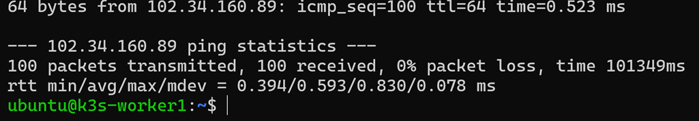


---

### 18.3.2 Server → Worker1

Source:

```text
k3s-server
102.34.160.89
```

Destination:

```text
k3s-worker1
102.34.160.87
```

Command:

```bash
ping -c 100 102.34.160.87
```

Observed result:

```text
100 packets transmitted
100 packets received
0% packet loss

RTT min/avg/max/mdev:
0.395 / 0.608 / 0.831 / 0.080 ms
```

Therefore:

```text
Average RTT:  0.608 ms
Packet loss:  0%
```

The two directions of the native server-to-worker path therefore showed
similar healthy RTT characteristics during this characterization run.

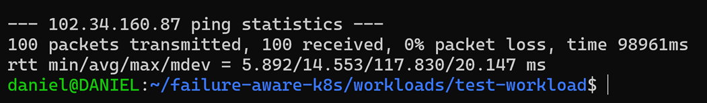


---

### 18.3.3 External Client → Worker1

Source:

```text
External experimental client
```

Destination:

```text
k3s-worker1
102.34.160.87
```

Command:

```bash
ping -c 100 102.34.160.87
```

Observed result:

```text
100 packets transmitted
100 packets received
0% packet loss

RTT min/avg/max/mdev:
5.892 / 14.553 / 117.830 / 20.147 ms
```

Therefore:

```text
Average RTT:  14.553 ms
Packet loss:  0%
```

This path is important because it represents the independent client path
that should remain available during the Scenario B control-plane
partition experiment.


---

### 18.3.4 External Client → Server

Source:

```text
External experimental client
```

Destination:

```text
k3s-server
102.34.160.89
```

Command:

```bash
ping -c 100 102.34.160.89
```

Observed result:

```text
100 packets transmitted
99 packets received
1% packet loss

RTT min/avg/max/mdev:
4.057 / 15.259 / 128.919 / 19.355 ms
```

Therefore:

```text
Average RTT:  15.259 ms
Packet loss:  1%
```

The healthy external path therefore exhibited greater variability than
the intra-cluster paths during this measurement period.

The observed packet loss is retained as part of the baseline rather
than being discarded.

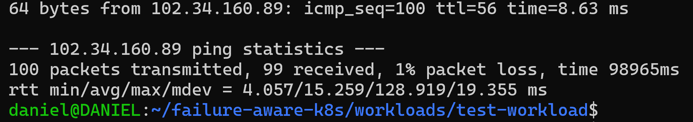


---

### 18.3.5 Worker1 → Worker2

Source:

```text
k3s-worker1
102.34.160.87
```

Destination:

```text
k3s-worker2
102.34.160.103
```

Command:

```bash
ping -c 100 102.34.160.103
```

Observed result:

```text
100 packets transmitted
100 packets received
0% packet loss

RTT min/avg/max/mdev:
0.366 / 0.586 / 1.280 / 0.116 ms
```

Therefore:

```text
Average RTT:  0.586 ms
Packet loss:  0%
```

This path will later be relevant when workloads recover from Worker 1
onto Worker 2.

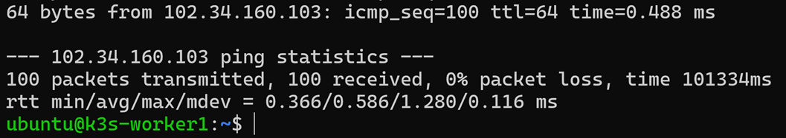


---

## 18.4 TCP Throughput Characterization

TCP throughput was measured using `iperf3`.

For each path, one endpoint was explicitly started as an `iperf3`
server:

```bash
iperf3 -s
```

The other endpoint then initiated a 30-second TCP measurement:

```bash
iperf3 -c <SERVER_IP> -t 30
```

Reverse mode was measured using:

```bash
iperf3 -c <SERVER_IP> -t 30 -R
```

The `-R` option causes the remote `iperf3` server to send traffic back
to the initiating client.

The resulting throughput values characterize the sustained TCP
throughput observed during these healthy pilot measurements.

---

### 18.4.1 Worker1 → Server

Start the `iperf3` server on `k3s-server`:

```bash
iperf3 -s
```

From `k3s-worker1`:

```bash
iperf3 -c 102.34.160.89 -t 30
```

Observed result:

```text
Duration:         30 seconds
Transfer:         32.9 GBytes
Sender bitrate:   9.41 Gbit/s
Receiver bitrate: 9.41 Gbit/s
Retransmissions:  1
```

Healthy TCP throughput:

```text
Worker1 -> Server = 9.41 Gbit/s
```

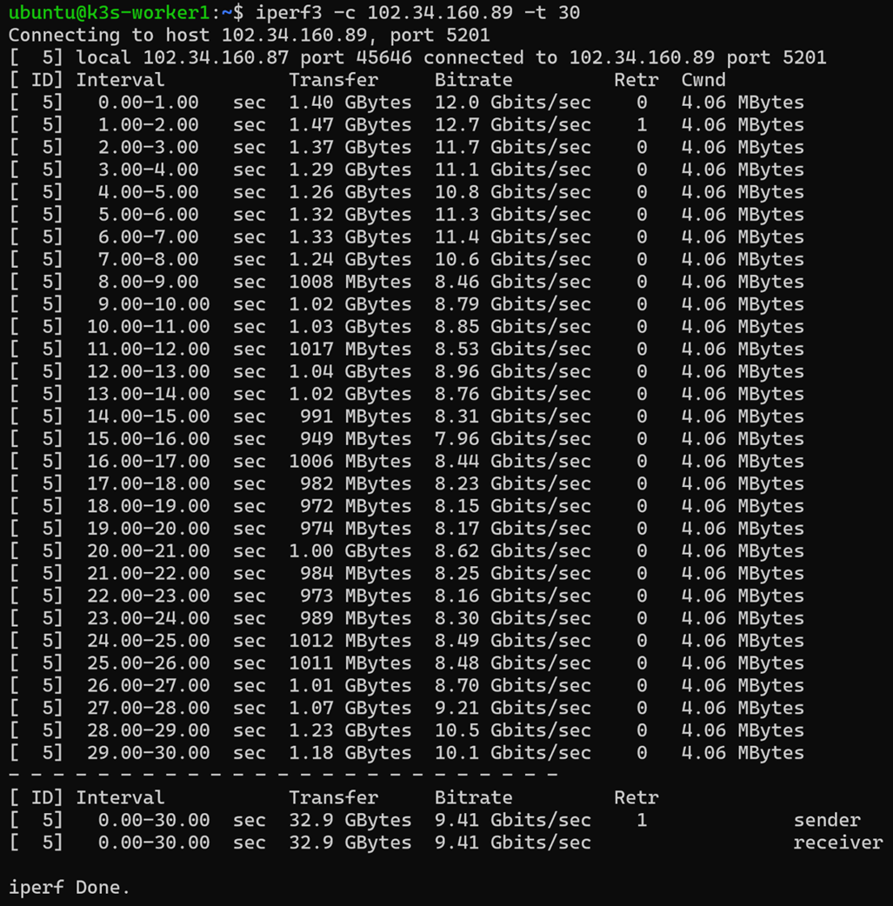

---

### 18.4.2 Server → Worker1

With the `iperf3` server still running on `k3s-server`, execute from
Worker 1:

```bash
iperf3 -c 102.34.160.89 -t 30 -R
```

Observed result:

```text
Duration:          30 seconds
Sender transfer:   34.0 GBytes
Receiver transfer: 33.9 GBytes
Sender bitrate:    9.72 Gbit/s
Receiver bitrate:  9.72 Gbit/s
Retransmissions:   3
```

Healthy reverse throughput:

```text
Server -> Worker1 = 9.72 Gbit/s
```

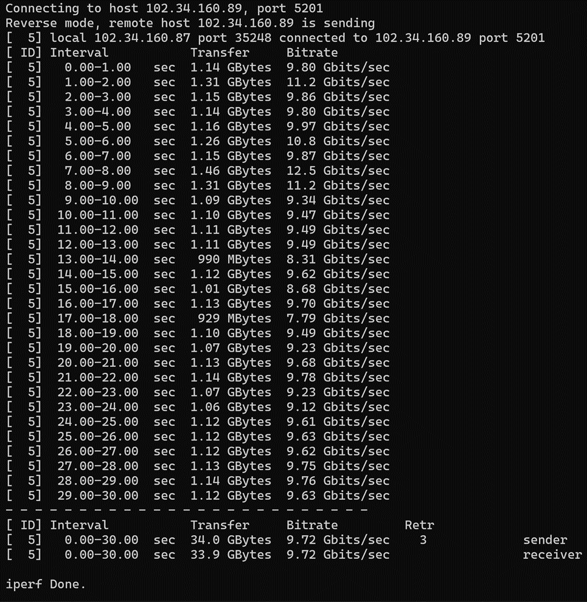


---

### 18.4.3 External Client → Worker1

Start the `iperf3` server on `k3s-worker1`:

```bash
iperf3 -s
```

From the external experimental client:

```bash
iperf3 -c 102.34.160.87 -t 30
```

Observed result:

```text
Sender transfer:    158 MBytes
Sender bitrate:     44.0 Mbit/s
Receiver transfer:  156 MBytes
Receiver bitrate:   44.2 Mbit/s
Retransmissions:    16
```

Healthy external-client throughput:

```text
External Client -> Worker1 ~= 44 Mbit/s
```

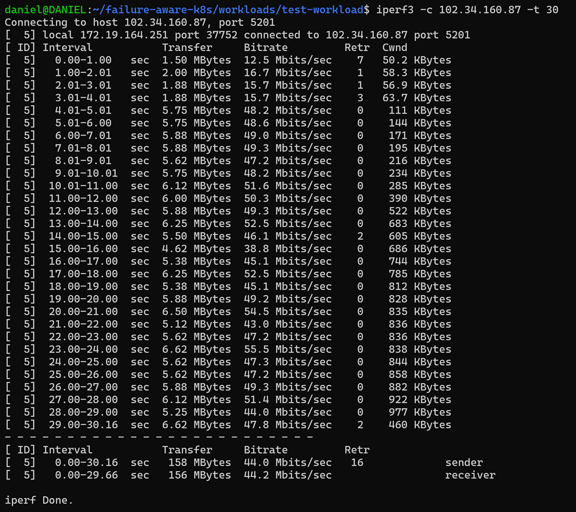

---

### 18.4.4 Worker1 → External Client

Using reverse mode from the external client:

```bash
iperf3 -c 102.34.160.87 -t 30 -R
```

Observed result:

```text
Sender transfer:    176 MBytes
Sender bitrate:     50.1 Mbit/s
Receiver transfer:  173 MBytes
Receiver bitrate:   48.3 Mbit/s
Retransmissions:    257
```

The observed healthy reverse-path throughput was approximately:

```text
Worker1 -> External Client ~= 48-50 Mbit/s
```

The retransmission count is retained as part of the raw baseline rather
than discarded.

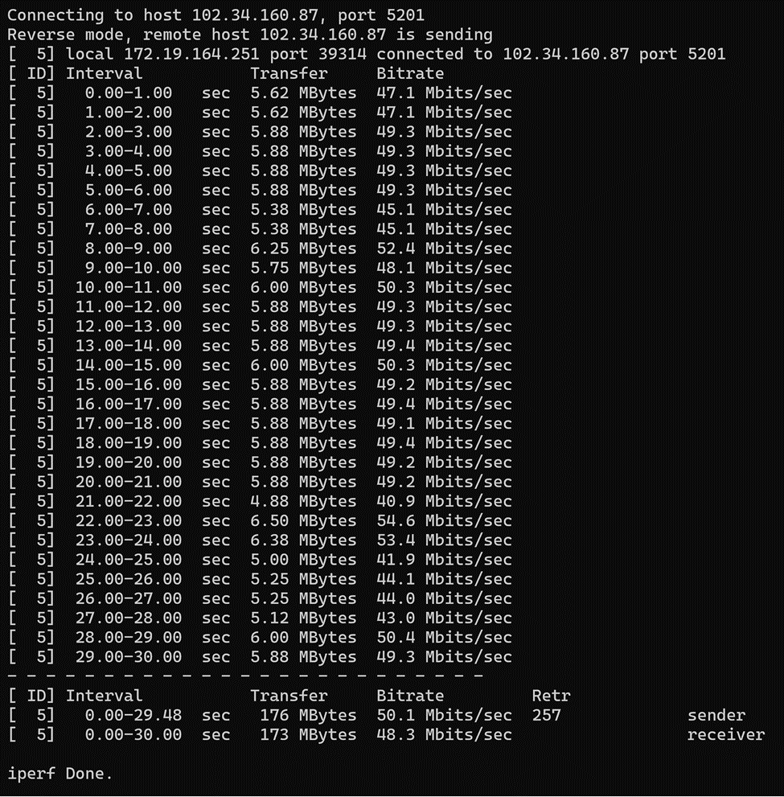


---

### 18.4.5 Worker1 → Worker2

Start the `iperf3` server on `k3s-worker2`:

```bash
iperf3 -s
```

From `k3s-worker1`:

```bash
iperf3 -c 102.34.160.103 -t 30
```

Observed result:

```text
Duration:         30 seconds
Transfer:         46.1 GBytes
Sender bitrate:   13.2 Gbit/s
Receiver bitrate: 13.2 Gbit/s
Retransmissions:  1
```

Healthy Worker1-to-Worker2 throughput:

```text
Worker1 -> Worker2 = 13.2 Gbit/s
```

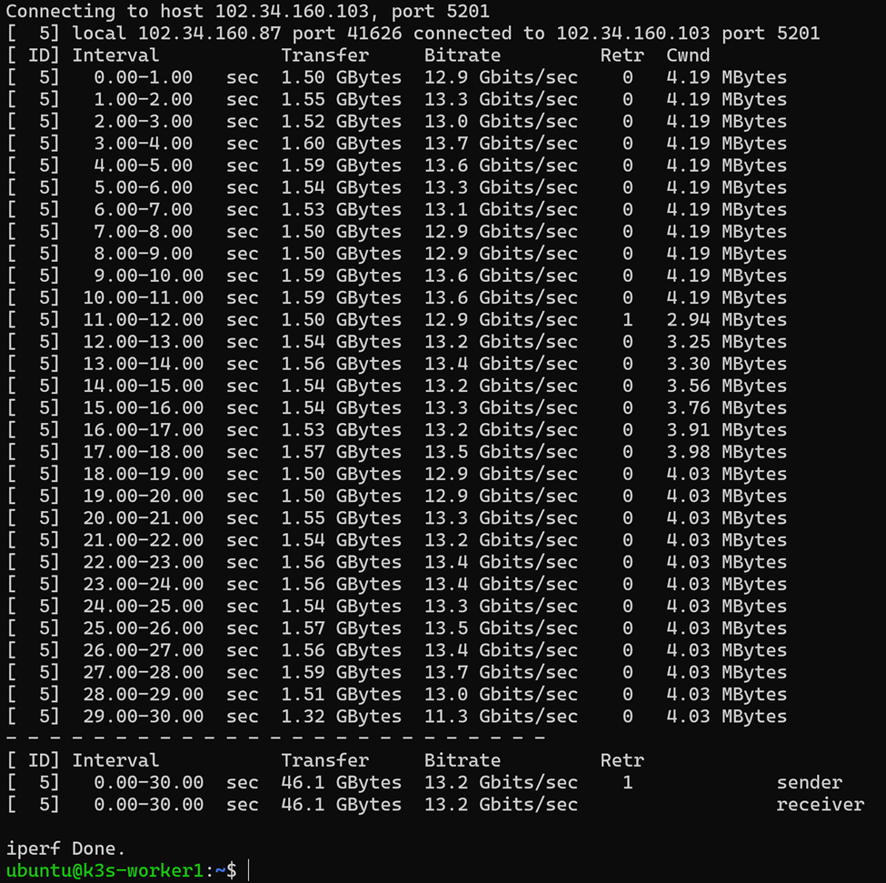

---

### 18.4.6 Worker2 → Worker1

With the server running on Worker 2, execute reverse mode from Worker 1:

```bash
iperf3 -c 102.34.160.103 -t 30 -R
```

Observed result:

```text
Duration:         30 seconds
Transfer:         30.2 GBytes
Sender bitrate:   8.65 Gbit/s
Receiver bitrate: 8.65 Gbit/s
Retransmissions:  2
```

Healthy reverse throughput:

```text
Worker2 -> Worker1 = 8.65 Gbit/s
```

The observed asymmetry between the two directions is retained as part
of the baseline characterization. A single pilot measurement is not
used to attribute this difference to a specific cause.

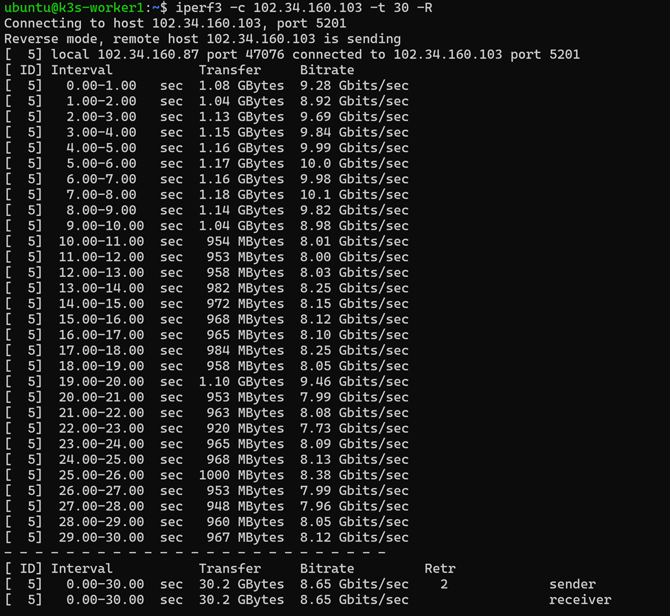

---

## 18.5 UDP Jitter and Loss Characterization

UDP tests were used to characterize jitter and datagram loss.

The general command was:

```bash
iperf3 -c <DESTINATION_IP> -u -b 10M -t 30
```

The UDP offered load was deliberately fixed at:

```text
10 Mbit/s
```

for 30 seconds.

**Important:** the `10 Mbit/s` value is the offered UDP measurement
rate. It is **not** interpreted as the available bandwidth of the
network.

Available/sustained throughput was characterized separately using the
TCP measurements above.

---

### 18.5.1 Worker1 → Server

Start:

```bash
iperf3 -s
```

on `k3s-server`.

From Worker 1:

```bash
iperf3 -c 102.34.160.89 -u -b 10M -t 30
```

Observed receiver result:

```text
Transfer:        35.8 MBytes
Bitrate:         10.0 Mbit/s
Jitter:          0.033 ms
Lost datagrams:  0 / 25898
Packet loss:     0%
```

Therefore:

```text
Worker1 -> Server UDP jitter = 0.033 ms
Worker1 -> Server UDP loss   = 0%
```

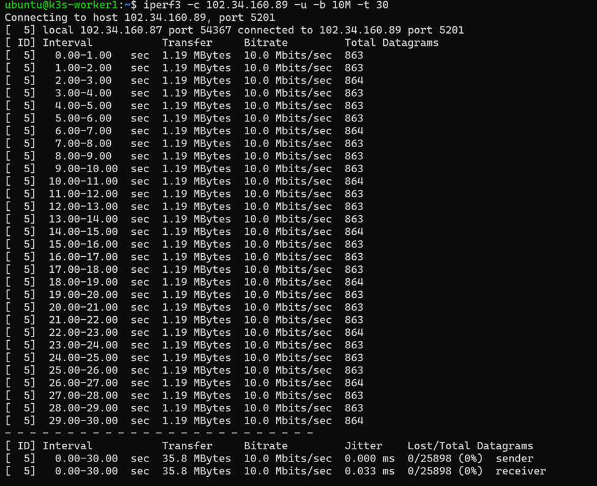

---

### 18.5.2 External Client → Worker1

Start:

```bash
iperf3 -s
```

on `k3s-worker1`.

From the external client:

```bash
iperf3 -c 102.34.160.87 -u -b 10M -t 30
```

Observed receiver result:

```text
Transfer:        35.8 MBytes
Bitrate:         10.2 Mbit/s
Jitter:          0.426 ms
Lost datagrams:  4 / 27017
Packet loss:     0.015%
```

Therefore:

```text
External Client -> Worker1 UDP jitter = 0.426 ms
External Client -> Worker1 UDP loss   = 0.015%
```

This confirms that the healthy external path exhibited measurable
variability and a small amount of UDP datagram loss even before
artificial degradation was introduced.

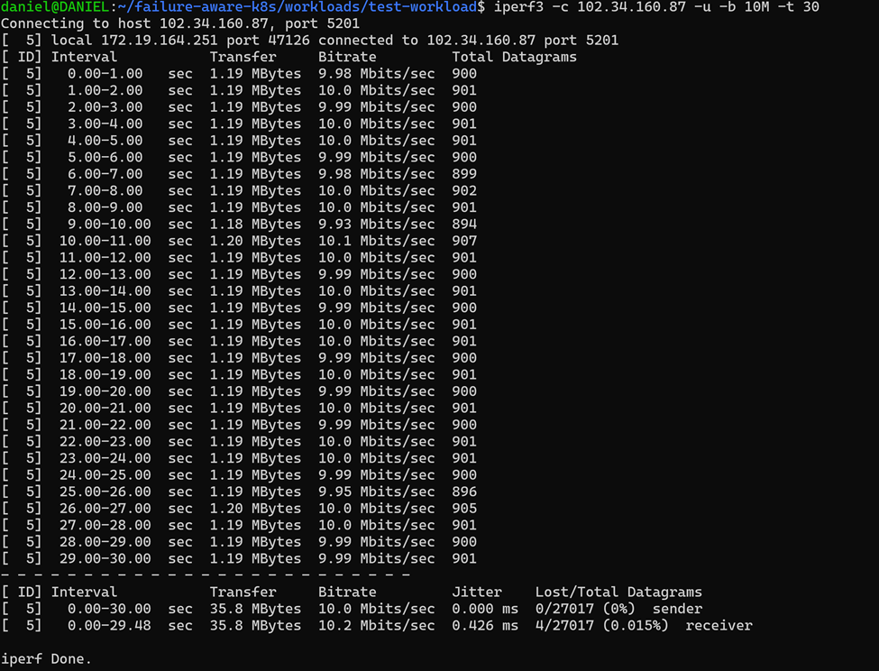


---

### 18.5.3 Worker1 → Worker2

Start:

```bash
iperf3 -s
```

on `k3s-worker2`.

From Worker 1:

```bash
iperf3 -c 102.34.160.103 -u -b 10M -t 30
```

Observed receiver result:

```text
Transfer:        35.8 MBytes
Bitrate:         10.0 Mbit/s
Jitter:          0.056 ms
Lost datagrams:  0 / 25898
Packet loss:     0%
```

Therefore:

```text
Worker1 -> Worker2 UDP jitter = 0.056 ms
Worker1 -> Worker2 UDP loss   = 0%
```

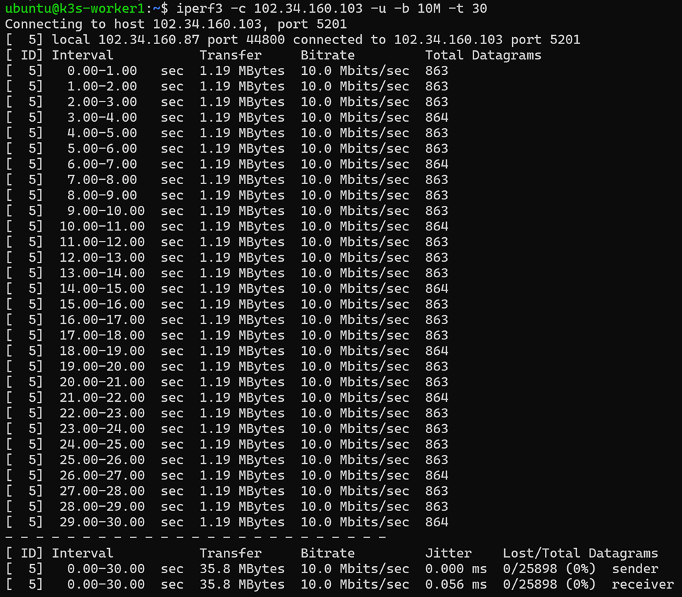


---

## 18.6 Consolidated Healthy Network Baseline

The initial healthy network characterization produced the following
results.

| Path | RTT min/avg/max/mdev | ICMP Loss | TCP Throughput | UDP Jitter | UDP Loss |
|---|---|---:|---:|---:|---:|
| Worker1 → Server | `0.394 / 0.593 / 0.830 / 0.078 ms` | 0% | 9.41 Gbit/s | 0.033 ms | 0% |
| Server → Worker1 | `0.395 / 0.608 / 0.831 / 0.080 ms` | 0% | 9.72 Gbit/s | Not measured | Not measured |
| External Client → Worker1 | `5.892 / 14.553 / 117.830 / 20.147 ms` | 0% | 44.0–44.2 Mbit/s | 0.426 ms | 0.015% |
| Worker1 → External Client | Not separately measured by ICMP | — | 48.3–50.1 Mbit/s | Not measured | Not measured |
| External Client → Server | `4.057 / 15.259 / 128.919 / 19.355 ms` | 1% | Not measured | Not measured | Not measured |
| Worker1 → Worker2 | `0.366 / 0.586 / 1.280 / 0.116 ms` | 0% | 13.2 Gbit/s | 0.056 ms | 0% |
| Worker2 → Worker1 | Not separately measured by ICMP | — | 8.65 Gbit/s | Not measured | Not measured |

The measurements show that the intra-cluster paths and external-client
path have substantially different healthy characteristics.

The intra-cluster VM paths exhibited:

- sub-millisecond average RTT;
- no observed ICMP loss during the 100-packet samples;
- multi-gigabit TCP throughput; and
- very low UDP jitter.

The external-client path exhibited:

- higher and more variable RTT;
- approximately 44–50 Mbit/s TCP throughput;
- greater UDP jitter; and
- small but non-zero UDP datagram loss during the Worker 1 test.

These differences are retained as part of the experimental baseline and
will be considered when later defining degraded-network profiles.

No causal explanation is inferred from these initial characterization
runs alone.

---

## 18.7 Raw Network Measurement Storage

The raw network characterization outputs are retained under:

```text
experiments/
└── baseline/
    └── network/
        ├── ping/
        │   ├── worker1-to-server.txt
        │   ├── server-to-worker1.txt
        │   ├── client-to-worker1.txt
        │   ├── client-to-server.txt
        │   └── worker1-to-worker2.txt
        │
        ├── tcp/
        │   ├── worker1-to-server.txt
        │   ├── server-to-worker1.txt
        │   ├── client-to-worker1.txt
        │   ├── worker1-to-client.txt
        │   ├── worker1-to-worker2.txt
        │   └── worker2-to-worker1.txt
        │
        └── udp/
            ├── worker1-to-server.txt
            ├── client-to-worker1.txt
            └── worker1-to-worker2.txt
```

The above measurements are captured directly into these files rather
than relying only on screenshots.

For example, ping output can be captured using:

```bash
ping -c 100 102.34.160.89 \
  | tee experiments/baseline/network/ping/worker1-to-server.txt
```

TCP output can be captured using:

```bash
iperf3 -c 102.34.160.89 -t 30 \
  | tee experiments/baseline/network/tcp/worker1-to-server.txt
```

UDP output can be captured using:

```bash
iperf3 -c 102.34.160.89 -u -b 10M -t 30 \
  | tee experiments/baseline/network/udp/worker1-to-server.txt
```
---

## 18.8 Network Baseline Status

The following healthy network characterization tasks have been
completed:

- [x] `iperf3` installed
- [x] `ping` available
- [x] Worker1 → Server RTT measured
- [x] Server → Worker1 RTT measured
- [x] External Client → Worker1 RTT measured
- [x] External Client → Server RTT measured
- [x] Worker1 → Worker2 RTT measured
- [x] Worker1 → Server TCP throughput measured
- [x] Server → Worker1 TCP throughput measured
- [x] External Client → Worker1 TCP throughput measured
- [x] Worker1 → External Client TCP throughput measured
- [x] Worker1 → Worker2 TCP throughput measured
- [x] Worker2 → Worker1 TCP throughput measured
- [x] Worker1 → Server UDP jitter/loss measured
- [x] External Client → Worker1 UDP jitter/loss measured
- [x] Worker1 → Worker2 UDP jitter/loss measured
- [x] No artificial network degradation active during characterization
- [x] Raw baseline results retained under `experiments/baseline/network/`

The healthy network baseline is therefore sufficiently characterized
for the subsequent native K3s failure and partition pilot experiments.

The next experimental activity will evaluate the Scenario B condition
in which communication between `k3s-worker1` and `k3s-server` is
deliberately disrupted while the independent external-client path to
the workload on `k3s-worker1` remains available.
---

# 19. Native K3s Scenario B — Control-Plane Partition Baseline

This section documents the native K3s behaviour observed when
`k3s-worker1` loses communication with the Kubernetes control plane
while the workload hosted on the worker remains independently reachable.

The experiment was performed **without the proposed Failure-Aware
Controller**. Its purpose was to establish the native Kubernetes
baseline and verify the central ambiguity motivating the proposed
controller.

The target condition was:

```text
CONTROL-PLANE PATH

k3s-worker1                  k3s-server
102.34.160.87               102.34.160.89

      X -------------------- X
          TCP/6443 blocked
```

while preserving:

```text
INDEPENDENT APPLICATION PATH

External Client
      |
      | HTTP
      v
k3s-worker1
102.34.160.87
      |
      v
baseline-web
```

The experiment successfully reproduced a condition in which Kubernetes
considered Worker 1 unreachable while the existing workload on Worker 1
continued serving external requests.

---

## 19.1 Experimental Objective

The experiment tested whether loss of Worker 1's control-plane
connectivity necessarily implies loss of the workload executing on the
worker.

Specifically, the experiment sought to establish the following
condition:

```text
Kubernetes control-plane observation:
Worker 1 is unreachable

                 while

Independent application observation:
Workload on Worker 1 remains reachable
```

This experiment provides the native baseline for the operational state
later represented by the proposed controller as:

```text
reachable_outside_control_plane
```

No controller-level intervention was active during this experiment.

---

## 19.2 Experimental Environment

The relevant nodes were:

| Component | Hostname | IP Address | Role |
|---|---|---|---|
| Control plane | `k3s-server` | `102.34.160.89` | Kubernetes control plane |
| Fault target | `k3s-worker1` | `102.34.160.87` | Partitioned worker |
| Recovery worker | `k3s-worker2` | `102.34.160.103` | Available recovery capacity |
| External client | External machine | `[CLIENT_IP]` | Independent service verification |

The baseline workload was:

```text
Application:  Nginx
Deployment:   baseline-web
Namespace:    failure-aware
Worker:       k3s-worker1
Service:      NodePort
NodePort:     30364
```

The externally tested endpoint was:

```text
http://102.34.160.87:30364
```

---

## 19.3 Pre-Experiment Verification

Before introducing the partition, verify that all cluster nodes are
healthy:

```bash
kubectl get nodes -o wide
```

Expected initial state:

```text
k3s-server     Ready
k3s-worker1    Ready
k3s-worker2    Ready
```

Verify that the workload is executing on Worker 1:

```bash
kubectl get pods \
  -n failure-aware \
  -o wide
```

The baseline workload must show:

```text
NODE = k3s-worker1
```

Verify that Worker 1's Lease is renewing:

```bash
watch -n 2 \
"kubectl get lease k3s-worker1 \
-n kube-node-lease \
-o custom-columns=NODE:.metadata.name,RENEW:.spec.renewTime"
```

During healthy operation, the Lease renewal timestamp was observed to
change at approximately **10-second intervals**.

Verify the external application path:

```bash
sh workloads/test-workload/independent-path-test.sh
```

Successful requests should return:

```text
HTTP=200
```

before fault injection begins.

---

## 19.4 Monitoring During the Experiment

Several observations were performed concurrently so that the
control-plane view could be compared with the independent application
view.

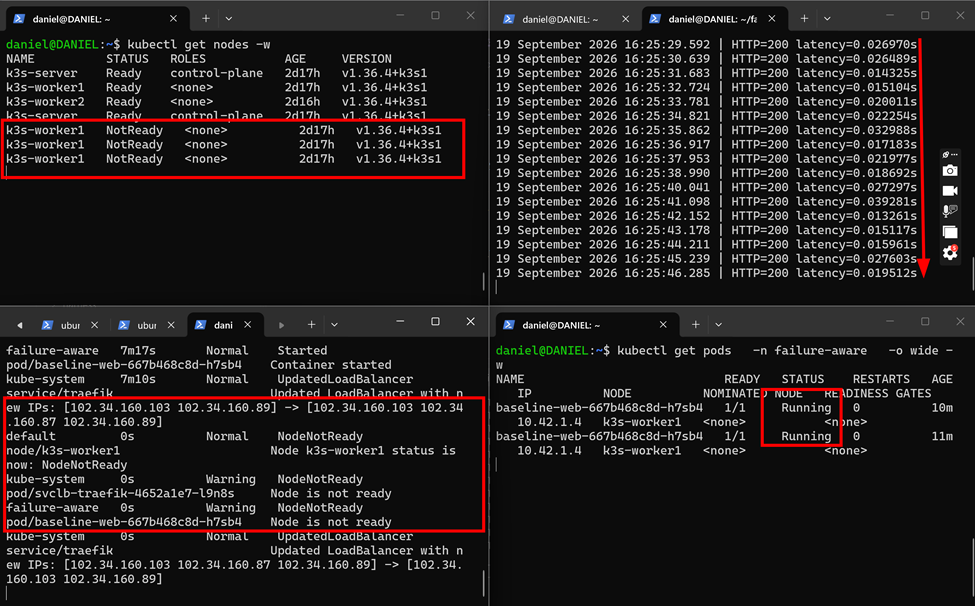

### 19.4.1 Node State

On the control-plane side:

```bash
kubectl get nodes -w
```

This was used to observe the transition from:

```text
Ready
```

to:

```text
NotReady
```

---

### 19.4.2 Worker 1 Lease

Worker 1's Lease was monitored using:

```bash
watch -n 2 \
"kubectl get lease k3s-worker1 \
-n kube-node-lease \
-o custom-columns=NODE:.metadata.name,RENEW:.spec.renewTime"
```

Before the partition, the Lease renewed periodically.

After the partition, the observed Lease renewal timestamp stopped at:

```text
2026-09-19T13:24:17.830355Z
```
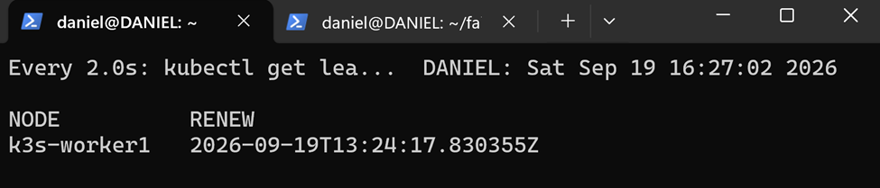
---

### 19.4.3 Pod State

The workload state was monitored using:

```bash
kubectl get pods \
  -n failure-aware \
  -o wide -w
```

This allowed the native Kubernetes Pod lifecycle to be observed while
Worker 1 was unreachable.

---

### 19.4.4 Kubernetes Events

Cluster events were monitored using:

```bash
kubectl get events \
  --all-namespaces \
  --sort-by='.lastTimestamp' \
  -w
```

Events associated with Worker 1 included native node-health changes such
as:

```text
NodeNotReady
```

and workload-related events indicating that the node was not ready.

---

### 19.4.5 Independent Application Reachability

From the external client:

```bash
sh workloads/test-workload/independent-path-test.sh
```

The script continued sending HTTP requests directly to:

```text
102.34.160.87:30364
```

throughout the partition.

The output contained timestamped observations such as:

```text
19 September 2026 16:25:29.592 | HTTP=200 latency=0.026970s
19 September 2026 16:25:30.639 | HTTP=200 latency=0.026489s
19 September 2026 16:25:31.683 | HTTP=200 latency=0.014325s
19 September 2026 16:25:32.724 | HTTP=200 latency=0.015104s
```

The repeated `HTTP=200` responses were used as independent evidence that
the workload remained operationally reachable.

---

## 19.5 Selective Control-Plane Partition

The experiment intentionally blocked only the Worker 1 to K3s API
Server path.

The relevant communication path was:

```text
k3s-worker1
102.34.160.87
      |
      | TCP/6443
      v
k3s-server
102.34.160.89
```

The following rule was inserted on `k3s-worker1`:

```bash
sudo iptables -I OUTPUT 1 \
  -p tcp \
  -d 102.34.160.89 \
  --dport 6443 \
  -j DROP
```

The rule blocks Worker 1's outbound TCP communication to the K3s API
Server while leaving unrelated Worker 1 traffic available.

The entire Worker 1 network interface was **not** disabled because doing
so would create complete worker isolation rather than the required
Scenario B control-plane partition.

Verify the inserted rule using:

```bash
sudo iptables -L OUTPUT -n -v --line-numbers
```

---

## 19.6 Fault-Injection Timestamp

The partition injection time was recorded as:

```text
2026-09-19 13:24:28.367
```

This represents:

```text
t_partition
```

for this pilot run.

The timestamp was stored under:

```text
experiments/baseline/scenario-b/fault-time.txt
```

A reproducible command for future runs is:

```bash
date '+%Y-%m-%d %H:%M:%S.%3N' \
  | tee experiments/baseline/scenario-b/fault-time.txt
```

For formal automated experiments, timestamp collection will later be
performed by the experimental harness.

---

## 19.7 Lease Behaviour After Partition

Before fault injection, Worker 1 renewed its NodeLease at approximately
10-second intervals.

The last observed Lease renewal was:

```text
2026-09-19T13:24:17.830355Z
```

The partition was injected at:

```text
2026-09-19 13:24:28.367
```

After the Worker 1 to API Server path was blocked, the Lease renewal
timestamp stopped advancing.

The observed sequence was therefore:

```text
Healthy Worker1
      |
      | periodic Lease renewal
      | approximately every 10 seconds
      v
2026-09-19T13:24:17.830355Z
      |
      | control-plane path blocked
      v
2026-09-19 13:24:28.367
      |
      v
No subsequent Lease renewal observed
```

This provided the native failure-suspicion precursor for the experiment.

---

## 19.8 Native Node-State Transition

Following the loss of Worker 1's control-plane communication, Kubernetes
eventually changed Worker 1 from:

```text
Ready
```

to:

```text
NotReady
```

The observed control-plane state was:

```text
k3s-worker1    NotReady
```

This occurred while `k3s-server` and `k3s-worker2` remained healthy.

The experiment therefore selectively affected Worker 1 rather than the
entire cluster.

---

## 19.9 Native Unreachable Taints

After Kubernetes detected loss of communication with Worker 1, the
node received native unreachable taints.

The taints were inspected using:

```bash
kubectl get node k3s-worker1 \
  -o jsonpath='{.spec.taints}'
```

The observed output contained:

```text
node.kubernetes.io/unreachable
```

with both:

```text
NoSchedule
```

and:

```text
NoExecute
```

effects.

The taint state was preserved in:

```text
experiments/baseline/scenario-b/unreachable-taint.txt
```

using:

```bash
kubectl get node k3s-worker1 \
  -o jsonpath='{.spec.taints}' \
  > experiments/baseline/scenario-b/unreachable-taint.txt
```

This file forms part of the reproducible evidence for the native
Kubernetes failure response.

---

## 19.10 Native Pod Lifecycle Observation

The baseline workload initially executed normally on:

```text
k3s-worker1
```

After Worker 1 became unreachable, Kubernetes progressed the Pod object
toward termination.

The observed state included:

```text
baseline-web-...    1/1    Terminating    ...    k3s-worker1
```

A replacement Pod was also observed in:

```text
Pending
```

state.

The existing Pod therefore appeared from the control-plane perspective
as:

```text
Running
   |
   v
Terminating
```

However, the `Terminating` state did **not** demonstrate that the
container process had stopped on Worker 1.

Because the control plane could no longer communicate with the kubelet
on Worker 1, the control-plane Pod lifecycle state and the actual
execution state of the workload became distinguishable.

---

## 19.11 Independent Workload Remained Reachable

While Kubernetes reported:

```text
k3s-worker1 = NotReady
```

and the original Pod object was:

```text
Terminating
```

the external client continued successfully accessing:

```text
http://102.34.160.87:30364
```

The workload continued returning:

```text
HTTP=200
```

The Nginx service was also independently accessible through a web
browser using:

```text
102.34.160.87:30364
```
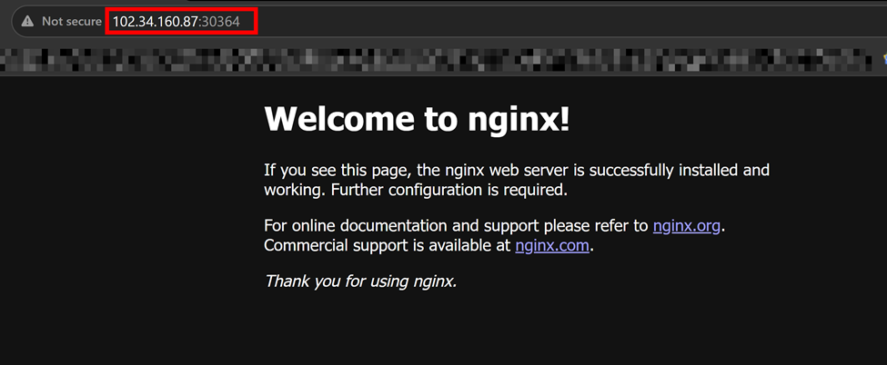

The resulting observation was therefore:

```text
KUBERNETES CONTROL-PLANE VIEW

Worker1 = NotReady
       |
       v
unreachable taint
       |
       v
Pod = Terminating


              BUT


INDEPENDENT APPLICATION VIEW

External Client
       |
       v
102.34.160.87:30364
       |
       v
Nginx workload
       |
       v
HTTP 200
```

This distinction is the principal result of the native Scenario B pilot.

---

## 19.12 Interpretation of `Terminating`

The observed `Terminating` Pod state is retained as part of the native
Kubernetes baseline.

The proposed Failure-Aware Controller will **not** attempt to rewrite
the native Pod status back to `Running`.

Instead, the architecture distinguishes:

```text
Native Kubernetes state
```

from:

```text
Observed operational state
```

For this scenario:

```text
Native Kubernetes:

Node = NotReady
Pod  = Terminating

          +

Independent evidence:

HTTP service = reachable

          ↓

Failure-Aware operational classification:

reachable_outside_control_plane
```

The controller will therefore consume native Kubernetes failure
signals and supplement them with post-suspicion operational evidence
rather than modifying Kubernetes-owned status fields.

---

## 19.13 Native Baseline Decision Context

The Scenario B observation establishes the condition that the proposed
controller must later evaluate.

Conceptually:

```text
NodeLease stops
       |
       v
Native failure suspicion
       |
       v
Node becomes NotReady
       |
       v
Post-suspicion verification
       |
       +---- Service reachable?
       |
       +---- Workload useful?
       |
       v
reachable_outside_control_plane
       |
       v
PRESERVE
```

The `PRESERVE` behaviour is part of the proposed controller and was
**not active during this baseline experiment**.

This experiment therefore does not demonstrate an improvement by the
proposed system. It establishes the native condition against which the
controller will later be evaluated.

---

## 19.14 Evidence Capture

The Scenario B pilot evidence is stored under:

```text
experiments/
└── baseline/
    └── scenario-b/
        ├── fault-time.txt
        ├── independent-path.txt
        ├── worker1-node-describe.txt
        ├── worker1-node.yaml
        ├── worker1-lease.yaml
        ├── unreachable-taint.txt
        └── pods.txt
```

The following commands are used to capture the relevant state.

### Node description

```bash
kubectl describe node k3s-worker1 \
  > experiments/baseline/scenario-b/worker1-node-describe.txt
```

### Complete Node object

```bash
kubectl get node k3s-worker1 -o yaml \
  > experiments/baseline/scenario-b/worker1-node.yaml
```

### NodeLease

```bash
kubectl get lease k3s-worker1 \
  -n kube-node-lease \
  -o yaml \
  > experiments/baseline/scenario-b/worker1-lease.yaml
```

### Unreachable taints

```bash
kubectl get node k3s-worker1 \
  -o jsonpath='{.spec.taints}' \
  > experiments/baseline/scenario-b/unreachable-taint.txt
```

### Pod state

```bash
kubectl get pods \
  -n failure-aware \
  -o wide \
  > experiments/baseline/scenario-b/pods.txt
```

### Independent application observations

```bash
sh workloads/test-workload/independent-path-test.sh \
  | tee experiments/baseline/scenario-b/independent-path.txt
```

Screenshots used for visual documentation are maintained separately
under:

```text
images/
```
---

## 19.15 Restore Control-Plane Connectivity

After completing the observation period, the experimental firewall rule
was removed using the exact rule specification:

```bash
sudo iptables -D OUTPUT \
  -p tcp \
  -d 102.34.160.89 \
  --dport 6443 \
  -j DROP
```

This method is preferred over deleting the rule by line number because
it explicitly removes the rule introduced by the experiment.

Verify that the rule has been removed:

```bash
sudo iptables -L OUTPUT -n -v --line-numbers
```

No Scenario B TCP/6443 DROP rule should remain.

---

## 19.16 Verify Native Recovery

After removing the partition, observe node state:

```bash
kubectl get nodes -w
```

Worker 1 should return to:

```text
Ready
```

Observe its Lease:

```bash
watch -n 2 \
"kubectl get lease k3s-worker1 \
-n kube-node-lease \
-o custom-columns=NODE:.metadata.name,RENEW:.spec.renewTime"
```

The Lease renewal timestamp should resume advancing.

Verify workload state:

```bash
kubectl get pods \
  -n failure-aware \
  -o wide
```

Verify external application access:

```bash
sh workloads/test-workload/independent-path-test.sh
```

Successful restoration requires:

```text
Worker1 = Ready
Lease renewal = resumed
External workload access = successful
Experimental DROP rule = absent
```

---

## 19.17 Scenario B Baseline Result

The native K3s Scenario B pilot successfully demonstrated the target
failure ambiguity.

The observed sequence was:

```text
Worker1 healthy
       |
       | Lease renews approximately every 10 s
       v
Control-plane path blocked
       |
       v
Lease stops renewing
       |
       v
Kubernetes marks Worker1 NotReady
       |
       v
node.kubernetes.io/unreachable applied
       |
       v
Original Pod enters Terminating
       |
       +--------------------------------------+
                                              |
                                  simultaneously
                                              |
                                              v
                               Existing Nginx workload
                               continues serving HTTP
                                              |
                                              v
                                          HTTP 200
```

The experiment therefore established that:

```text
loss of Kubernetes control-plane reachability
```

did not necessarily imply:

```text
loss of application usefulness
```

for the workload executing on the affected worker.

This observation provides the empirical baseline for the proposed
operational state:

```text
reachable_outside_control_plane
```

and motivates post-suspicion verification before recovery decisions are
made.

---

## 19.18 Scenario B Completion Status

The following pilot objectives were successfully completed:

- [x] Worker 1 initially observed as `Ready`
- [x] Worker 1 NodeLease renewal observed
- [x] Approximately 10-second Lease renewal cadence observed
- [x] Baseline workload confirmed on `k3s-worker1`
- [x] External application path confirmed before partition
- [x] Worker1 → Server TCP/6443 selectively blocked
- [x] Partition injection timestamp recorded
- [x] Worker 1 Lease renewal stopped
- [x] Worker 1 transitioned to `NotReady`
- [x] `node.kubernetes.io/unreachable` observed
- [x] `NoSchedule` unreachable taint observed
- [x] `NoExecute` unreachable taint observed
- [x] Original workload Pod observed entering `Terminating`
- [x] External client continued receiving HTTP `200`
- [x] Workload independently verified through `102.34.160.87:30364`
- [x] Native Kubernetes behaviour recorded without controller intervention
- [x] Unreachable taints captured to reproducibility file
- [x] Experimental firewall rule removed using exact-rule deletion
- [x] Control-plane connectivity restored
- [x] Native recovery verified

The native Scenario B baseline is therefore complete.

The next implementation stage is the development of the experimental
harness required to automate timestamp collection, workload probing,
Kubernetes-state observation, fault coordination, and result recording
before the Failure-Aware Controller itself is introduced.
---

# 20. Formal EMR Workload

The final workload will use an actual containerised Electronic Medical
Record application.

To be selected:

- EMR system: **[EMR NAME]**
- EMR version: **[VERSION]**
- deployment model: **[DEPLOYMENT MODEL]**
- application tier: **[STATELESS / OTHER]**
- relational database: **[MYSQL / MARIADB / POSTGRESQL / OTHER]**
- database version: **[VERSION]**

The relational database will represent a
**duplication-sensitive stateful workload**.

The final workload should expose repeatable:

- read operations
- write operations
- application-health checks

Exact workload parameters will be frozen before formal experiments.

---

# 21. Storage Configuration

Persistent database state must not rely on ephemeral container storage.

Expected path:

```text
EMR Application
      |
      v
Relational Database
      |
      v
PersistentVolumeClaim
      |
      v
CSI / Persistent Storage
```

Initial K3s development storage:

```text
Local Path Provisioner
```

Formal stateful storage remains to be selected:

```text
CSI implementation:  [CSI_IMPLEMENTATION]
CSI version:         [VERSION]
StorageClass:        [STORAGE_CLASS]
Access mode:         [RWO / RWOP]
Replication factor:  [VALUE / N/A]
Volume size:         [SIZE]
```

Native RWO/RWOP access-mode enforcement will remain part of the
storage stack.

The project does not assume that RWO/RWOP alone provides sufficient
fencing during the target network-partition scenarios.

Explicit fencing will therefore be evaluated before recovery of
duplication-sensitive stateful workloads.

---

# 22. Primary Experimental Comparison

The principal comparison is:

```text
DEFAULT K3s
Failure-Aware Controller OFF
```

versus:

```text
K3s + FAILURE-AWARE CONTROLLER
Failure-Aware Controller ON
```

The following must remain fixed for each comparison:

- K3s version
- Kubernetes version
- CNI
- Ingress Controller
- workload version
- database version
- storage configuration
- worker resource profile
- network condition
- fault condition
- request rate
- client concurrency
- transaction mix
- experiment duration

The intended architectural difference is the presence or absence of the
Failure-Aware Controller.

---

# 23. Failure Scenarios

## Scenario A — Genuine Worker Failure

Target:

```text
k3s-worker1
```

Expected operational state:

```text
unreachable
```

---

## Scenario B — Control-Plane Partition, Workload Reachable

Target condition:

```text
k3s-worker1  X  k3s-server
```

while preserving:

```text
External Client ---> k3s-worker1 ---> workload
```

Expected operational state:

```text
reachable_outside_control_plane
```

This is the principal scenario demonstrating the ambiguity targeted by
the project.

---

## Scenario C — Complete Worker Isolation

`k3s-worker1` remains operational but all relevant communication paths
are unavailable.

Expected operational state:

```text
unreachable
```

The controller will not claim to distinguish complete isolation from a
physical crash when no independent evidence exists.

---

## Scenario D — Stateful Database Failure and Recovery

The worker hosting the duplication-sensitive database is failed or
isolated.

Required recovery sequence:

```text
RECOVER requested
       |
       v
Duplication-sensitive?
       |
      YES
       |
       v
Explicit fencing
       |
       v
Verify old authority excluded
       |
       v
Permit Kubernetes recovery
       |
       v
Replacement becomes authoritative
```

---

## Scenario E — Degraded Network

Network degradation will vary:

```text
bandwidth
latency
packet loss
jitter
```

without deliberately failing the worker.

---

# 24. Rust Experimental Harness

The formal experimental harness will run outside the K3s cluster.

It will eventually provide:

- workload generation
- concurrent requests
- request timestamps
- latency measurement
- success/failure recording
- Kubernetes event observation
- fault-injection coordination
- experiment start/stop control
- raw result export

The harness and controller are separate:

```text
Rust Experimental Harness
        |
        | drives and measures
        v
Experimental K3s Environment


Failure-Aware Controller
        |
        | system under test
        v
Kubernetes recovery behaviour
```

The harness will record:

```text
t_failure
t_suspect
t_classified
t_authorized
t_restored
t_last_success
t_first_success
```

---

# 25. Experimental Measurements

Timing metrics:

- Failure Detection Latency (FDL)
- Failure Classification Latency (FCL)
- Decision Timing Difference (DTD)
- Workload Switching Latency (WSL)
- Service Interruption Duration (SID)
- End-to-End Recovery Latency (ERL)

Application metrics:

- P50 latency
- P95 latency
- P99 latency
- request failure rate
- throughput
- local service availability

Controller overhead:

- CPU consumption
- memory consumption
- diagnostic network traffic
- diagnostic probe count

Correctness:

- unnecessary workload recreation
- incorrect recovery decisions
- duplicate authoritative execution
- successful stateful recovery

---

# 26. Formal Experimental Repetitions

Pilot runs validate:

- fault injection
- environment reset
- timestamps
- workload generation
- metrics collection
- controller behavior
- data export

Pilot runs are not included in the formal headline results.

After the configuration is frozen:

```text
Minimum repetitions per configuration: 30
```

Formal results will report:

- raw observations
- mean
- 95% confidence interval
- P50/P95/P99 where applicable
- effect size where applicable

---

# 27. Reproducibility Requirements

The repository will preserve:

- K3s version
- Kubernetes version
- OS version
- kernel version
- VM resource allocation
- container image versions/digests
- CNI configuration
- Ingress configuration
- CSI configuration
- EMR version
- database version
- experimental configuration files
- workload manifests
- fault-injection scripts
- Rust harness source
- controller source
- raw experimental data
- analysis scripts
- generated figures and tables

Secrets and credentials must not be committed.

The repository will eventually expose a single reproduction entry
point such as:

```bash
make reproduce
```

or:

```bash
cargo xtask reproduce
```

---

# 28. Current Healthy-Baseline Status

Completed:

- [x] Git repository initialized
- [x] Hypotheses pre-registered
- [x] Experimental design documented
- [x] Three Proxmox VMs provisioned
- [x] K3s server installed
- [x] Worker 1 joined
- [x] Worker 2 joined
- [x] All nodes operational
- [x] NodeLeases verified
- [x] Flannel present
- [x] CoreDNS verified
- [x] Traefik retained
- [x] Experimental worker labels configured
- [x] `failure-aware` namespace created
- [x] Baseline Nginx workload deployed
- [x] Workload placed on `k3s-worker1`
- [x] Kubernetes Service verified
- [x] CoreDNS Service resolution verified
- [x] External independent HTTP path verified
- [x] Continuous HTTP `200` responses observed
- [x] Healthy HTTP latency pilot completed

Pending next:

- [ ] Healthy bandwidth measurement
- [ ] Healthy RTT measurement
- [ ] Healthy packet-loss measurement
- [ ] Healthy jitter measurement
- [ ] NodePort behavior through Worker 2 documented
- [ ] First Scenario B selective-partition pilot
- [ ] Native K3s response to partition documented
- [ ] EMR selected and deployed
- [ ] Stateful CSI storage selected
- [ ] Rust harness initialized
- [ ] Failure-Aware Controller implementation started

---

# 29. Next Experimental Stage

The next stage is **healthy network characterization**.

The baseline values to be measured are:

```text
B = available bandwidth
L = round-trip latency
P = packet-loss rate
J = jitter
```

Only after those healthy characteristics are measured will artificial
network degradation or selective partitioning be introduced.

The subsequent Scenario B pilot will disrupt:

```text
k3s-worker1  X  k3s-server
```

while preserving:

```text
External Client ---> k3s-worker1 ---> baseline-web
```

The expected native-K3s observation is:

```text
Worker Lease stops renewing
          |
          v
Kubernetes eventually raises failure suspicion
          |
          +-------------------------------+
                                          |
                              meanwhile   |
                                          v
                              existing workload
                              remains reachable
                              to external client
```

This establishes the central failure ambiguity before the
Failure-Aware Controller is introduced.

