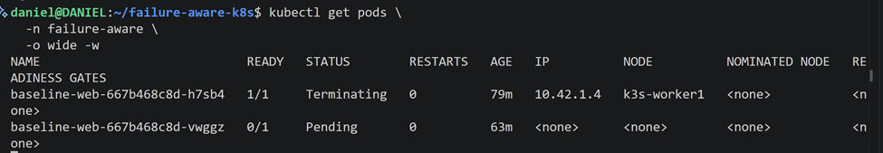

# Experimental Testbed

This document describes the infrastructure, K3s installation,
Kubernetes configuration, baseline workload validation, networking,
storage, resource profiles, and experimental procedures used for the
evaluation of the Failure-Aware Kubernetes Controller.

The testbed configuration forms part of the reproducibility record for
the project. Configuration changes made after the formal experimental
configuration is frozen must be documented and version-controlled.

---

# 1. Infrastructure Overview

The experimental environment is hosted on **Proxmox** and consists of
three virtual machines running K3s.

| Node | Role | Hostname | IP Address | vCPU | RAM | Disk | OS |
|---|---|---|---|---:|---:|---:|---|
| Server | K3s control plane | `k3s-server` | `102.34.160.89` | 4 | 4 GB | 100 GB | Ubuntu 24.04.5 LTS, Kernel `6.8.0-59-generic` |
| Worker 1 | Primary fault target | `k3s-worker1` | `102.34.160.87` | 4 | 4 GB | 100 GB | Ubuntu 24.04.5 LTS, Kernel `6.8.0-59-generic` |
| Worker 2 | Recovery target | `k3s-worker2` | `102.34.160.103` | 4 | 4 GB | 100 GB | Ubuntu 24.04.5 LTS, Kernel `6.8.0-59-generic` |

The Rust experimental harness and external workload generator run from
a separate client machine outside the K3s cluster.

The VM addresses are intended to remain fixed throughout the formal
experimental campaign.

---

# 2. Repository Layout

The project repository currently follows this structure:

```text
failure-aware-k8s/
├── LICENSE
├── Makefile
├── README.md
├── analysis/
├── controller/
├── docs/
│   ├── architecture/
│   ├── experimental-design.md
│   ├── hypothesis.md
│   ├── image.png
│   └── testbed.md
├── experiments/
├── harness/
├── kubernetes/
├── scripts/
└── workloads/
    └── test-workload/
        ├── nginx.yaml
        ├── independent-path-test.sh
        └── healthy-http-latency.sh
```

Workload-specific scripts are kept with the workload to which they
belong. Generic experimental orchestration scripts will be maintained
under `scripts/` or `experiments/`, while the formal Rust experimental
harness will be maintained under `harness/`.

---

# 3. K3s Installation and Cluster Bootstrap

## 3.1 Operating-System Preparation

All three K3s nodes use:

```text
Ubuntu 24.04.5 LTS
Kernel: 6.8.0-59-generic
```

The operating system can be verified using:

```bash
cat /etc/os-release
```

The kernel can be verified using:

```bash
uname -r
```

The nodes were updated using:

```bash
sudo apt update
sudo apt upgrade -y
```

Basic administration tools were installed using:

```bash
sudo apt install -y curl vim git jq
```

---

## 3.2 Configure Node Hostnames

On the control-plane node:

```bash
sudo hostnamectl set-hostname k3s-server
```

On Worker 1:

```bash
sudo hostnamectl set-hostname k3s-worker1
```

On Worker 2:

```bash
sudo hostnamectl set-hostname k3s-worker2
```

Verify:

```bash
hostname
```

The configured node addresses are:

```text
102.34.160.89   k3s-server
102.34.160.87   k3s-worker1
102.34.160.103  k3s-worker2
```

---

## 3.3 Optional Local Name Resolution

Where DNS-based hostname resolution is not available, the nodes may be
added to `/etc/hosts`.

```bash
sudo nano /etc/hosts
```

Add:

```text
102.34.160.89   k3s-server
102.34.160.87   k3s-worker1
102.34.160.103  k3s-worker2
```

Verify:

```bash
ping -c 3 k3s-server
ping -c 3 k3s-worker1
ping -c 3 k3s-worker2
```

---

## 3.4 Install the K3s Server

K3s was installed on `k3s-server` using:

```bash
curl -sfL https://get.k3s.io | sh -
```

Verify:

```bash
sudo systemctl status k3s
```

Check cluster state:

```bash
sudo k3s kubectl get nodes -o wide
```

Initially, the cluster contains:

```text
k3s-server    Ready    control-plane,master
```

---

## 3.5 Record and Pin the K3s Version

The installed K3s version is:

```text
v1.36.4+k3s1
```

Verify using:

```bash
sudo k3s --version
```

The Kubernetes/kubelet versions can be recorded using:

```bash
sudo k3s kubectl get nodes \
  -o custom-columns=NAME:.metadata.name,K8S:.status.nodeInfo.kubeletVersion
```

Recorded Kubernetes version:

```text
v1.36.4
```

For reproducibility, future installations should explicitly pin the
K3s version:

```bash
curl -sfL https://get.k3s.io | \
INSTALL_K3S_VERSION='v1.36.4+k3s1' sh -
```

The same K3s version must be used on the server and both workers during
formal experiments.

---

## 3.6 Obtain the Worker Join Token

On `k3s-server`:

```bash
sudo cat /var/lib/rancher/k3s/server/node-token
```

The token is a cluster secret and must **not** be committed to the
repository.

The repository must also exclude:

- K3s join tokens
- kubeconfig credentials
- database passwords
- private keys
- API secrets
- other authentication material

---

## 3.7 Join Worker 1

On `k3s-worker1`:

```bash
curl -sfL https://get.k3s.io | \
INSTALL_K3S_VERSION='v1.36.4+k3s1' \
K3S_URL=https://102.34.160.89:6443 \
K3S_TOKEN='[K3S_TOKEN]' sh -
```

Verify:

```bash
sudo systemctl status k3s-agent
```

From `k3s-server`:

```bash
sudo k3s kubectl get nodes -o wide
```

Expected:

```text
k3s-server     Ready
k3s-worker1    Ready
```

---

## 3.8 Join Worker 2

On `k3s-worker2`:

```bash
curl -sfL https://get.k3s.io | \
INSTALL_K3S_VERSION='v1.36.4+k3s1' \
K3S_URL=https://102.34.160.89:6443 \
K3S_TOKEN='[K3S_TOKEN]' sh -
```

Verify:

```bash
sudo systemctl status k3s-agent
```

Then verify the complete cluster:

```bash
sudo k3s kubectl get nodes -o wide
```

Expected:

```text
NAME          STATUS   ROLES
k3s-server    Ready    control-plane,master
k3s-worker1   Ready    <none>
k3s-worker2   Ready    <none>
```

---

# 4. Native K3s Configuration

The initial Kubernetes configuration is:

- Kubernetes distribution: **K3s**
- K3s version: **v1.36.4+k3s1**
- Kubernetes version: **v1.36.4**
- Container runtime: **containerd**
- Configuration: **Default K3s configuration**
- CNI: **Flannel**
- Cluster DNS: **CoreDNS**
- Ingress Controller: **Traefik**
- Service Load Balancer: **ServiceLB**
- Initial storage provisioner: **Local Path Provisioner**
- Formal experimental CSI implementation: **[CSI_IMPLEMENTATION]**
- Cluster domain: **[CLUSTER_DOMAIN]**
- Pod CIDR: **[POD_CIDR]**
- Service CIDR: **[SERVICE_CIDR]**

These components remain constant between the default K3s baseline and
the K3s + Failure-Aware Controller experiments unless the component
itself is explicitly evaluated as an independent variable.

---

## 4.1 Verify System Components

Inspect K3s system workloads:

```bash
sudo k3s kubectl get pods -n kube-system -o wide
```

Inspect all workloads:

```bash
sudo k3s kubectl get pods -A -o wide
```

Before baseline experimentation, there should be no unexplained
long-running states such as:

```text
CrashLoopBackOff
ImagePullBackOff
Pending
```

Any such condition must be resolved or documented before formal
measurements begin.

---

## 4.2 CNI Configuration

The initial experimental cluster uses the default **Flannel CNI**.

Record:

```text
CNI: Flannel
Configuration: Default K3s configuration
```

The CNI remains unchanged between:

```text
Default K3s
Controller OFF
```

and:

```text
K3s + Failure-Aware Controller
Controller ON
```

This prevents CNI differences from becoming a confounding experimental
variable.

---

## 4.3 Ingress Configuration

The K3s environment uses **Traefik** as its packaged Ingress Controller.

Verify Traefik:

```bash
sudo k3s kubectl get pods -n kube-system | grep traefik
```

Inspect its Service:

```bash
sudo k3s kubectl get svc -n kube-system | grep traefik
```

Inspect K3s-managed Helm charts:

```bash
sudo k3s kubectl get helmchart -n kube-system
```

Get the Traefik version

```bash
sudo k3s kubectl get deployment traefik \
  -n kube-system \
  -o jsonpath='{.spec.template.spec.containers[0].image}'
```

Record:

```text
Ingress Controller: Traefik
Traefik version: 3.7.8
Configuration: Default K3s configuration
```

K3s packaged component manifests are maintained under:

```text
/var/lib/rancher/k3s/server/manifests/
```

K3s-managed manifests should not be manually modified without
documenting the change.

---

# 5. Node Roles

## 5.1 `k3s-server`

Role: **K3s control plane**

Primary responsibilities include:

- Kubernetes API Server
- Controller Manager
- Scheduler
- cluster datastore
- Node lifecycle management
- NodeLease observation
- cluster-state management

The Failure-Aware Controller consumes native Kubernetes state through
the Kubernetes API rather than replacing these mechanisms.

---

## 5.2 `k3s-worker1`

Role: **Primary fault-injection target**

This worker will primarily host workloads used for:

- genuine node-failure experiments
- control-plane partition experiments
- complete-isolation experiments
- degraded-network experiments
- workload reachability verification
- stateful workload experiments where applicable

---

## 5.3 `k3s-worker2`

Role: **Recovery target**

This worker provides compute capacity when workloads on
`k3s-worker1` require recovery.

This separation enables recovery onto Worker 2 without replacing or
modifying the Kubernetes scheduler.

---

# 6. NodeLease and Heartbeat Verification

NodeLease objects provide the native Kubernetes heartbeat mechanism
that forms the starting point of the Failure-Aware Controller.

List NodeLeases:

```bash
sudo k3s kubectl get leases -n kube-node-lease
```

Expected:

```text
k3s-server
k3s-worker1
k3s-worker2
```

Inspect Worker 1:

```bash
sudo k3s kubectl get lease k3s-worker1 \
  -n kube-node-lease -o yaml
```

Expected Lease fields include:

```yaml
spec:
  holderIdentity: k3s-worker1
  renewTime: "..."
```

Observe the renewal timestamp:

```bash
watch -n 2 \
"sudo k3s kubectl get lease k3s-worker1 \
-n kube-node-lease \
-o custom-columns=NODE:.metadata.name,RENEW:.spec.renewTime"
```

The `renewTime` changes periodically while Worker 1 maintains
communication with the control plane.

Simultaneously observe node state:

```bash
sudo k3s kubectl get nodes -w
```

The native path relevant to this project is:

```text
k3s-worker1 kubelet
        |
        | Lease renewal
        v
Kubernetes API Server
        |
        v
Node lifecycle controller
        |
        v
Ready / Unknown
```

The proposed controller does not replace this mechanism.

It consumes the native Kubernetes failure-suspicion signal after the
node-health mechanism raises suspicion.

---

# 7. Experimental Node Labels

Label Worker 1:

```bash
sudo k3s kubectl label node k3s-worker1 \
  experiment-role=fault-target
```

Label Worker 2:

```bash
sudo k3s kubectl label node k3s-worker2 \
  experiment-role=recovery-target
```

Verify:

```bash
sudo k3s kubectl get nodes -L experiment-role
```

Expected:

| Node | Experimental Role |
|---|---|
| `k3s-server` | Control plane |
| `k3s-worker1` | Fault/partition target |
| `k3s-worker2` | Recovery target |


These labels control experimental workload placement without modifying
the native Kubernetes scheduler.

---

# 8. Experimental Namespace

Create:

```bash
sudo k3s kubectl create namespace failure-aware
```

Verify:

```bash
sudo k3s kubectl get namespace failure-aware
```

---

# 9. Native Healthy-State Baseline

Before introducing the Failure-Aware Controller or fault injection, the
native K3s environment was inspected.

```bash
sudo k3s kubectl get nodes -o wide
```

```bash
sudo k3s kubectl get leases -n kube-node-lease
```

```bash
sudo k3s kubectl describe node k3s-worker1
```

```bash
sudo k3s kubectl get pods -A -o wide
```

Worker 1 healthy state:

```text
Ready = True
```

Inspect existing taints:

```bash
sudo k3s kubectl get node k3s-worker1 \
  -o jsonpath='{.spec.taints}'
```

No unexpected `node.kubernetes.io/unreachable` condition should exist
during the healthy baseline.

---

# 10. Baseline HTTP Test Workload

Before deploying the formal EMR workload, a lightweight Nginx workload
is used to validate:

- Pod scheduling
- worker placement
- Flannel networking
- Kubernetes Services
- CoreDNS
- external client reachability
- continuous application availability
- the independent client path required by Scenario B

The workload-specific files are stored under:

```text
workloads/test-workload/
```

Current structure:

```text
workloads/test-workload/
├── nginx.yaml
├── independent-path-test.sh
└── healthy-http-latency.sh
```

---

## 10.1 Baseline Nginx Manifest

File:

```text
workloads/test-workload/nginx.yaml
```

Contents:

```yaml
apiVersion: apps/v1
kind: Deployment
metadata:
  name: baseline-web
  namespace: failure-aware
spec:
  replicas: 1
  selector:
    matchLabels:
      app: baseline-web
  template:
    metadata:
      labels:
        app: baseline-web
    spec:
      nodeSelector:
        experiment-role: fault-target
      containers:
        - name: nginx
          image: nginx:1.27
          ports:
            - containerPort: 80
          resources:
            requests:
              cpu: "25m"
              memory: "32Mi"
            limits:
              cpu: "100m"
              memory: "128Mi"

---
apiVersion: v1
kind: Service
metadata:
  name: baseline-web
  namespace: failure-aware
spec:
  selector:
    app: baseline-web
  type: NodePort
  ports:
    - name: http
      port: 80
      targetPort: 80
```

Deploy:

```bash
sudo k3s kubectl apply \
  -f workloads/test-workload/nginx.yaml
```

Verify:

```bash
sudo k3s kubectl get pods \
  -n failure-aware \
  -o wide
```

Verify workload placement:

```bash
sudo k3s kubectl get pod \
  -n failure-aware \
  -l app=baseline-web \
  -o jsonpath='{.items[0].spec.nodeName}'
```

Observed node:

```text
k3s-worker1
```

---

## 10.2 Service Verification

Inspect the Service:

```bash
sudo k3s kubectl get svc \
  -n failure-aware
```

Retrieve the NodePort:

```bash
sudo k3s kubectl get svc baseline-web \
  -n failure-aware \
  -o jsonpath='{.spec.ports[0].nodePort}'
```

Recorded NodePort:

```text
[ACTUAL_NODEPORT]
```

Retrieve the ClusterIP:

```bash
sudo k3s kubectl get svc baseline-web \
  -n failure-aware \
  -o jsonpath='{.spec.clusterIP}'
```

Observed ClusterIP:

```text
10.43.86.169
```

---

## 10.3 Pod and Service Reachability

Retrieve Pod details:

```bash
sudo k3s kubectl get pods \
  -n failure-aware \
  -o wide
```

Test the Pod directly while on the any node in the cluster:

```bash
curl http://[POD_IP]
```

Expected:

```text
Welcome to nginx!
```

Test the Service:

```bash
curl http://10.43.86.169
```

Expected:

```text
Welcome to nginx!
```

---

# 11. CoreDNS Verification

A temporary BusyBox Pod was used to verify Kubernetes DNS resolution.

Create:

```bash
sudo k3s kubectl run dns-test \
  --image=busybox:1.36 \
  --restart=Never \
  -n failure-aware \
  -- sleep 3600
```

Verify:

```bash
sudo k3s kubectl get pod dns-test \
  -n failure-aware
```

Resolve the Service name:

```bash
sudo k3s kubectl exec \
  -n failure-aware dns-test -- \
  nslookup baseline-web
```

Observed successful resolution:

```text
Server:  10.43.0.10
Address: 10.43.0.10:53

Name:    baseline-web.failure-aware.svc.cluster.local
Address: 10.43.86.169
```

Therefore:

```text
baseline-web.failure-aware.svc.cluster.local
                    |
                    v
               10.43.86.169
```

CoreDNS service discovery is functioning correctly.

BusyBox `nslookup` may additionally issue lookups based on Kubernetes
search domains and display `NXDOMAIN` for those alternate names. These
additional unsuccessful lookups do not invalidate the successful fully
qualified Service lookup above.

Remove the test Pod:

```bash
sudo k3s kubectl delete pod dns-test \
  -n failure-aware
```

---

# 12. External Independent-Path Verification

The workload was tested from the external experimental client (My personal PC).


This verifies the path required for Scenario B:

```text
Control-plane path:

k3s-worker1  ---->  k3s-server


Independent application path:

External Client
      |
      v
102.34.160.87
      |
      v
baseline-web on k3s-worker1
```

The independent application path must remain available when the
worker-to-control-plane path is deliberately disrupted.

---

## 12.1 Firewall Requirement

The Kubernetes NodePort range is normally:

```text
30000-32767/TCP
```

The firewall must permit the NodePort used by the test workload.

Check UFW:

```bash
sudo ufw status
```

Where appropriate for the controlled test environment, allow the
NodePort range:

```bash
sudo ufw allow 30000:32767/tcp
```

Alternatively, allow only the allocated NodePort.

For a controlled and isolated experimental environment, UFW may
temporarily be disabled where permitted:

```bash
sudo ufw disable
```

**Caution:** disabling the firewall reduces host protection and should
only be done in an appropriately isolated experimental environment.

Firewall state must remain consistent between comparable experimental
runs.

A blocked NodePort could otherwise be incorrectly interpreted as
application or network-partition failure.

---

# 13. Continuous Independent-Path Test

File:

```text
workloads/test-workload/independent-path-test.sh
```

Script:

```sh
#!/bin/sh

URL="http://102.34.160.87:[NODEPORT]"

while true; do
    date '+%Y-%m-%dT%H:%M:%S.%3N'

    curl -s -o /dev/null \
        -w 'HTTP=%{http_code} time=%{time_total}s\n' \
        "$URL"

    sleep 1
done
```

Run from the repository root:

```bash
sh workloads/test-workload/independent-path-test.sh
```

Observed healthy responses included:

```text
2026-09-19T09:36:24.540
HTTP=200 time=0.110325s

2026-09-19T09:36:26.053
HTTP=200 time=0.033957s

2026-09-19T09:36:27.103
HTTP=200 time=0.027503s

2026-09-19T09:36:28.607
HTTP=200 time=0.025054s

2026-09-19T09:36:29.649
HTTP=200 time=0.042599s
```

Repeated HTTP `200` responses demonstrate that the external client can
continuously reach the workload under healthy conditions.

This script is a pilot validation utility. Formal workload generation
and measurement will later be implemented in the Rust experimental
harness.

---

# 14. Healthy HTTP Latency Pilot

File:

```text
workloads/test-workload/healthy-http-latency.sh
```

Script:

```sh
#!/bin/sh

URL="http://102.34.160.87:[NODEPORT]"
OUTPUT="baseline-http-latency.txt"

: > "$OUTPUT"

i=1

while [ "$i" -le 100 ]; do
    curl -s -o /dev/null \
        -w '%{time_total}\n' \
        "$URL" >> "$OUTPUT"

    sleep 0.1
    i=$((i + 1))
done
```

Run:

```bash
sh workloads/test-workload/healthy-http-latency.sh
```

The first ten observations were:

```text
0.022381
0.022032
0.028396
0.016413
0.026923
0.019650
0.021870
0.020069
0.016057
0.021782
```

`curl` reports `time_total` in seconds.

For example:

```text
0.022381 seconds = 22.381 ms
```

These values are pilot measurements used to confirm that the
measurement path functions correctly.

They are **not formal experimental results**.

---

# 15. NodePort Path Behaviour

The NodePort should also be tested against Worker 2:

```bash
curl http://102.34.160.103:[NODEPORT]
```

Record:


```text
External Client -> k3s-worker1:NodePort = [WORKS / DOES NOT WORK]
External Client -> k3s-worker2:NodePort = [WORKS / DOES NOT WORK]
```

This matters because NodePort Service forwarding may allow traffic
arriving through another node to reach the Pod on Worker 1.

Therefore the formal Scenario B probe must distinguish:

```text
The Kubernetes Service remains reachable somewhere
```

from:

```text
The existing workload on the partitioned Worker 1
remains independently reachable.
```

---

# 16. Development Resource Profile

The current development environment uses:

| Node | vCPU | RAM | Disk |
|---|---:|---:|---:|
| `k3s-server` | 4 | 4 GB | 100 GB |
| `k3s-worker1` | 4 | 4 GB | 100 GB |
| `k3s-worker2` | 4 | 4 GB | 100 GB |

This profile is used for:

- initial cluster deployment
- workload validation
- controller development
- baseline characterization
- pilot experiments

---

# 17. Candidate Formal Resource Profiles

Resource constraints will later be introduced as controlled independent
variables.

Candidate profiles are:

## Low

```text
1 vCPU
1 GB RAM
```

## Medium

```text
2 vCPU
2 GB RAM
```

## Higher

```text
4 vCPU
4 GB RAM
```

The final profiles will be frozen only after preliminary
characterization.

For any baseline-versus-controller comparison, CPU and memory
allocations must remain identical.

---

# 18. Healthy Network Characterization

Before introducing network partitions, artificial latency, packet loss,
bandwidth restrictions, or the Failure-Aware Controller, the healthy
network characteristics of the experimental environment were measured.

The purpose of this characterization is to establish the native network
baseline against which later degraded-network and failure experiments
can be compared.

The network condition is represented as:

```text
N = {B, L, P, J}
```

where:

- `B` = available/sustained bandwidth or throughput
- `L` = round-trip latency
- `P` = packet-loss rate
- `J` = network jitter

Three principal experimental paths were characterized:

```text
1. k3s-server <------> k3s-worker1
   Control-plane path

2. External Client <------> k3s-worker1
   Independent application/client path

3. k3s-worker1 <------> k3s-worker2
   Worker-to-worker / recovery path
```

The external client was also tested against `k3s-server` to provide
additional context for the client-to-cluster path.

No `tc/netem`, Chaos Mesh network fault, artificial bandwidth limit,
or deliberate partition was active during these measurements.

---

## 18.1 Network Measurement Tools

The following tools were used:

- `ping` for round-trip latency and ICMP packet loss
- `iperf3` TCP mode for sustained network throughput
- `iperf3` UDP mode for jitter and datagram-loss characterization

Install the tools on the K3s nodes:

```bash
sudo apt update
sudo apt install -y iperf3 iputils-ping
```

Install the same tools on the external experimental client where
required.

Verify `iperf3`:

```bash
iperf3 --version
```

The external experimental client used:

```text
iperf 3.16
```

---

## 18.2 Important `iperf3` Service Configuration

`iperf3` should **not** be configured as a permanently running server
during these experiments.

On some Ubuntu installations, package installation may offer to run
`iperf3` automatically as a system service. If enabled, the service
occupies the default `iperf3` port:

```text
5201/TCP
```

Attempting to subsequently run:

```bash
iperf3 -s
```

will then produce an error similar to:

```text
iperf3: error - unable to start listener for connections:
Address already in use
```

This occurred during initial testbed characterization because
`iperf3.service` was already running.

The running service can be identified using:

```bash
systemctl status iperf3
```

If the daemon was enabled, stop it using:

```bash
sudo systemctl stop iperf3
```

Disable automatic startup where applicable:

```bash
sudo systemctl disable iperf3
```

For the experimental measurements, the server is instead started
manually on the required destination:

```bash
iperf3 -s
```

The server is stopped after the required measurements using:

```text
Ctrl+C
```

This approach ensures that the measurement endpoint is deliberately
selected for every test and avoids port conflicts.

---

## 18.3 Healthy RTT and Packet-Loss Measurements

ICMP measurements were performed using 100 packets per path.

The general command was:

```bash
ping -c 100 <DESTINATION_IP>
```

The final `ping` summary provides:

```text
min / avg / max / mdev
```

where:

- `min` = minimum observed RTT
- `avg` = mean observed RTT
- `max` = maximum observed RTT
- `mdev` = mean deviation of the RTT observations

The complete summaries are retained because average RTT alone does not
describe network variability.

---

### 18.3.1 Worker1 → Server

Source:

```text
k3s-worker1
102.34.160.87
```

Destination:

```text
k3s-server
102.34.160.89
```

Command:

```bash
ping -c 100 102.34.160.89
```

Observed result:

```text
100 packets transmitted
100 packets received
0% packet loss

RTT min/avg/max/mdev:
0.394 / 0.593 / 0.830 / 0.078 ms
```

Therefore:

```text
Average RTT:  0.593 ms
Packet loss:  0%
```

This represents the healthy Worker 1 to control-plane path.


---

### 18.3.2 Server → Worker1

Source:

```text
k3s-server
102.34.160.89
```

Destination:

```text
k3s-worker1
102.34.160.87
```

Command:

```bash
ping -c 100 102.34.160.87
```

Observed result:

```text
100 packets transmitted
100 packets received
0% packet loss

RTT min/avg/max/mdev:
0.395 / 0.608 / 0.831 / 0.080 ms
```

Therefore:

```text
Average RTT:  0.608 ms
Packet loss:  0%
```

The two directions of the native server-to-worker path therefore showed
similar healthy RTT characteristics during this characterization run.


---

### 18.3.3 External Client → Worker1

Source:

```text
External experimental client
```

Destination:

```text
k3s-worker1
102.34.160.87
```

Command:

```bash
ping -c 100 102.34.160.87
```

Observed result:

```text
100 packets transmitted
100 packets received
0% packet loss

RTT min/avg/max/mdev:
5.892 / 14.553 / 117.830 / 20.147 ms
```

Therefore:

```text
Average RTT:  14.553 ms
Packet loss:  0%
```

This path is important because it represents the independent client path
that should remain available during the Scenario B control-plane
partition experiment.


---

### 18.3.4 External Client → Server

Source:

```text
External experimental client
```

Destination:

```text
k3s-server
102.34.160.89
```

Command:

```bash
ping -c 100 102.34.160.89
```

Observed result:

```text
100 packets transmitted
99 packets received
1% packet loss

RTT min/avg/max/mdev:
4.057 / 15.259 / 128.919 / 19.355 ms
```

Therefore:

```text
Average RTT:  15.259 ms
Packet loss:  1%
```

The healthy external path therefore exhibited greater variability than
the intra-cluster paths during this measurement period.

The observed packet loss is retained as part of the baseline rather
than being discarded.


---

### 18.3.5 Worker1 → Worker2

Source:

```text
k3s-worker1
102.34.160.87
```

Destination:

```text
k3s-worker2
102.34.160.103
```

Command:

```bash
ping -c 100 102.34.160.103
```

Observed result:

```text
100 packets transmitted
100 packets received
0% packet loss

RTT min/avg/max/mdev:
0.366 / 0.586 / 1.280 / 0.116 ms
```

Therefore:

```text
Average RTT:  0.586 ms
Packet loss:  0%
```

This path will later be relevant when workloads recover from Worker 1
onto Worker 2.


---

## 18.4 TCP Throughput Characterization

TCP throughput was measured using `iperf3`.

For each path, one endpoint was explicitly started as an `iperf3`
server:

```bash
iperf3 -s
```

The other endpoint then initiated a 30-second TCP measurement:

```bash
iperf3 -c <SERVER_IP> -t 30
```

Reverse mode was measured using:

```bash
iperf3 -c <SERVER_IP> -t 30 -R
```

The `-R` option causes the remote `iperf3` server to send traffic back
to the initiating client.

The resulting throughput values characterize the sustained TCP
throughput observed during these healthy pilot measurements.

---

### 18.4.1 Worker1 → Server

Start the `iperf3` server on `k3s-server`:

```bash
iperf3 -s
```

From `k3s-worker1`:

```bash
iperf3 -c 102.34.160.89 -t 30
```

Observed result:

```text
Duration:         30 seconds
Transfer:         32.9 GBytes
Sender bitrate:   9.41 Gbit/s
Receiver bitrate: 9.41 Gbit/s
Retransmissions:  1
```

Healthy TCP throughput:

```text
Worker1 -> Server = 9.41 Gbit/s
```


---

### 18.4.2 Server → Worker1

With the `iperf3` server still running on `k3s-server`, execute from
Worker 1:

```bash
iperf3 -c 102.34.160.89 -t 30 -R
```

Observed result:

```text
Duration:          30 seconds
Sender transfer:   34.0 GBytes
Receiver transfer: 33.9 GBytes
Sender bitrate:    9.72 Gbit/s
Receiver bitrate:  9.72 Gbit/s
Retransmissions:   3
```

Healthy reverse throughput:

```text
Server -> Worker1 = 9.72 Gbit/s
```


---

### 18.4.3 External Client → Worker1

Start the `iperf3` server on `k3s-worker1`:

```bash
iperf3 -s
```

From the external experimental client:

```bash
iperf3 -c 102.34.160.87 -t 30
```

Observed result:

```text
Sender transfer:    158 MBytes
Sender bitrate:     44.0 Mbit/s
Receiver transfer:  156 MBytes
Receiver bitrate:   44.2 Mbit/s
Retransmissions:    16
```

Healthy external-client throughput:

```text
External Client -> Worker1 ~= 44 Mbit/s
```


---

### 18.4.4 Worker1 → External Client

Using reverse mode from the external client:

```bash
iperf3 -c 102.34.160.87 -t 30 -R
```

Observed result:

```text
Sender transfer:    176 MBytes
Sender bitrate:     50.1 Mbit/s
Receiver transfer:  173 MBytes
Receiver bitrate:   48.3 Mbit/s
Retransmissions:    257
```

The observed healthy reverse-path throughput was approximately:

```text
Worker1 -> External Client ~= 48-50 Mbit/s
```

The retransmission count is retained as part of the raw baseline rather
than discarded.


---

### 18.4.5 Worker1 → Worker2

Start the `iperf3` server on `k3s-worker2`:

```bash
iperf3 -s
```

From `k3s-worker1`:

```bash
iperf3 -c 102.34.160.103 -t 30
```

Observed result:

```text
Duration:         30 seconds
Transfer:         46.1 GBytes
Sender bitrate:   13.2 Gbit/s
Receiver bitrate: 13.2 Gbit/s
Retransmissions:  1
```

Healthy Worker1-to-Worker2 throughput:

```text
Worker1 -> Worker2 = 13.2 Gbit/s
```


---

### 18.4.6 Worker2 → Worker1

With the server running on Worker 2, execute reverse mode from Worker 1:

```bash
iperf3 -c 102.34.160.103 -t 30 -R
```

Observed result:

```text
Duration:         30 seconds
Transfer:         30.2 GBytes
Sender bitrate:   8.65 Gbit/s
Receiver bitrate: 8.65 Gbit/s
Retransmissions:  2
```

Healthy reverse throughput:

```text
Worker2 -> Worker1 = 8.65 Gbit/s
```

The observed asymmetry between the two directions is retained as part
of the baseline characterization. A single pilot measurement is not
used to attribute this difference to a specific cause.


---

## 18.5 UDP Jitter and Loss Characterization

UDP tests were used to characterize jitter and datagram loss.

The general command was:

```bash
iperf3 -c <DESTINATION_IP> -u -b 10M -t 30
```

The UDP offered load was deliberately fixed at:

```text
10 Mbit/s
```

for 30 seconds.

**Important:** the `10 Mbit/s` value is the offered UDP measurement
rate. It is **not** interpreted as the available bandwidth of the
network.

Available/sustained throughput was characterized separately using the
TCP measurements above.

---

### 18.5.1 Worker1 → Server

Start:

```bash
iperf3 -s
```

on `k3s-server`.

From Worker 1:

```bash
iperf3 -c 102.34.160.89 -u -b 10M -t 30
```

Observed receiver result:

```text
Transfer:        35.8 MBytes
Bitrate:         10.0 Mbit/s
Jitter:          0.033 ms
Lost datagrams:  0 / 25898
Packet loss:     0%
```

Therefore:

```text
Worker1 -> Server UDP jitter = 0.033 ms
Worker1 -> Server UDP loss   = 0%
```


---

### 18.5.2 External Client → Worker1

Start:

```bash
iperf3 -s
```

on `k3s-worker1`.

From the external client:

```bash
iperf3 -c 102.34.160.87 -u -b 10M -t 30
```

Observed receiver result:

```text
Transfer:        35.8 MBytes
Bitrate:         10.2 Mbit/s
Jitter:          0.426 ms
Lost datagrams:  4 / 27017
Packet loss:     0.015%
```

Therefore:

```text
External Client -> Worker1 UDP jitter = 0.426 ms
External Client -> Worker1 UDP loss   = 0.015%
```

This confirms that the healthy external path exhibited measurable
variability and a small amount of UDP datagram loss even before
artificial degradation was introduced.


---

### 18.5.3 Worker1 → Worker2

Start:

```bash
iperf3 -s
```

on `k3s-worker2`.

From Worker 1:

```bash
iperf3 -c 102.34.160.103 -u -b 10M -t 30
```

Observed receiver result:

```text
Transfer:        35.8 MBytes
Bitrate:         10.0 Mbit/s
Jitter:          0.056 ms
Lost datagrams:  0 / 25898
Packet loss:     0%
```

Therefore:

```text
Worker1 -> Worker2 UDP jitter = 0.056 ms
Worker1 -> Worker2 UDP loss   = 0%
```


---

## 18.6 Consolidated Healthy Network Baseline

The initial healthy network characterization produced the following
results.

| Path | RTT min/avg/max/mdev | ICMP Loss | TCP Throughput | UDP Jitter | UDP Loss |
|---|---|---:|---:|---:|---:|
| Worker1 → Server | `0.394 / 0.593 / 0.830 / 0.078 ms` | 0% | 9.41 Gbit/s | 0.033 ms | 0% |
| Server → Worker1 | `0.395 / 0.608 / 0.831 / 0.080 ms` | 0% | 9.72 Gbit/s | Not measured | Not measured |
| External Client → Worker1 | `5.892 / 14.553 / 117.830 / 20.147 ms` | 0% | 44.0–44.2 Mbit/s | 0.426 ms | 0.015% |
| Worker1 → External Client | Not separately measured by ICMP | — | 48.3–50.1 Mbit/s | Not measured | Not measured |
| External Client → Server | `4.057 / 15.259 / 128.919 / 19.355 ms` | 1% | Not measured | Not measured | Not measured |
| Worker1 → Worker2 | `0.366 / 0.586 / 1.280 / 0.116 ms` | 0% | 13.2 Gbit/s | 0.056 ms | 0% |
| Worker2 → Worker1 | Not separately measured by ICMP | — | 8.65 Gbit/s | Not measured | Not measured |

The measurements show that the intra-cluster paths and external-client
path have substantially different healthy characteristics.

The intra-cluster VM paths exhibited:

- sub-millisecond average RTT;
- no observed ICMP loss during the 100-packet samples;
- multi-gigabit TCP throughput; and
- very low UDP jitter.

The external-client path exhibited:

- higher and more variable RTT;
- approximately 44–50 Mbit/s TCP throughput;
- greater UDP jitter; and
- small but non-zero UDP datagram loss during the Worker 1 test.

These differences are retained as part of the experimental baseline and
will be considered when later defining degraded-network profiles.

No causal explanation is inferred from these initial characterization
runs alone.

---

## 18.7 Raw Network Measurement Storage

The raw network characterization outputs are retained under:

```text
experiments/
└── baseline/
    └── network/
        ├── ping/
        │   ├── worker1-to-server.txt
        │   ├── server-to-worker1.txt
        │   ├── client-to-worker1.txt
        │   ├── client-to-server.txt
        │   └── worker1-to-worker2.txt
        │
        ├── tcp/
        │   ├── worker1-to-server.txt
        │   ├── server-to-worker1.txt
        │   ├── client-to-worker1.txt
        │   ├── worker1-to-client.txt
        │   ├── worker1-to-worker2.txt
        │   └── worker2-to-worker1.txt
        │
        └── udp/
            ├── worker1-to-server.txt
            ├── client-to-worker1.txt
            └── worker1-to-worker2.txt
```

The above measurements are captured directly into these files rather
than relying only on screenshots.

For example, ping output can be captured using:

```bash
ping -c 100 102.34.160.89 \
  | tee experiments/baseline/network/ping/worker1-to-server.txt
```

TCP output can be captured using:

```bash
iperf3 -c 102.34.160.89 -t 30 \
  | tee experiments/baseline/network/tcp/worker1-to-server.txt
```

UDP output can be captured using:

```bash
iperf3 -c 102.34.160.89 -u -b 10M -t 30 \
  | tee experiments/baseline/network/udp/worker1-to-server.txt
```
---

## 18.8 Network Baseline Status

The following healthy network characterization tasks have been
completed:

- [x] `iperf3` installed
- [x] `ping` available
- [x] Worker1 → Server RTT measured
- [x] Server → Worker1 RTT measured
- [x] External Client → Worker1 RTT measured
- [x] External Client → Server RTT measured
- [x] Worker1 → Worker2 RTT measured
- [x] Worker1 → Server TCP throughput measured
- [x] Server → Worker1 TCP throughput measured
- [x] External Client → Worker1 TCP throughput measured
- [x] Worker1 → External Client TCP throughput measured
- [x] Worker1 → Worker2 TCP throughput measured
- [x] Worker2 → Worker1 TCP throughput measured
- [x] Worker1 → Server UDP jitter/loss measured
- [x] External Client → Worker1 UDP jitter/loss measured
- [x] Worker1 → Worker2 UDP jitter/loss measured
- [x] No artificial network degradation active during characterization
- [x] Raw baseline results retained under `experiments/baseline/network/`

The healthy network baseline is therefore sufficiently characterized
for the subsequent native K3s failure and partition pilot experiments.

The next experimental activity will evaluate the Scenario B condition
in which communication between `k3s-worker1` and `k3s-server` is
deliberately disrupted while the independent external-client path to
the workload on `k3s-worker1` remains available.
---

# 19. Native K3s Scenario B — Control-Plane Partition Baseline

This section documents the native K3s behaviour observed when
`k3s-worker1` loses communication with the Kubernetes control plane
while the workload hosted on the worker remains independently reachable.

The experiment was performed **without the proposed Failure-Aware
Controller**. Its purpose was to establish the native Kubernetes
baseline and verify the central ambiguity motivating the proposed
controller.

The target condition was:

```text
CONTROL-PLANE PATH

k3s-worker1                  k3s-server
102.34.160.87               102.34.160.89

      X -------------------- X
          TCP/6443 blocked
```

while preserving:

```text
INDEPENDENT APPLICATION PATH

External Client
      |
      | HTTP
      v
k3s-worker1
102.34.160.87
      |
      v
baseline-web
```

The experiment successfully reproduced a condition in which Kubernetes
considered Worker 1 unreachable while the existing workload on Worker 1
continued serving external requests.

---

## 19.1 Experimental Objective

The experiment tested whether loss of Worker 1's control-plane
connectivity necessarily implies loss of the workload executing on the
worker.

Specifically, the experiment sought to establish the following
condition:

```text
Kubernetes control-plane observation:
Worker 1 is unreachable

                 while

Independent application observation:
Workload on Worker 1 remains reachable
```

This experiment provides the native baseline for the operational state
later represented by the proposed controller as:

```text
reachable_outside_control_plane
```

No controller-level intervention was active during this experiment.

---

## 19.2 Experimental Environment

The relevant nodes were:

| Component | Hostname | IP Address | Role |
|---|---|---|---|
| Control plane | `k3s-server` | `102.34.160.89` | Kubernetes control plane |
| Fault target | `k3s-worker1` | `102.34.160.87` | Partitioned worker |
| Recovery worker | `k3s-worker2` | `102.34.160.103` | Available recovery capacity |
| External client | External machine | `[CLIENT_IP]` | Independent service verification |

The baseline workload was:

```text
Application:  Nginx
Deployment:   baseline-web
Namespace:    failure-aware
Worker:       k3s-worker1
Service:      NodePort
NodePort:     30364
```

The externally tested endpoint was:

```text
http://102.34.160.87:30364
```

---

## 19.3 Pre-Experiment Verification

Before introducing the partition, verify that all cluster nodes are
healthy:

```bash
kubectl get nodes -o wide
```

Expected initial state:

```text
k3s-server     Ready
k3s-worker1    Ready
k3s-worker2    Ready
```

Verify that the workload is executing on Worker 1:

```bash
kubectl get pods \
  -n failure-aware \
  -o wide
```

The baseline workload must show:

```text
NODE = k3s-worker1
```

Verify that Worker 1's Lease is renewing:

```bash
watch -n 2 \
"kubectl get lease k3s-worker1 \
-n kube-node-lease \
-o custom-columns=NODE:.metadata.name,RENEW:.spec.renewTime"
```

During healthy operation, the Lease renewal timestamp was observed to
change at approximately **10-second intervals**.

Verify the external application path:

```bash
sh workloads/test-workload/independent-path-test.sh
```

Successful requests should return:

```text
HTTP=200
```

before fault injection begins.

---

## 19.4 Monitoring During the Experiment

Several observations were performed concurrently so that the
control-plane view could be compared with the independent application
view.


### 19.4.1 Node State

On the control-plane side:

```bash
kubectl get nodes -w
```

This was used to observe the transition from:

```text
Ready
```

to:

```text
NotReady
```

---

### 19.4.2 Worker 1 Lease

Worker 1's Lease was monitored using:

```bash
watch -n 2 \
"kubectl get lease k3s-worker1 \
-n kube-node-lease \
-o custom-columns=NODE:.metadata.name,RENEW:.spec.renewTime"
```

Before the partition, the Lease renewed periodically.

After the partition, the observed Lease renewal timestamp stopped at:

```text
2026-09-19T13:24:17.830355Z
```

---

### 19.4.3 Pod State

The workload state was monitored using:

```bash
kubectl get pods \
  -n failure-aware \
  -o wide -w
```

This allowed the native Kubernetes Pod lifecycle to be observed while
Worker 1 was unreachable.

---

### 19.4.4 Kubernetes Events

Cluster events were monitored using:

```bash
kubectl get events \
  --all-namespaces \
  --sort-by='.lastTimestamp' \
  -w
```

Events associated with Worker 1 included native node-health changes such
as:

```text
NodeNotReady
```

and workload-related events indicating that the node was not ready.

---

### 19.4.5 Independent Application Reachability

From the external client:

```bash
sh workloads/test-workload/independent-path-test.sh
```

The script continued sending HTTP requests directly to:

```text
102.34.160.87:30364
```

throughout the partition.

The output contained timestamped observations such as:

```text
19 September 2026 16:25:29.592 | HTTP=200 latency=0.026970s
19 September 2026 16:25:30.639 | HTTP=200 latency=0.026489s
19 September 2026 16:25:31.683 | HTTP=200 latency=0.014325s
19 September 2026 16:25:32.724 | HTTP=200 latency=0.015104s
```

The repeated `HTTP=200` responses were used as independent evidence that
the workload remained operationally reachable.

---

## 19.5 Selective Control-Plane Partition

The experiment intentionally blocked only the Worker 1 to K3s API
Server path.

The relevant communication path was:

```text
k3s-worker1
102.34.160.87
      |
      | TCP/6443
      v
k3s-server
102.34.160.89
```

The following rule was inserted on `k3s-worker1`:

```bash
sudo iptables -I OUTPUT 1 \
  -p tcp \
  -d 102.34.160.89 \
  --dport 6443 \
  -j DROP
```

The rule blocks Worker 1's outbound TCP communication to the K3s API
Server while leaving unrelated Worker 1 traffic available.

The entire Worker 1 network interface was **not** disabled because doing
so would create complete worker isolation rather than the required
Scenario B control-plane partition.

Verify the inserted rule using:

```bash
sudo iptables -L OUTPUT -n -v --line-numbers
```

---

## 19.6 Fault-Injection Timestamp

The partition injection time was recorded as:

```text
2026-09-19 13:24:28.367
```

This represents:

```text
t_partition
```

for this pilot run.

The timestamp was stored under:

```text
experiments/baseline/scenario-b/fault-time.txt
```

A reproducible command for future runs is:

```bash
date '+%Y-%m-%d %H:%M:%S.%3N' \
  | tee experiments/baseline/scenario-b/fault-time.txt
```

For formal automated experiments, timestamp collection will later be
performed by the experimental harness.

---

## 19.7 Lease Behaviour After Partition

Before fault injection, Worker 1 renewed its NodeLease at approximately
10-second intervals.

The last observed Lease renewal was:

```text
2026-09-19T13:24:17.830355Z
```

The partition was injected at:

```text
2026-09-19 13:24:28.367
```

After the Worker 1 to API Server path was blocked, the Lease renewal
timestamp stopped advancing.

The observed sequence was therefore:

```text
Healthy Worker1
      |
      | periodic Lease renewal
      | approximately every 10 seconds
      v
2026-09-19T13:24:17.830355Z
      |
      | control-plane path blocked
      v
2026-09-19 13:24:28.367
      |
      v
No subsequent Lease renewal observed
```

This provided the native failure-suspicion precursor for the experiment.

---

## 19.8 Native Node-State Transition

Following the loss of Worker 1's control-plane communication, Kubernetes
eventually changed Worker 1 from:

```text
Ready
```

to:

```text
NotReady
```

The observed control-plane state was:

```text
k3s-worker1    NotReady
```

This occurred while `k3s-server` and `k3s-worker2` remained healthy.

The experiment therefore selectively affected Worker 1 rather than the
entire cluster.

---

## 19.9 Native Unreachable Taints

After Kubernetes detected loss of communication with Worker 1, the
node received native unreachable taints.

The taints were inspected using:

```bash
kubectl get node k3s-worker1 \
  -o jsonpath='{.spec.taints}'
```

The observed output contained:

```text
node.kubernetes.io/unreachable
```

with both:

```text
NoSchedule
```

and:

```text
NoExecute
```

effects.

The taint state was preserved in:

```text
experiments/baseline/scenario-b/unreachable-taint.txt
```

using:

```bash
kubectl get node k3s-worker1 \
  -o jsonpath='{.spec.taints}' \
  > experiments/baseline/scenario-b/unreachable-taint.txt
```

This file forms part of the reproducible evidence for the native
Kubernetes failure response.

---

## 19.10 Native Pod Lifecycle Observation

The baseline workload initially executed normally on:

```text
k3s-worker1
```

After Worker 1 became unreachable, Kubernetes progressed the Pod object
toward termination.

The observed state included:

```text
baseline-web-...    1/1    Terminating    ...    k3s-worker1
```

A replacement Pod was also observed in:

```text
Pending
```

state.

The existing Pod therefore appeared from the control-plane perspective
as:

```text
Running
   |
   v
Terminating
```

However, the `Terminating` state did **not** demonstrate that the
container process had stopped on Worker 1.

Because the control plane could no longer communicate with the kubelet
on Worker 1, the control-plane Pod lifecycle state and the actual
execution state of the workload became distinguishable.

---

## 19.11 Independent Workload Remained Reachable

While Kubernetes reported:

```text
k3s-worker1 = NotReady
```

and the original Pod object was:

```text
Terminating
```

the external client continued successfully accessing:

```text
http://102.34.160.87:30364
```

The workload continued returning:

```text
HTTP=200
```

The Nginx service was also independently accessible through a web
browser using:

```text
102.34.160.87:30364
```


The resulting observation was therefore:

```text
KUBERNETES CONTROL-PLANE VIEW

Worker1 = NotReady
       |
       v
unreachable taint
       |
       v
Pod = Terminating


              BUT


INDEPENDENT APPLICATION VIEW

External Client
       |
       v
102.34.160.87:30364
       |
       v
Nginx workload
       |
       v
HTTP 200
```

This distinction is the principal result of the native Scenario B pilot.

---

## 19.12 Interpretation of `Terminating`

The observed `Terminating` Pod state is retained as part of the native
Kubernetes baseline.



And the replacement cannot simply go to Worker2 since it's node affinity is set to worker1. On top of that, Worker1 is unreachable/tainted. Hence the replacement remains Pending.

The proposed Failure-Aware Controller will **not** attempt to rewrite
the native Pod status back to `Running`.

Instead, the architecture distinguishes:

```text
Native Kubernetes state
```

from:

```text
Observed operational state
```

For this scenario:

```text
Native Kubernetes:

Node = NotReady
Pod  = Terminating

          +

Independent evidence:

HTTP service = reachable

          ↓

Failure-Aware operational classification:

reachable_outside_control_plane
```

The controller will therefore consume native Kubernetes failure
signals and supplement them with post-suspicion operational evidence
rather than modifying Kubernetes-owned status fields.

---

## 19.13 Native Baseline Decision Context

The Scenario B observation establishes the condition that the proposed
controller must later evaluate.

Conceptually:

```text
NodeLease stops
       |
       v
Native failure suspicion
       |
       v
Node becomes NotReady
       |
       v
Post-suspicion verification
       |
       +---- Service reachable?
       |
       +---- Workload useful?
       |
       v
reachable_outside_control_plane
       |
       v
PRESERVE
```

The `PRESERVE` behaviour is part of the proposed controller and was
**not active during this baseline experiment**.

This experiment therefore does not demonstrate an improvement by the
proposed system. It establishes the native condition against which the
controller will later be evaluated.

---

## 19.14 Evidence Capture

The Scenario B pilot evidence is stored under:

```text
experiments/
└── baseline/
    └── scenario-b/
        ├── fault-time.txt
        ├── independent-path.txt
        ├── worker1-node-describe.txt
        ├── worker1-node.yaml
        ├── worker1-lease.yaml
        ├── unreachable-taint.txt
        └── pods.txt
```

The following commands are used to capture the relevant state.

### Node description

```bash
kubectl describe node k3s-worker1 \
  > experiments/baseline/scenario-b/worker1-node-describe.txt
```

### Complete Node object

```bash
kubectl get node k3s-worker1 -o yaml \
  > experiments/baseline/scenario-b/worker1-node.yaml
```

### NodeLease

```bash
kubectl get lease k3s-worker1 \
  -n kube-node-lease \
  -o yaml \
  > experiments/baseline/scenario-b/worker1-lease.yaml
```

### Unreachable taints

```bash
kubectl get node k3s-worker1 \
  -o jsonpath='{.spec.taints}' \
  > experiments/baseline/scenario-b/unreachable-taint.txt
```

### Pod state

```bash
kubectl get pods \
  -n failure-aware \
  -o wide \
  > experiments/baseline/scenario-b/pods.txt
```

### Independent application observations

```bash
sh workloads/test-workload/independent-path-test.sh \
  | tee experiments/baseline/scenario-b/independent-path.txt
```

Screenshots used for visual documentation are maintained separately
under:

```text
images/
```
---

## 19.15 Restore Control-Plane Connectivity

After completing the observation period, the experimental firewall rule
was removed using the exact rule specification:

```bash
sudo iptables -D OUTPUT \
  -p tcp \
  -d 102.34.160.89 \
  --dport 6443 \
  -j DROP
```

This method is preferred over deleting the rule by line number because
it explicitly removes the rule introduced by the experiment.

Verify that the rule has been removed:

```bash
sudo iptables -L OUTPUT -n -v --line-numbers
```

No Scenario B TCP/6443 DROP rule should remain.

---

## 19.16 Verify Native Recovery

After removing the partition, observe node state:

```bash
kubectl get nodes -w
```

Worker 1 should return to:

```text
Ready
```

Observe its Lease:

```bash
watch -n 2 \
"kubectl get lease k3s-worker1 \
-n kube-node-lease \
-o custom-columns=NODE:.metadata.name,RENEW:.spec.renewTime"
```

The Lease renewal timestamp should resume advancing.

Verify workload state:

```bash
kubectl get pods \
  -n failure-aware \
  -o wide
```

Verify external application access:

```bash
sh workloads/test-workload/independent-path-test.sh
```

Successful restoration requires:

```text
Worker1 = Ready
Lease renewal = resumed
External workload access = successful
Experimental DROP rule = absent
```

---

## 19.17 Scenario B Baseline Result

The native K3s Scenario B pilot successfully demonstrated the target
failure ambiguity.

The observed sequence was:

```text
Worker1 healthy
       |
       | Lease renews approximately every 10 s
       v
Control-plane path blocked
       |
       v
Lease stops renewing
       |
       v
Kubernetes marks Worker1 NotReady
       |
       v
node.kubernetes.io/unreachable applied
       |
       v
Original Pod enters Terminating
       |
       +--------------------------------------+
                                              |
                                  simultaneously
                                              |
                                              v
                               Existing Nginx workload
                               continues serving HTTP
                                              |
                                              v
                                          HTTP 200
```

The experiment therefore established that:

```text
loss of Kubernetes control-plane reachability
```

did not necessarily imply:

```text
loss of application usefulness
```

for the workload executing on the affected worker.

This observation provides the empirical baseline for the proposed
operational state:

```text
reachable_outside_control_plane
```

and motivates post-suspicion verification before recovery decisions are
made.

---

## 19.18 Scenario B Completion Status

The following pilot objectives were successfully completed:

- [x] Worker 1 initially observed as `Ready`
- [x] Worker 1 NodeLease renewal observed
- [x] Approximately 10-second Lease renewal cadence observed
- [x] Baseline workload confirmed on `k3s-worker1`
- [x] External application path confirmed before partition
- [x] Worker1 → Server TCP/6443 selectively blocked
- [x] Partition injection timestamp recorded
- [x] Worker 1 Lease renewal stopped
- [x] Worker 1 transitioned to `NotReady`
- [x] `node.kubernetes.io/unreachable` observed
- [x] `NoSchedule` unreachable taint observed
- [x] `NoExecute` unreachable taint observed
- [x] Original workload Pod observed entering `Terminating`
- [x] External client continued receiving HTTP `200`
- [x] Workload independently verified through `102.34.160.87:30364`
- [x] Native Kubernetes behaviour recorded without controller intervention
- [x] Unreachable taints captured to reproducibility file
- [x] Experimental firewall rule removed using exact-rule deletion
- [x] Control-plane connectivity restored
- [x] Native recovery verified

The native Scenario B baseline is therefore complete.

The next implementation stage is the development of the experimental
harness required to automate timestamp collection, workload probing,
Kubernetes-state observation, fault coordination, and result recording
before the Failure-Aware Controller itself is introduced.
---

# 20. Rust Experimental Harness

Following completion of the native K3s Scenario B baseline, a Rust-based
experimental harness was developed to automate the observations that had
previously been collected manually.

The harness is intentionally separate from the proposed Failure-Aware
Controller.

Its purpose is to:

- generate independent application-health requests;
- timestamp observations using a common UTC time base;
- observe Kubernetes Node state;
- observe NodeLease renewal;
- observe Pod lifecycle state;
- observe Node taints;
- capture Kubernetes events;
- record application latency and request failures;
- preserve experiment metadata; and
- generate machine-readable evidence for subsequent statistical analysis.

The relationship between the harness and the system under test is:

```text
                    RUST HARNESS
                         |
          +--------------+--------------+
          |              |              |
          v              v              v
     HTTP Probe       K8s State      Event State
          |              |              |
          +--------------+--------------+
                         |
                         v
                  Timestamped Results


              FAILURE-AWARE CONTROLLER
                         |
                         v
                  System Under Test
```

The harness measures and records experimental behaviour.

It does not implement the Failure-Aware Controller logic.

---

## 20.1 Harness Repository Structure

The harness is maintained under:

```text
harness/
```

The current structure is:

```text
harness/
├── Cargo.toml
├── config/
│   └── scenario-b.json
└── src/
    ├── main.rs
    ├── config.rs
    ├── http_probe.rs
    └── kubernetes.rs
```

The Rust source files have the following responsibilities:

| File | Purpose |
|---|---|
| `main.rs` | Coordinates configuration, observers, run creation, result paths, metadata, and shutdown |
| `config.rs` | Loads scenario configuration from JSON |
| `http_probe.rs` | Performs independent workload reachability and latency probing |
| `kubernetes.rs` | Observes Node, Lease, Pod, taint, and Kubernetes event state |

---

## 20.2 Rust Project Initialization

The harness was initialized as a Rust binary project:

```bash
cd harness
cargo init --bin .
```

The initial installation was verified using:

```bash
cargo run
```

The project uses:

```text
Rust edition: 2024
```

The Rust edition identifies the language edition under which the source
code is compiled. It is separate from the installed Rust compiler
version.

For reproducibility, the actual compiler and Cargo versions should also
be recorded:

```bash
rustc --version
```

```bash
cargo --version
```

Recorded values:

```text
Rust compiler: [RUSTC_VERSION]
Cargo:         [CARGO_VERSION]
Rust edition:  2024
```

---

## 20.3 Rust Dependencies

The harness uses the following dependencies:

```toml
[package]
name = "failure-aware-harness"
version = "0.1.0"
edition = "2024"

[dependencies]
tokio = { version = "1", features = ["full"] }
reqwest = { version = "0.12", default-features = false, features = ["json", "rustls-tls"] }
chrono = { version = "0.4", features = ["serde"] }
serde = { version = "1", features = ["derive"] }
serde_json = "1"
csv = "1"
anyhow = "1"
```

The dependencies provide the following functionality:

| Dependency | Role |
|---|---|
| `tokio` | Asynchronous runtime used to execute multiple observers concurrently |
| `reqwest` | HTTP client used for independent workload probing |
| `rustls-tls` | Rust-based TLS backend used by `reqwest` |
| `chrono` | UTC timestamp generation |
| `serde` | Serialization and deserialization of Rust structures |
| `serde_json` | JSON configuration and metadata handling |
| `csv` | Machine-readable experiment result generation |
| `anyhow` | Simplified application error handling |

Rustls is explicitly enabled for the HTTP client to reduce dependence on
the host OpenSSL installation.

---

## 20.4 Host Build Dependencies

During initial development, the following system packages were also
installed:

```bash
sudo apt update
sudo apt install -y pkg-config libssl-dev
```

These were installed after an initial Rust build encountered an
`openssl-sys` dependency error.

The HTTP client was subsequently configured to use:

```text
rustls-tls
```

instead of the default native TLS backend.

The OpenSSL development packages are nevertheless retained in this
reproducibility record because they were installed in the development
environment.

The harness was rebuilt using:

```bash
cargo clean
cargo build
```

---

## 20.5 Scenario Configuration

Experiment-specific settings are externalised from the Rust source code.

Scenario B uses:

```text
harness/config/scenario-b.json
```

with:

```json
{
  "scenario": "scenario-b",
  "target_url": "http://102.34.160.87:30364",
  "target_node": "k3s-worker1",
  "namespace": "failure-aware",
  "pod_label_selector": "app=baseline-web",
  "request_interval_ms": 1000,
  "request_timeout_ms": 3000
}
```

The configuration fields are:

| Parameter | Purpose |
|---|---|
| `scenario` | Experimental scenario identifier |
| `target_url` | Independently reachable workload endpoint |
| `target_node` | Kubernetes worker under observation |
| `namespace` | Namespace containing the workload |
| `pod_label_selector` | Selector used to identify the workload Pods |
| `request_interval_ms` | Delay between HTTP probes |
| `request_timeout_ms` | Maximum HTTP request duration before failure |

For Scenario B:

```text
Request interval = 1000 ms
Request timeout  = 3000 ms
```

Moving these values into the configuration file allows the same harness
source code to support future experimental scenarios without recompiling
scenario-specific values into the binary.

---

## 20.6 Reproducible Configuration Path

The scenario configuration path is anchored to the Cargo manifest
directory:

```rust
let config_path = concat!(
    env!("CARGO_MANIFEST_DIR"),
    "/config/scenario-b.json"
);
```

This prevents configuration loading from depending on the shell's
current working directory.

The harness can therefore locate its configuration consistently whether
it is launched from the repository root or from within the `harness`
directory.

---

## 20.7 Timestamp-Based Run Identification

Each harness execution is assigned a unique run identifier based on its
UTC start time.

The run identifier is generated using:

```rust
let start_time = Utc::now();

let run_id = format!(
    "run-{}",
    start_time.format("%Y%m%dT%H%M%SZ")
);
```

A run beginning at:

```text
2026-09-20 16:15:00 UTC
```

therefore produces:

```text
run-20260920T161500Z
```

This convention provides two properties:

```text
unique run identifier
        +
run start time visible from directory name
```

The run identifier is also written into the run metadata.

---

## 20.8 Harness Result Hierarchy

The existing Scenario B experimental evidence remains under:

```text
experiments/
└── baseline/
    └── scenario-b/
```

Automated harness executions are stored separately under:

```text
experiments/
└── baseline/
    └── scenario-b/
        └── runs/
```

Each execution receives a timestamped subdirectory:

```text
runs/
├── run-20260920T161500Z/
├── run-20260920T162100Z/
├── run-20260920T163015Z/
└── ...
```

The output path is constructed using:

```rust
let output_dir = format!(
    "{}/../experiments/baseline/{}/runs/{}",
    env!("CARGO_MANIFEST_DIR"),
    config.scenario,
    run_id
);
```

The directory is created using:

```rust
fs::create_dir_all(&output_dir)?;
```

This prevents observations from independent harness executions from
being appended to the same CSV files.

---

## 20.9 Per-Run Output Files

Each timestamped run directory contains:

```text
run-20260920T161500Z/
├── metadata.json
├── http-observations.csv
├── node-observations.csv
├── lease-observations.csv
├── pod-observations.csv
├── taint-observations.csv
└── event-observations.csv
```

The complete hierarchy is therefore:

```text
experiments/
└── baseline/
    └── scenario-b/
        ├── <manual baseline evidence>
        │
        └── runs/
            ├── run-20260920T161500Z/
            │   ├── metadata.json
            │   ├── http-observations.csv
            │   ├── node-observations.csv
            │   ├── lease-observations.csv
            │   ├── pod-observations.csv
            │   ├── taint-observations.csv
            │   └── event-observations.csv
            │
            └── run-20260920T162100Z/
                └── ...
```

The formal experimental campaign will still contain at least 30
independent repetitions per frozen configuration.

The repetitions are identified by their timestamped run directories
rather than sequential numeric folder names.

---

## 20.10 Experiment Metadata

Each execution creates:

```text
metadata.json
```

containing the configuration associated with the run.

The metadata is generated using the harness start time and loaded
scenario configuration.

A representative record is:

```json
{
  "run_id": "run-20260920T161500Z",
  "scenario": "scenario-b",
  "start_time_utc": "2026-09-20T16:15:00+00:00",
  "target_url": "http://102.34.160.87:30364",
  "target_node": "k3s-worker1",
  "namespace": "failure-aware",
  "pod_label_selector": "app=baseline-web",
  "request_interval_ms": 1000,
  "request_timeout_ms": 3000
}
```

This allows every result set to be interpreted independently without
relying on external notes to determine the experimental parameters.

---

## 20.11 Independent HTTP Observer

The HTTP observer automates the external application-path verification
previously performed by:

```text
independent-path-test.sh
```

The target for Scenario B is:

```text
http://102.34.160.87:30364
```

Requests are issued approximately once per second.

Each observation contains:

```text
timestamp_utc
http_status
latency_ms
success
error
```

A successful observation may appear as:

```csv
timestamp_utc,http_status,latency_ms,success,error
2026-09-20T15:15:53.246626347+00:00,200,8.924409,true,
```

The latency measurement represents the elapsed duration of the HTTP
request.

---

## 20.12 HTTP Failure Representation

If the workload returns an HTTP response, the actual status is recorded,
for example:

```text
200
404
500
503
```

If the request fails before a valid HTTP response is obtained, the
harness records:

```text
http_status = 0
success = false
```

The value:

```text
0
```

is an experimental sentinel and is **not an HTTP status code**.

The observer also records the request error.

For example:

```csv
timestamp_utc,http_status,latency_ms,success,error
2026-09-20T15:16:09.775298705+00:00,0,7.033641,false,<request error>
```

This permits subsequent analysis to distinguish failures such as:

```text
connection refused
connection reset
timeout
transport failure
```

rather than grouping every failed probe into an undifferentiated
`false` state.

---

## 20.13 Node-State Observer

The Node observer records the native Kubernetes Ready condition for:

```text
k3s-worker1
```

Results are written to:

```text
node-observations.csv
```

with:

```text
timestamp_utc
node
ready_status
```

Under healthy conditions:

```text
Ready=True
```

During the native Scenario B partition, the observer successfully
captured:

```text
True
 |
 v
Unknown
```

After control-plane connectivity was restored, it subsequently captured:

```text
Unknown
   |
   v
True
```

The underlying Kubernetes condition is recorded directly.

Therefore:

```text
Ready condition = Unknown
```

may correspond to the human-readable:

```text
kubectl get nodes -> NotReady
```

display.

---

## 20.14 NodeLease Observer

The Lease observer retrieves:

```text
spec.renewTime
```

for:

```text
kube-node-lease/k3s-worker1
```

and stores observations in:

```text
lease-observations.csv
```

Each record contains:

```text
timestamp_utc
node
renew_time
```

During healthy operation, Worker 1 was observed renewing its Lease
approximately every 10 seconds.

The harness polls more frequently than the Lease renewal interval.

Consequently, several harness observations may contain the same
`renewTime`.

For example:

```text
Harness timestamp        Lease renewTime

15:00:01                 14:59:57
15:00:02                 14:59:57
15:00:03                 14:59:57
...
15:00:08                 15:00:07
```

During the partition:

```text
renewTime freezes
```

and after connectivity returns:

```text
renewTime begins advancing again
```

---

## 20.15 Pod-State Observer

The Pod observer uses:

```text
namespace = failure-aware
selector  = app=baseline-web
```

and writes:

```text
pod-observations.csv
```

Each observation contains:

```text
timestamp_utc
pod
phase
deletion_timestamp
node
```

Both:

```text
phase
```

and:

```text
deletion_timestamp
```

are recorded.

This is required because:

```text
Terminating
```

is not a formal Kubernetes Pod phase.

Formal phases include:

```text
Pending
Running
Succeeded
Failed
Unknown
```

A Pod displayed by `kubectl` as `Terminating` may therefore still have:

```text
phase = Running
```

while:

```text
metadata.deletionTimestamp != null
```

The two fields together provide a more accurate representation of the
native Pod lifecycle.

---

## 20.16 Observed Pod Reconciliation

During Scenario B harness validation, the existing Nginx Pod initially
remained:

```text
Running
```

on:

```text
k3s-worker1
```

After the partition was removed and native Kubernetes reconciliation
progressed, the harness observed the existing Pod transition away from
active execution and a replacement Pod appear.

The replacement progressed through:

```text
Pending
   |
   v
assigned to k3s-worker1
   |
   v
Running
```

The HTTP observer captured a temporary service interruption during this
reconciliation period in one validation run.

This reproduces in machine-readable form the behaviour initially
identified manually during the native Scenario B experiment.

---

## 20.17 Taint Observer

The harness records Node taints separately from the Node Ready
condition.

Results are stored in:

```text
taint-observations.csv
```

with:

```text
timestamp_utc
node
taints
```

Under normal operation, no relevant failure taint may be present.

During native failure handling, the observer is intended to capture:

```text
node.kubernetes.io/unreachable
```

including effects such as:

```text
NoSchedule
NoExecute
```

This replaces the need to manually collect:

```bash
kubectl get node k3s-worker1 \
  -o jsonpath='{.spec.taints}'
```

for every run.

---

## 20.18 Kubernetes Event Observer

The harness records Kubernetes events associated with:

```text
k3s-worker1
```

into:

```text
event-observations.csv
```

Each event record includes:

```text
timestamp_utc
namespace
event_type
reason
message
event_time
involved_kind
involved_name
```

Events of interest include:

```text
NodeNotReady
NodeReady
```

The observer avoids continuously writing an unchanged event every
second by tracking previously observed event identifiers during the
active harness execution.

The event stream can later be correlated with:

```text
Lease cessation
Ready transition
taint application
Pod reconciliation
HTTP availability
controller classification
controller decision
```

---

## 20.19 Concurrent Observation

The harness executes the observation tasks concurrently using Tokio.

The active observers are:

```text
HTTP observer
Node observer
Lease observer
Pod observer
Taint observer
Event observer
```

Conceptually:

```text
                           HARNESS
                              |
          +---------+---------+---------+---------+---------+
          |         |         |         |         |         |
          v         v         v         v         v         v
        HTTP       Node      Lease      Pod      Taint     Event
          |         |         |         |         |         |
          +---------+---------+---------+---------+---------+
                              |
                              v
                      Timestamped run data
```

This replaces the multiple manually monitored terminals used during the
initial Scenario B baseline.

---

## 20.20 UTC Timestamp Standardization

All machine-readable harness observations use UTC.

For example:

```text
2026-09-20T15:16:09.775298705+00:00
```

This provides a common time base for all measurement streams.

It eliminates the earlier mismatch between:

```text
local fault timestamps
```

and:

```text
UTC Kubernetes timestamps
```

and enables direct calculation of subsequent timing metrics including:

```text
FDL
FCL
DTD
WSL
SID
ERL
```

---

## 20.21 Graceful Harness Shutdown

The harness explicitly handles:

```text
Ctrl+C
```

using:

```rust
tokio::signal::ctrl_c()
```

When shutdown is requested:

```text
Shutdown requested.
```

is displayed.

The active observation tasks are then aborted and the generated files
remain in the current run directory.

The harness also prints the location of the completed run:

```text
Harness stopped. Results saved under:
<output_directory>
```

Formal experiments should only be stopped after the full fault and
recovery lifecycle has been observed.

---

## 20.22 Harness Validation

The harness was validated against the existing native Scenario B
environment.

The completed observers successfully recorded:

```text
Node:
True -> Unknown -> True

Lease:
renewing -> frozen -> renewing

Pod:
Running -> native reconciliation -> Running

HTTP:
HTTP 200 -> temporary request failure -> HTTP 200
```

One validation run showed the temporary HTTP interruption during the
post-partition reconciliation stage.

Another run was stopped before the partition had been removed and
therefore did not reproduce that HTTP interruption.

This distinction is important.

The expected complete validation sequence is:

```text
healthy period
      |
      v
partition introduced
      |
      v
Node becomes Unknown
      |
      v
workload may remain reachable
      |
      v
partition removed
      |
      v
Lease resumes
      |
      v
native reconciliation occurs
      |
      v
workload stabilises
      |
      v
harness stopped
```

The harness should therefore remain active through the recovery period
when validating native reconciliation behaviour.

---

## 20.23 Current Fault Injection Method

The harness currently observes the experiment but does **not** inject
the network fault itself.

Scenario B is still introduced manually on `k3s-worker1`:

```bash
sudo iptables -I OUTPUT 1 \
  -p tcp \
  -d 102.34.160.89 \
  --dport 6443 \
  -j DROP
```

The partition is removed using:

```bash
sudo iptables -D OUTPUT \
  -p tcp \
  -d 102.34.160.89 \
  --dport 6443 \
  -j DROP
```

Keeping fault injection manual during the initial harness-development
stage allows the observation system to be validated independently from
fault-orchestration logic.

Automated fault orchestration can be introduced before the formal
repeated experiment campaign.

---

## 20.24 Recommended Harness Run Procedure

Each Scenario B harness run should follow the same sequence.

### 1. Verify healthy cluster

```bash
kubectl get nodes
```

Expected:

```text
k3s-server     Ready
k3s-worker1    Ready
k3s-worker2    Ready
```

### 2. Verify the workload

```bash
kubectl get pods \
  -n failure-aware \
  -o wide
```

Confirm that the target workload is healthy.

### 3. Start the harness

From the repository root:

```bash
cargo run \
  --manifest-path harness/Cargo.toml
```

A timestamped directory is automatically created.

For example:

```text
run-20260920T161500Z
```

### 4. Allow a healthy observation interval

Confirm that the harness records:

```text
HTTP 200
Ready=True
Lease advancing
Pod Running
```

before injecting the fault.

### 5. Introduce Scenario B

On Worker 1:

```bash
sudo iptables -I OUTPUT 1 \
  -p tcp \
  -d 102.34.160.89 \
  --dport 6443 \
  -j DROP
```

### 6. Observe native failure detection

Allow sufficient time to observe:

```text
Lease stops advancing
Ready becomes Unknown
unreachable taints appear
Node events are generated
```

while continuing HTTP probing.

### 7. Restore connectivity

```bash
sudo iptables -D OUTPUT \
  -p tcp \
  -d 102.34.160.89 \
  --dport 6443 \
  -j DROP
```

### 8. Continue observing recovery

Do not immediately stop the harness.

Allow it to observe:

```text
Lease renewal resumes
Node returns to True
Pod reconciliation completes
HTTP stabilises
```

### 9. Stop the harness

After the cluster and workload return to a stable state:

```text
Ctrl+C
```

The complete result set remains stored under the timestamped run
directory.

---

## 20.25 Formal Repetition Strategy

Once the experiment configuration has been frozen, Scenario B will be
executed for at least:

```text
30 independent repetitions
```

The harness does not require sequential numeric folder names.

Instead, each repetition receives a unique UTC timestamp-based
identifier:

```text
run-YYYYMMDDTHHMMSSZ
```

For example:

```text
run-20260920T161500Z
run-20260920T163100Z
run-20260920T164800Z
```

The analysis stage will enumerate the completed timestamped directories
and validate the number of usable independent runs.

---

## 20.26 Harness Completion Status

The following harness foundation has been completed:

- [x] Rust binary project initialized
- [x] Rust edition recorded
- [x] Rust dependency roles documented
- [x] Rustls enabled for the HTTP client
- [x] Host development dependencies documented
- [x] Scenario configuration externalised to JSON
- [x] Configuration path made independent of current working directory
- [x] Target URL externalised
- [x] Target node externalised
- [x] Namespace externalised
- [x] Pod label selector externalised
- [x] Request interval configurable
- [x] Request timeout configurable
- [x] Timestamp-based run IDs implemented
- [x] Separate result directory created per harness execution
- [x] Run metadata recorded
- [x] HTTP status recorded
- [x] HTTP latency recorded
- [x] HTTP success/failure recorded
- [x] HTTP failure reason recorded
- [x] UTC timestamps standardised
- [x] Node Ready condition recorded
- [x] NodeLease renewal recorded
- [x] Pod phase recorded
- [x] Pod deletion timestamp recorded
- [x] Node taints observed
- [x] Kubernetes Node events observed
- [x] CSV output generated per observation stream
- [x] Concurrent observation implemented
- [x] Ctrl+C shutdown handling implemented
- [x] Manual baseline evidence retained separately
- [x] Automated harness run hierarchy established
- [x] Harness validated against native Scenario B behaviour

The experimental observation foundation is therefore complete.

The next implementation stage is the development of the proposed
Failure-Aware Controller, beginning with the **Failure-Suspicion
Listener**.

The listener will consume native Kubernetes failure suspicion rather
than replacing Kubernetes NodeLease or node-lifecycle handling.

The first controller trigger will therefore be based on a native
condition transition such as:

```text
Ready=True
    |
    v
Ready=Unknown
```

After this trigger, the subsequent post-suspicion verification stage
will determine whether the affected workload remains independently
reachable and operationally useful.

# 21. Failure-Suspicion Listener

Following completion of the experimental harness, implementation of the
proposed Failure-Aware Controller began with the
**Failure-Suspicion Listener**.

The purpose of this component is to consume failure suspicion already
generated by native Kubernetes node-health mechanisms.

The controller does **not** implement a replacement heartbeat,
NodeLease mechanism, or independent node-failure timeout.

Instead, the architectural boundary is:

```text
Kubelet
   |
   | NodeLease renewal
   v
Kubernetes API Server
   |
   v
Native node-lifecycle handling
   |
   | Ready=True -> Ready=Unknown
   v
Failure-Suspicion Listener
   |
   v
FailureSuspicion
```

The controller therefore begins its processing only after Kubernetes
has raised native failure suspicion.

At this stage of implementation, the listener does not:

- modify Kubernetes Node state;
- modify Pod state;
- suppress eviction;
- issue `PRESERVE`;
- issue `RECOVER`;
- perform fencing; or
- replace native Kubernetes failure detection.

These capabilities are introduced in subsequent controller stages.

---

## 21.1 Controller Repository Structure

The Failure-Aware Controller is maintained separately from the
experimental harness under:

```text
controller/
```

The initial controller structure is:

```text
controller/
├── Cargo.toml
├── config/
│   └── controller.json
└── src/
    ├── main.rs
    ├── config.rs
    ├── suspicion.rs
    └── verification.rs
```

At the completion of the Failure-Suspicion Listener stage:

| File | Purpose |
|---|---|
| `main.rs` | Initializes the controller and Kubernetes API client |
| `config.rs` | Loads controller configuration |
| `suspicion.rs` | Watches native Kubernetes Node state and raises failure suspicion |
| `verification.rs` | Added for the subsequent post-suspicion verification stage |

The controller and experimental harness remain separate software
components:

```text
Experimental Harness
        |
        | measures
        v
Kubernetes + Controller


Failure-Aware Controller
        |
        | observes and later influences
        v
Kubernetes failure handling
```

---

## 21.2 Rust Controller Initialization

The controller was initialized as a separate Rust binary project:

```bash
cd controller
cargo init --bin .
```

The project uses:

```text
Rust edition: 2024
```

The initial binary was compiled before adding Kubernetes-specific
functionality.

---

## 21.3 Controller Dependencies

Unlike the experimental harness, the controller communicates directly
with the Kubernetes API.

It does not use repeated shell invocations of:

```text
kubectl
```

for its failure-suspicion mechanism.

The controller dependencies include:

```toml
[dependencies]
tokio = { version = "1", features = ["full"] }
kube = { version = "4.2.0", features = ["runtime", "client", "rustls-tls"] }
k8s-openapi = { version = "0.28.0", features = ["v1_36"] }
futures = "0.3"
chrono = { version = "0.4", features = ["serde"] }
serde = { version = "1", features = ["derive"] }
serde_json = "1"
anyhow = "1"
```

The dependencies used specifically by the suspicion-listener stage are:

| Dependency | Role |
|---|---|
| `tokio` | Asynchronous controller runtime |
| `kube` | Kubernetes API client and runtime watcher |
| `k8s-openapi` | Kubernetes API object definitions |
| `futures` | Asynchronous Kubernetes watch-stream processing |
| `chrono` | UTC timestamps for controller events |
| `serde` | Controller configuration deserialization |
| `serde_json` | JSON configuration parsing |
| `anyhow` | Controller error handling |

The controller uses:

```text
kube 4.2.0
```

and:

```text
k8s-openapi 0.28.0
```

with:

```text
v1_36
```

API definitions, corresponding to the Kubernetes v1.36 experimental
environment.

The Kubernetes client uses Rustls for TLS communication.

---

## 21.4 Controller Configuration

Controller-specific configuration is externalised under:

```text
controller/config/controller.json
```

The initial Failure-Suspicion Listener configuration used:

```json
{
  "target_node": "k3s-worker1",
  "trigger_ready_status": "Unknown"
}
```

The configuration fields are:

| Parameter | Purpose |
|---|---|
| `target_node` | Kubernetes Node monitored during the experiment |
| `trigger_ready_status` | Native Ready condition interpreted as failure suspicion |

The initial target is:

```text
k3s-worker1
```

because this is the primary fault and partition target defined by the
experimental design.

---

## 21.5 Native Failure-Suspicion Signal

The listener deliberately does not calculate its own NodeLease timeout.

The native sequence remains:

```text
k3s-worker1 kubelet
        |
        | Lease renewal
        v
Kubernetes API Server
        |
        v
Node lifecycle handling
        |
        v
Ready condition
```

During healthy operation:

```text
Ready=True
```

Following loss of control-plane communication, Kubernetes eventually
changes the underlying condition to:

```text
Ready=Unknown
```

The human-readable:

```bash
kubectl get nodes
```

output may display this as:

```text
NotReady
```

However, the Failure-Suspicion Listener consumes the underlying
Kubernetes condition:

```text
Ready=Unknown
```

rather than parsing the human-readable `kubectl` output.

---

## 21.6 Kubernetes API Client

The controller establishes a direct Kubernetes API connection using:

```rust
Client::try_default().await?
```

During the development stage, the controller runs from the external
development machine where Kubernetes access has already been configured.

The same environment can successfully execute:

```bash
kubectl get nodes
```

and the Rust Kubernetes client uses the available Kubernetes
configuration to establish API access.

Successful initialization produced:

```text
Connected to Kubernetes API
```

This confirms that the controller can communicate directly with the
Kubernetes API without using `kubectl` as an intermediary.

---

## 21.7 Node Watch

The controller creates a Kubernetes watch over the Node resource.

The watcher is filtered to:

```text
metadata.name=k3s-worker1
```

so the initial development version observes only the experimental fault
target.

The watcher receives changes to the Kubernetes Node object rather than
polling the Node once per second.

Conceptually:

```text
Kubernetes API
      |
      | Node watch stream
      v
Failure-Suspicion Listener
      |
      v
Node state changes
```

This makes the controller event-driven.

---

## 21.8 Initial State Synchronization

When the controller starts, the Kubernetes watcher first synchronizes
the current Node state.

A healthy startup produced:

```text
Starting Failure-Aware Controller
Target node: k3s-worker1
Native suspicion trigger: Ready=Unknown
Connected to Kubernetes API
[LISTENER] Watching node=k3s-worker1 for Ready=Unknown
[LISTENER] Initializing node watch
[INITIAL STATE] node=k3s-worker1 | Ready=Some("True")
[LISTENER] Initial node state synchronized
```

The initial state is stored before normal watch events are processed.

This prevents controller startup against an already healthy Node from
being incorrectly interpreted as a new failure transition.

---

## 21.9 Ready-Condition Extraction

For every observed Node object, the listener examines:

```text
status.conditions
```

and locates the condition whose type is:

```text
Ready
```

The extracted value becomes the controller's native node-health input.

Possible values include:

```text
True
False
Unknown
```

For the target Scenario B condition:

```text
Unknown
```

is treated as native Kubernetes failure suspicion.

---

## 21.10 Transition-Aware Suspicion Detection

The listener retains the previously observed Ready state.

This is required because a Node may remain:

```text
Ready=Unknown
```

for an extended period.

Without transition tracking, repeated Node updates could cause repeated
verification and decision processing.

The intended behavior is:

```text
True
 |
 v
Unknown     <-- emit suspicion
 |
 v
Unknown     <-- no new suspicion
 |
 v
Unknown     <-- no new suspicion
```

rather than:

```text
Unknown -> suspicion
Unknown -> suspicion
Unknown -> suspicion
```

The listener therefore raises suspicion only when the Node
**transitions into** the configured suspicion state.

---

## 21.11 FailureSuspicion Structure

A native suspicion is represented internally using a structured
controller event containing:

```text
node
detected_at
previous_ready
current_ready
```

Conceptually:

```text
FailureSuspicion
|
+-- node             = k3s-worker1
+-- detected_at      = UTC timestamp
+-- previous_ready   = True
+-- current_ready    = Unknown
```

This structured event forms the input to the subsequent
post-suspicion verification stage.

The timestamp:

```text
detected_at
```

represents the controller's observation of native Kubernetes failure
suspicion.

It is therefore distinct from:

```text
t_failure
```

or:

```text
t_partition
```

which represents the actual fault-injection time.

---

## 21.12 Healthy-State Validation

The controller was first executed while the cluster was healthy.

The initial state was:

```text
Ready=Some("True")
```

After synchronization, no suspicion event was generated while the Node
remained healthy.

This verified that:

```text
Ready=True
```

does not trigger the post-suspicion processing path.

---

## 21.13 Scenario B Suspicion Test

The native Scenario B control-plane partition was reproduced by
blocking Worker 1's communication with the K3s API Server.

On:

```text
k3s-worker1
```

the following rule was inserted:

```bash
sudo iptables -I OUTPUT 1 \
  -p tcp \
  -d 102.34.160.89 \
  --dport 6443 \
  -j DROP
```

This selectively disrupted:

```text
k3s-worker1
      |
      X TCP/6443
      |
      v
k3s-server
```

without intentionally disabling the independent application path.

The controller remained active throughout the experiment.

---

## 21.14 Observed Failure-Suspicion Event

Following native Kubernetes failure detection, the listener successfully
observed:

```text
Ready=True
```

transitioning to:

```text
Ready=Unknown
```

The controller emitted:

```text
[SUSPICION] 2026-09-20T17:59:25.780842891+00:00 |
node=k3s-worker1 |
Ready=Some("True") -> Unknown
```

The suspicion timestamp was therefore:

```text
2026-09-20T17:59:25.780842891+00:00
```

This demonstrates that the controller can consume native Kubernetes
failure suspicion without implementing a separate node-health detector.

---

## 21.15 Duplicate-Suspicion Suppression

The partition remained active after the first suspicion event.

Although the Node continued to have:

```text
Ready=Unknown
```

the controller did not repeatedly emit additional suspicion events.

The observed behavior was therefore:

```text
True
 |
 v
Unknown
 |
 +----> one FailureSuspicion emitted
 |
 v
Unknown
 |
 v
Unknown
```

This confirms that the previous-state tracking correctly suppresses
duplicate suspicion processing while the same failure condition remains
active.

---

## 21.16 Recovery Observation

The experimental partition was removed using:

```bash
sudo iptables -D OUTPUT \
  -p tcp \
  -d 102.34.160.89 \
  --dport 6443 \
  -j DROP
```

After Kubernetes re-established Node health, the listener observed:

```text
Ready=Unknown
```

transitioning back to:

```text
Ready=True
```

The controller emitted:

```text
[RECOVERED] 2026-09-20T18:00:52.245901436+00:00 |
node=k3s-worker1 |
Ready=Unknown -> True
```

The recovery observation timestamp was:

```text
2026-09-20T18:00:52.245901436+00:00
```

The controller did not initiate this recovery.

It only observed the native Kubernetes state transition.

---

## 21.17 Suspicion-State Duration in the Validation Run

For this controller validation run:

```text
Suspicion observed:
2026-09-20T17:59:25.780842891+00:00

Recovery observed:
2026-09-20T18:00:52.245901436+00:00
```

The Node therefore remained in the controller-observed suspicion state
for approximately:

```text
86.5 seconds
```

This value is retained as a development/validation observation.

It is **not treated as a formal experimental result**, since the fault
duration in this validation run was manually controlled.

---

## 21.18 Controller Boundary at Completion of Step 21

At completion of the Failure-Suspicion Listener stage, the implemented
controller path is:

```text
                NATIVE KUBERNETES
                       |
                NodeLease handling
                       |
                       v
               Ready=True/Unknown
                       |
                       v
          FAILURE-SUSPICION LISTENER
                       |
                       v
              FailureSuspicion
```

The following are deliberately **not yet part of this stage**:

```text
service verification
node/network verification
application-health verification
workload awareness
resource awareness
recovery-safety awareness
PRESERVE
RECOVER
fencing
```

This preserves the intended separation between:

```text
native failure detection
```

and:

```text
failure-aware post-suspicion reasoning
```

---

## 21.19 Failure-Suspicion Listener Validation Status

The following objectives were successfully completed:

- [x] Controller Rust project initialized
- [x] Controller dependencies installed
- [x] `kube` Kubernetes API client configured
- [x] Kubernetes v1.36 API definitions configured
- [x] Rustls enabled for Kubernetes API communication
- [x] Controller configuration externalised
- [x] Direct Kubernetes API connection established
- [x] Node watcher scoped to `k3s-worker1`
- [x] Initial Node state synchronized
- [x] Native `Ready` condition extracted
- [x] Healthy `Ready=True` state produces no suspicion
- [x] `True -> Unknown` transition detected
- [x] Failure suspicion timestamp recorded
- [x] Exactly one suspicion emitted for the active failure condition
- [x] Repeated `Unknown` state does not produce duplicate suspicion
- [x] `Unknown -> True` recovery transition observed
- [x] Controller does not replace native Kubernetes failure detection
- [x] Controller does not modify Node state
- [x] Controller does not modify Pod state
- [x] No `PRESERVE` or `RECOVER` policy executed at this stage

The Failure-Suspicion Listener is therefore operational.

The next controller stage is **post-suspicion verification**, where the
controller uses independent evidence to determine whether a workload
associated with a Kubernetes-unreachable Node remains operationally
reachable.

# 22. Post-Suspicion Verification

Following successful implementation of the Failure-Suspicion Listener,
the controller was extended with a **Post-Suspicion Verification**
stage.

The purpose of this stage is to collect independent operational evidence
after Kubernetes has raised native failure suspicion.

The central question evaluated by this stage is:

```text
Kubernetes cannot communicate with the Node.

                BUT

Is the workload on that Node still operationally reachable?
```

This stage addresses the ambiguity demonstrated during the native
Scenario B baseline, where loss of control-plane communication did not
necessarily imply loss of the workload executing on the affected worker.

The implemented controller path is now:

```text
Native Kubernetes
       |
       v
Ready=True -> Unknown
       |
       v
Failure-Suspicion Listener
       |
       v
FailureSuspicion
       |
       v
Post-Suspicion Verification
       |
       v
Independent HTTP probe
       |
       +------------------+
       |                  |
       v                  v
   reachable          unreachable
```

At this stage, the controller still does **not** issue a `PRESERVE` or
`RECOVER` decision.

The purpose of Step 22 is only to determine whether independent evidence
supports continued workload reachability following native Kubernetes
failure suspicion.

---

## 22.1 Controller Structure

The controller source tree was extended with a dedicated verification
module:

```text
controller/
├── Cargo.toml
├── config/
│   └── controller.json
└── src/
    ├── main.rs
    ├── config.rs
    ├── suspicion.rs
    └── verification.rs
```

The responsibilities are now:

| File | Purpose |
|---|---|
| `main.rs` | Initializes the controller and passes configuration to controller components |
| `config.rs` | Loads controller configuration |
| `suspicion.rs` | Detects native Kubernetes failure suspicion and invokes verification |
| `verification.rs` | Performs independent post-suspicion workload verification |

The separation allows failure suspicion and secondary verification to
remain logically distinct controller stages.

---

## 22.2 Verification Dependency

HTTP verification is implemented using the Rust `reqwest` client.

The following dependency was added:

```toml
reqwest = { version = "0.12", default-features = false, features = ["rustls-tls"] }
```

The controller dependency set therefore includes:

```toml
[dependencies]
tokio = { version = "1", features = ["full"] }
kube = { version = "4.2.0", features = ["runtime", "client", "rustls-tls"] }
k8s-openapi = { version = "0.28.0", features = ["v1_36"] }
futures = "0.3"
chrono = { version = "0.4", features = ["serde"] }
serde = { version = "1", features = ["derive"] }
serde_json = "1"
anyhow = "1"
reqwest = { version = "0.12", default-features = false, features = ["rustls-tls"] }
```

Rustls is used for the HTTP client rather than the default native TLS
backend.

---

## 22.3 Verification Configuration

The controller configuration was extended from:

```json
{
  "target_node": "k3s-worker1",
  "trigger_ready_status": "Unknown"
}
```

to:

```json
{
  "target_node": "k3s-worker1",
  "trigger_ready_status": "Unknown",
  "verification_url": "http://102.34.160.87:30364",
  "verification_timeout_ms": 3000
}
```

The new fields are:

| Parameter | Purpose |
|---|---|
| `verification_url` | Independent workload endpoint used for post-suspicion verification |
| `verification_timeout_ms` | Maximum duration allowed for the verification request |

For the Scenario B test:

```text
Verification endpoint:
http://102.34.160.87:30364

Verification timeout:
3000 ms
```

The endpoint directly targets the NodePort address associated with
Worker 1 rather than relying on the Kubernetes control-plane path being
tested.

---

## 22.4 Controller Configuration Loading

The `ControllerConfig` structure was extended to include:

```rust
pub verification_url: String,
pub verification_timeout_ms: u64,
```

The complete configuration structure is:

```rust
#[derive(Debug, Deserialize, Clone)]
pub struct ControllerConfig {
    pub target_node: String,
    pub trigger_ready_status: String,
    pub verification_url: String,
    pub verification_timeout_ms: u64,
}
```

This keeps verification parameters external to the controller source
code.

Future experiments can therefore change verification endpoints or
timeouts through configuration rather than recompilation.

---

## 22.5 Verification Result Structure

The post-suspicion verifier returns a structured result containing:

```text
checked_at
reachable
http_status
latency_ms
error
```

Conceptually:

```text
VerificationResult
|
+-- checked_at
|
+-- reachable
|
+-- http_status
|
+-- latency_ms
|
+-- error
```

The corresponding Rust structure is:

```rust
#[derive(Debug, Clone)]
pub struct VerificationResult {
    pub checked_at: DateTime<Utc>,
    pub reachable: bool,
    pub http_status: Option<u16>,
    pub latency_ms: f64,
    pub error: Option<String>,
}
```

This allows subsequent controller stages to consume verification
evidence programmatically rather than parsing log messages.

---

## 22.6 Independent HTTP Verification

When native Kubernetes suspicion is raised, the verifier sends an HTTP
request to:

```text
http://102.34.160.87:30364
```

The request is independent of the Kubernetes Node-health signal.

The verification path is therefore:

```text
CONTROL-PLANE PATH

k3s-worker1
      |
      X
      |
k3s-server


INDEPENDENT VERIFICATION PATH

Failure-Aware Controller
      |
      | HTTP
      v
102.34.160.87:30364
      |
      v
baseline-web
```

This distinction is essential to Scenario B.

If verification reused the failed control-plane path, it would provide
no additional evidence beyond the native Kubernetes suspicion signal.

---

## 22.7 Verification Timing

The verification request is initiated only after the listener observes:

```text
Ready=True -> Ready=Unknown
```

The sequence is therefore:

```text
Native Kubernetes
       |
       v
Ready=Unknown
       |
       v
FailureSuspicion
       |
       v
start verification timer
       |
       v
HTTP request
       |
       v
record result
```

The verifier records its own UTC timestamp:

```text
checked_at
```

and the HTTP request duration:

```text
latency_ms
```

These values can later contribute to measurement of the controller's
classification latency.

---

## 22.8 Reachability Interpretation

A successful HTTP response in the `2xx` range is currently interpreted
as:

```text
reachable = true
```

For example:

```text
HTTP 200
     |
     v
reachable=true
```

If the HTTP transaction fails before a valid response is obtained:

```text
reachable=false
```

and the error is retained.

Conceptually:

```text
HTTP probe
   |
   +------ 2xx response ------> reachable
   |
   +------ request error -----> unreachable
```

At this stage, `reachable` represents the result of the configured HTTP
verification probe.

It does not yet represent the complete Failure-Awareness Engine
classification.

---

## 22.9 Relationship Between Suspicion and Verification

The verification stage is invoked only when the listener detects a
transition **into** the configured suspicion state.

Therefore:

```text
True -> Unknown
       |
       +---- verification performed
```

whereas:

```text
Unknown -> Unknown
```

does not initiate repeated verification through the current
transition-triggered implementation.

This preserves the duplicate-suspicion suppression implemented in
Step 21.

---

## 22.10 Healthy-State Validation

The controller was first executed with Worker 1 healthy.

The startup output was:

```text
Starting Failure-Aware Controller
Target node: k3s-worker1
Native suspicion trigger: Ready=Unknown
Verification URL: http://102.34.160.87:30364
Verification timeout: 3000 ms
Connected to Kubernetes API
[LISTENER] Watching node=k3s-worker1 for Ready=Unknown
[LISTENER] Initializing node watch
[INITIAL STATE] node=k3s-worker1 | Ready=Some("True")
[LISTENER] Initial node state synchronized
```

No verification request was generated while:

```text
Ready=True
```

This confirms that verification is post-suspicion rather than
continuous health polling.

---

## 22.11 Scenario B Verification Test

The Scenario B control-plane partition was reproduced by applying the
existing selective firewall rule on Worker 1:

```bash
sudo iptables -I OUTPUT 1 \
  -p tcp \
  -d 102.34.160.89 \
  --dport 6443 \
  -j DROP
```

This blocked:

```text
k3s-worker1 -> k3s-server:6443
```

while preserving the independently reachable workload endpoint.

The controller remained active throughout the test.

---

## 22.12 Observed Native Suspicion

Kubernetes subsequently changed the underlying Worker 1 Ready condition
from:

```text
True
```

to:

```text
Unknown
```

The controller observed:

```text
[SUSPICION] 2026-09-20T18:56:36.100607362+00:00 |
node=k3s-worker1 |
Ready=Some("True") -> Unknown
```

This event triggered the post-suspicion verification stage.

---

## 22.13 Observed Verification Request

Immediately after native suspicion was received, the controller
initiated the configured verification probe:

```text
[VERIFY] 2026-09-20T18:56:36.100973630+00:00 |
probing http://102.34.160.87:30364
```

The difference between the recorded suspicion timestamp and the
verification invocation timestamp was very small during this
development run.

These development timings demonstrate correct execution ordering but
are not treated as formal performance results.

---

## 22.14 Observed Verification Result

The workload responded successfully:

```text
[VERIFY RESULT] 2026-09-20T18:56:36.108482026+00:00 |
reachable=true |
HTTP=Some(200) |
latency=29.019 ms
```

The controller therefore simultaneously held the following evidence:

```text
Native Kubernetes evidence:

Ready=Unknown


Independent operational evidence:

HTTP=200
reachable=true
```

This produced the experimentally important condition:

```text
Kubernetes cannot communicate
with the worker through its
normal control-plane relationship

              BUT

the workload hosted on that
worker remains independently
reachable
```

This reproduces programmatically the ambiguity first established during
the native Scenario B baseline.

---

## 22.15 Verification Timeline

The relevant timestamps for this validation run were:

```text
Native suspicion:
2026-09-20T18:56:36.100607362+00:00

Verification invocation:
2026-09-20T18:56:36.100973630+00:00

Verification result:
2026-09-20T18:56:36.108482026+00:00
```

The HTTP probe reported:

```text
29.019 ms
```

request latency.

These values are retained as implementation-validation observations.

They are **not formal experimental results**.

Formal timing measurements will be produced using repeated frozen
experimental configurations.

---

## 22.16 Recovery Observation

After the verification test, the partition was removed using:

```bash
sudo iptables -D OUTPUT \
  -p tcp \
  -d 102.34.160.89 \
  --dport 6443 \
  -j DROP
```

The controller subsequently observed:

```text
[RECOVERED] 2026-09-20T18:58:38.056743476+00:00 |
node=k3s-worker1 |
Ready=Unknown -> True
```

This recovery was performed by native Kubernetes after control-plane
communication was restored.

The Failure-Aware Controller only observed the transition.

---

## 22.17 Current Verification Semantics

At completion of this stage, the controller can distinguish:

```text
CASE 1

Ready=Unknown
      +
HTTP verification succeeds
      |
      v
workload independently reachable
```

from:

```text
CASE 2

Ready=Unknown
      +
HTTP verification fails
      |
      v
workload not verified as reachable
```

However, the controller does not yet interpret these results as final
recovery-policy decisions.

In particular:

```text
reachable=true
```

does not yet directly execute:

```text
PRESERVE
```

and:

```text
reachable=false
```

does not yet directly execute:

```text
RECOVER
```

The result is evidence for the subsequent Failure-Awareness Engine.

---

## 22.18 Current Architectural Position

After Step 22, the implemented path is:

```text
                  IMPLEMENTED

              Native Kubernetes
                     |
                     v
            Ready=True -> Unknown
                     |
                     v
          Failure-Suspicion Listener
                     |
                     v
              FailureSuspicion
                     |
                     v
        Post-Suspicion Verification
                     |
              HTTP verification
                     |
            +--------+--------+
            |                 |
            v                 v
        reachable         unreachable


                     NEXT

            Failure-Awareness Engine
                     |
                     v
          Operational classification
                     |
                     v
             Decision Engine
                /         \
               v           v
           PRESERVE      RECOVER
```

The current verifier therefore provides one input to the wider
Failure-Awareness Engine.

---

## 22.19 Post-Suspicion Verification Validation Status

The following objectives were successfully completed:

- [x] Verification module added to the controller
- [x] HTTP client dependency added
- [x] Rustls used by the HTTP client
- [x] Verification URL externalised to controller configuration
- [x] Verification timeout externalised to controller configuration
- [x] Structured verification result implemented
- [x] Verification triggered by native failure suspicion
- [x] No verification triggered while Node remains healthy
- [x] Independent workload endpoint probed
- [x] HTTP status recorded
- [x] HTTP latency recorded
- [x] Verification errors supported
- [x] `Ready=Unknown` successfully observed
- [x] HTTP `200` successfully obtained after native suspicion
- [x] `reachable=true` successfully produced
- [x] Recovery transition subsequently observed
- [x] No `PRESERVE` action executed
- [x] No `RECOVER` action executed
- [x] No Kubernetes Pod or Node state modified by the verifier

The initial Post-Suspicion Verification stage is therefore operational.

The next implementation stage is the **Failure-Awareness Engine**.

The first awareness classification will convert the combination:

```text
Ready=Unknown
       +
HTTP verification reachable
```

into the explicit operational state:

```text
reachable_outside_control_plane
```

while a failed verification will initially map to:

```text
unreachable
```

before additional workload, resource, and recovery-safety awareness is
introduced.

# 23. Failure-Awareness Engine

Following implementation of native failure-suspicion detection and
post-suspicion verification, the controller was extended with a
**Failure-Awareness Engine**.

The purpose of the Failure-Awareness Engine is to transform evidence
collected after Kubernetes raises failure suspicion into structured
context for the Recovery Decision Engine.

The implemented awareness model contains four components:

```text
                 Failure-Awareness Engine
                           |
          +----------------+----------------+
          |                |                |
          v                v                v
   Operational         Workload         Resource
    Awareness          Awareness        Awareness
          |                |                |
          +----------------+----------------+
                           |
                           v
                  Recovery-Safety
                     Awareness
                           |
                           v
                    AwarenessContext
```

The controller therefore does not treat:

```text
Ready=Unknown
```

as sufficient evidence for immediate workload recovery.

Instead, native Kubernetes suspicion is augmented with evidence about:

1. workload operational state;
2. workload characteristics;
3. recovery-resource availability; and
4. recovery safety.

---

## 23.1 Awareness Context

The controller represents the collected evidence through an
`AwarenessContext`.

Conceptually:

```text
AwarenessContext
|
+-- operational_state
|
+-- workload
|
+-- resources
|
+-- recovery_safety
```

This context becomes the input to the Recovery Decision Engine.

---

# 23A. Operational-State Awareness

The first awareness component determines whether the workload remains
operationally reachable after Kubernetes has raised native failure
suspicion.

The implemented path is:

```text
Ready=True
     |
     v
Ready=Unknown
     |
     v
FailureSuspicion
     |
     v
Bounded Verification
     |
     v
OperationalState
```

---

## 23A.1 Bounded Verification

The initial single HTTP verification request implemented during
post-suspicion verification was extended to use multiple bounded probes.

The controller configuration contains:

```json
"verification_timeout_ms": 3000,
"verification_attempts": 3,
"verification_interval_ms": 500
```

The development configuration therefore uses:

```text
Verification attempts = 3
Probe interval        = 500 ms
Per-request timeout   = 3000 ms
```

These values represent the current implementation configuration and are
not treated as experimentally optimized thresholds.

---

## 23A.2 Verification Evidence

Individual verification results are aggregated into:

```text
VerificationEvidence
|
+-- attempts
+-- successes
+-- failures
+-- individual results
```

For example:

```text
Attempt 1 -> HTTP 200
Attempt 2 -> HTTP 200
Attempt 3 -> HTTP 200

Attempts  = 3
Successes = 3
Failures  = 0
```

The individual probe results are retained so that latency and failure
characteristics can also be analyzed later.

---

## 23A.3 Operational States

The current implementation defines:

```text
ReachableOutsideControlPlane
Unreachable
Indeterminate
```

The current classification rule is:

```text
successes > failures
        |
        v
ReachableOutsideControlPlane
```

If:

```text
successes = 0
and
failures > 0
```

the state is:

```text
Unreachable
```

Otherwise the state is:

```text
Indeterminate
```

With three probes:

| Successful | Failed | Classification |
|---:|---:|---|
| 3 | 0 | `ReachableOutsideControlPlane` |
| 2 | 1 | `ReachableOutsideControlPlane` |
| 1 | 2 | `Indeterminate` |
| 0 | 3 | `Unreachable` |

This avoids basing operational classification on one potentially
transient request failure.

---

## 23A.4 Operational-Awareness Validation

Scenario B was reproduced by selectively disrupting Worker 1's
communication with the Kubernetes API Server.

The controller observed:

```text
[SUSPICION]
2026-09-20T19:18:20.940077644+00:00
node=k3s-worker1
Ready=Some("True") -> Unknown
```

The bounded verification produced:

```text
Attempt 1:
reachable=true
HTTP=200
latency=15.997 ms

Attempt 2:
reachable=true
HTTP=200
latency=17.161 ms

Attempt 3:
reachable=true
HTTP=200
latency=24.263 ms
```

The resulting classification was:

```text
operational_state=ReachableOutsideControlPlane
attempts=3
successes=3
failures=0
```

This confirms that the controller can distinguish:

```text
control-plane unreachability
```

from:

```text
workload unreachability
```

for the tested Scenario B condition.

The recorded timings are implementation-validation observations rather
than formal performance results.

---

# 23B. Workload Awareness

Operational reachability alone does not describe the recovery
characteristics of the affected workload.

The controller was therefore extended with **Workload Awareness**.

The current workload context contains:

```text
workload name
workload type
duplication sensitivity
service criticality
```

---

## 23B.1 Current Workload Configuration

The current baseline workload is configured as:

```json
"workload_name": "baseline-web",
"workload_type": "stateless",
"duplication_sensitive": false,
"service_criticality": "medium"
```

This represents:

```text
Workload              = baseline-web
Workload type         = Stateless
Duplication sensitive = false
Service criticality   = Medium
```

The properties are currently explicitly configured to keep the
development implementation deterministic.

Where properties can later be reliably discovered from Kubernetes
objects, they may be derived automatically.

Properties whose semantics cannot safely be inferred from Kubernetes
metadata alone, such as application-level duplication sensitivity or
institutional service criticality, should remain explicitly declared
through workload metadata or policy.

---

## 23B.2 Workload-Awareness Representation

The controller currently represents workload type as:

```text
Stateless
Stateful
```

and service criticality as:

```text
Low
Medium
High
```

The resulting context is:

```text
WorkloadAwareness
|
+-- name
+-- workload_type
+-- duplication_sensitive
+-- service_criticality
```

---

## 23B.3 Workload-Awareness Validation

During Scenario B validation, the controller produced:

```text
[SUSPICION]
2026-09-20T19:31:57.001200109+00:00
Ready=Some("True") -> Unknown
```

The bounded probes returned:

```text
Attempt 1:
HTTP=200
latency=18.691 ms

Attempt 2:
HTTP=200
latency=19.471 ms

Attempt 3:
HTTP=200
latency=14.385 ms
```

The resulting Awareness Context included:

```text
operational_state=ReachableOutsideControlPlane
workload=baseline-web
workload_type=Stateless
duplication_sensitive=false
service_criticality=Medium
attempts=3
successes=3
failures=0
```

The Node subsequently returned to:

```text
Ready=True
```

without affecting the workload-awareness representation.

---

# 23C. Resource Awareness

The Failure-Awareness Engine was subsequently extended with
**Resource Awareness**.

The purpose of Resource Awareness is to establish whether recovery
capacity exists if the Decision Engine later determines that recovery
is required.

Resource Awareness does not itself reschedule the workload.

Actual placement remains the responsibility of the native Kubernetes
scheduler.

---

## 23C.1 Recovery Candidate

For the current experimental topology:

```text
Affected node:
k3s-worker1

Candidate recovery node:
k3s-worker2
```

The controller configuration contains:

```json
"recovery_candidate_node": "k3s-worker2",
"required_cpu_millicores": 100,
"required_memory_mib": 128,
"required_node_labels": {}
```

The current test workload therefore requires:

```text
CPU    = 100 millicores
Memory = 128 MiB
```

No additional candidate-node label is required for this baseline.

---

## 23C.2 Resource States

The controller defines:

```text
Available
Insufficient
Unavailable
```

The current implementation considers:

```text
candidate node exists
        |
        v
candidate Ready?
        |
        v
configured labels satisfied?
        |
        v
CPU requirement satisfied?
        |
        v
memory requirement satisfied?
        |
        v
ResourceState
```

Resource Awareness contributes evidence to the Decision Engine but does
not perform placement.

---

## 23C.3 Scheduling Boundary

The controller is not intended to replace or reproduce the complete
Kubernetes scheduler.

The controller determines whether the configured recovery context
indicates that recovery capacity exists.

Kubernetes remains responsible for actual Pod placement when recovery
is subsequently permitted.

The current implementation supports explicitly configured required node
labels as a limited placement constraint where needed.

---

## 23C.4 Resource-Awareness Validation

During Scenario B, the controller observed:

```text
[SUSPICION]
2026-09-20T19:43:46.956047298+00:00
Ready=Some("True") -> Unknown
```

All three independent HTTP probes succeeded.

Resource Awareness then produced:

```text
[RESOURCE]
2026-09-20T19:43:48.084272725+00:00
candidate=k3s-worker2
state=Available
Ready=true
labels_match=true
CPU=4000m required=100m
memory=3915Mi required=128Mi
```

The resulting Awareness Context included:

```text
operational_state=ReachableOutsideControlPlane
workload=baseline-web
workload_type=Stateless
duplication_sensitive=false
service_criticality=Medium
resource_state=Available
recovery_candidate=k3s-worker2
attempts=3
successes=3
failures=0
```

This confirms that alternative recovery capacity can be represented
without automatically causing recovery.

---

# 23D. Recovery-Safety Awareness

The fourth component of the Failure-Awareness Engine evaluates whether
recovery could safely establish another workload authority.

This is particularly important for duplication-sensitive stateful
workloads where the original workload may continue executing despite
loss of control-plane communication.

The relevant question is:

```text
If recovery were selected,
could another instance safely become authoritative?
```

---

## 23D.1 Recovery-Safety States

The current implementation defines:

```text
Safe
FencingRequired
Unsafe
```

For a workload that is not duplication-sensitive:

```text
duplication_sensitive=false
        |
        v
Safe
```

For a duplication-sensitive workload where fencing is supported:

```text
duplication_sensitive=true
        +
fencing_supported=true
        |
        v
FencingRequired
```

For a duplication-sensitive workload where required fencing cannot be
provided:

```text
duplication_sensitive=true
        +
fencing_supported=false
        |
        v
Unsafe
```

`FencingRequired` does not mean recovery has already become safe.

It means fencing must successfully complete before another authoritative
instance may be established.

---

## 23D.2 Current Baseline

The current Nginx workload is:

```text
Stateless
Duplication sensitive = false
```

and therefore does not require fencing.

The current configuration contains:

```json
"fencing_supported": false
```

This is acceptable for the current workload because:

```text
fencing_required=false
```

---

## 23D.3 Recovery-Safety Validation

During validation, the controller produced:

```text
[SUSPICION]
2026-09-20T19:57:12.175368129+00:00
Ready=Some("True") -> Unknown
```

The three bounded probes returned:

```text
12.078 ms
14.513 ms
15.191 ms
```

with HTTP `200` for all three attempts.

Resource Awareness produced:

```text
candidate=k3s-worker2
state=Available
Ready=true
labels_match=true
CPU=4000m required=100m
memory=3915Mi required=128Mi
```

Recovery-Safety Awareness produced:

```text
[RECOVERY SAFETY]
state=Safe
fencing_required=false
fencing_supported=false
```

The complete Awareness Context was:

```text
operational_state=ReachableOutsideControlPlane
workload=baseline-web
workload_type=Stateless
duplication_sensitive=false
service_criticality=Medium
resource_state=Available
recovery_candidate=k3s-worker2
recovery_safety=Safe
fencing_required=false
attempts=3
successes=3
failures=0
```

---

## 23.2 Completed Failure-Awareness Context

At completion of Step 23, the controller produces:

```text
AwarenessContext
|
+-- operational_state
|     ReachableOutsideControlPlane
|
+-- workload
|     name                  = baseline-web
|     type                  = Stateless
|     duplication_sensitive = false
|     service_criticality   = Medium
|
+-- resources
|     candidate             = k3s-worker2
|     state                 = Available
|
+-- recovery_safety
      state                 = Safe
      fencing_required      = false
```

The complete controller path is now:

```text
Native Kubernetes Suspicion
            |
            v
Post-Suspicion Verification
            |
            v
+-----------------------------------+
|      Failure-Awareness Engine     |
|                                   |
| Operational Awareness             |
| Workload Awareness                |
| Resource Awareness                |
| Recovery-Safety Awareness         |
+-----------------------------------+
            |
            v
      AwarenessContext
```

---

## 23.3 Failure-Awareness Engine Status

The following components have been implemented and validated:

- [x] Bounded post-suspicion verification
- [x] Multiple independent verification attempts
- [x] Verification result aggregation
- [x] `ReachableOutsideControlPlane`
- [x] `Unreachable` representation
- [x] `Indeterminate` representation
- [x] Workload name awareness
- [x] Stateful/stateless representation
- [x] Duplication-sensitivity representation
- [x] Service-criticality representation
- [x] Recovery candidate representation
- [x] Candidate Node health check
- [x] CPU-capacity check
- [x] Memory-capacity check
- [x] Configured required-label check
- [x] Resource-state classification
- [x] Recovery-safety classification
- [x] Fencing requirement representation
- [x] Combined `AwarenessContext`

The Failure-Awareness Engine is operational for the current baseline
configuration.

---

# 24. Recovery Decision Engine

Following construction of the complete Awareness Context, the controller
was extended with a **Recovery Decision Engine**.

The Decision Engine converts the available awareness evidence into one
of the two policies defined by the proposed architecture:

```text
PRESERVE
RECOVER
```

The Decision Engine itself does not perform eviction, rescheduling, or
fencing.

It determines which policy the enforcement layer should execute.

---

## 24.1 Decision Flow

The implemented sequence is:

```text
Native Kubernetes
        |
        v
Failure Suspicion
        |
        v
Post-Suspicion Verification
        |
        v
Failure-Awareness Engine
        |
        v
AwarenessContext
        |
        v
Recovery Decision Engine
       /                 \
      v                   v
 PRESERVE               RECOVER
```

---

## 24.2 Decision Result

The Decision Engine returns:

```text
decision
reason
fencing_required
```

The decision itself remains binary:

```text
Preserve
Recover
```

while the fencing flag records whether a selected recovery path has an
additional safety prerequisite.

---

## 24.3 PRESERVE Rule

If the workload is:

```text
ReachableOutsideControlPlane
```

the Decision Engine selects:

```text
PRESERVE
```

even when alternative recovery capacity exists.

Therefore:

```text
ReachableOutsideControlPlane
        +
Worker2 Available
        +
Recovery Safety = Safe
        |
        v
PRESERVE
```

The existence of recovery capacity does not by itself justify replacing
an independently useful workload.

---

## 24.4 Indeterminate Evidence

If the operational state is:

```text
Indeterminate
```

the current implementation selects:

```text
PRESERVE
```

because the evidence does not justify disruptive recovery.

In this context, `PRESERVE` means:

```text
do not progress to disruptive recovery under the current evidence
```

rather than asserting that the workload is known to be healthy.

---

## 24.5 RECOVER Rule

For an unreachable workload:

```text
OperationalState=Unreachable
        +
ResourceState=Available
        +
RecoverySafety=Safe
        |
        v
RECOVER
```

For a duplication-sensitive workload where fencing is available:

```text
OperationalState=Unreachable
        +
ResourceState=Available
        +
RecoverySafety=FencingRequired
        |
        v
RECOVER
        |
        v
fencing must complete before replacement
```

The Decision Engine therefore does not use `RECOVER` to bypass the
recovery-safety requirements established by the Awareness Engine.

---

## 24.6 Unsafe or Unavailable Recovery

If no suitable recovery capacity exists, the current policy does not
progress to recovery.

Similarly, if:

```text
RecoverySafety=Unsafe
```

because required fencing cannot be provided, disruptive recovery is not
permitted.

The controller therefore avoids creating another workload authority
under conditions it has classified as unsafe.

---

## 24.7 Scenario B Decision Validation

Scenario B was reproduced after implementation of the Decision Engine.

The controller observed:

```text
[SUSPICION]
2026-09-20T20:03:17.670079738+00:00
node=k3s-worker1
Ready=Some("True") -> Unknown
```

Bounded verification produced:

```text
Attempt 1: HTTP 200, 20.190 ms
Attempt 2: HTTP 200, 15.005 ms
Attempt 3: HTTP 200, 12.526 ms
```

Resource Awareness produced:

```text
candidate=k3s-worker2
state=Available
Ready=true
labels_match=true
CPU=4000m required=100m
memory=3915Mi required=128Mi
```

Recovery-Safety Awareness produced:

```text
state=Safe
fencing_required=false
fencing_supported=false
```

The Awareness Engine therefore produced:

```text
operational_state=ReachableOutsideControlPlane
workload=baseline-web
workload_type=Stateless
duplication_sensitive=false
service_criticality=Medium
resource_state=Available
recovery_candidate=k3s-worker2
recovery_safety=Safe
fencing_required=false
```

The Decision Engine then emitted:

```text
[DECISION]
2026-09-20T20:03:18.799076404+00:00
node=k3s-worker1
decision=Preserve
fencing_required=false
reason=workload remains reachable outside the control-plane path
```

---

## 24.8 Scenario B Interpretation

The resulting decision demonstrates:

```text
Worker2 recovery capacity = Available

Recovery safety           = Safe

              BUT

Worker1 workload          = ReachableOutsideControlPlane

              THEREFORE

Decision                  = PRESERVE
```

This is the central distinction between native failure suspicion and
failure-aware recovery policy.

---

## 24.9 Recovery Observation

After the partition was removed, the controller observed:

```text
[RECOVERED]
2026-09-20T20:03:38.313348819+00:00
node=k3s-worker1
Ready=Unknown -> True
```

No recovery policy was required from the controller because the selected
decision was:

```text
PRESERVE
```

---

## 24.10 Recovery Decision Engine Status

The following functionality has been implemented:

- [x] Structured `PRESERVE`
- [x] Structured `RECOVER`
- [x] Decision reason
- [x] Fencing prerequisite propagation
- [x] `ReachableOutsideControlPlane -> PRESERVE`
- [x] `Indeterminate -> PRESERVE`
- [x] Unreachable + available resources + safe recovery can produce `RECOVER`
- [x] Fencing-required recovery represented
- [x] Unsafe recovery prevented
- [x] Unavailable recovery capacity prevents recovery progression
- [x] Scenario B produces `PRESERVE`

The Decision Engine is operational for the current Scenario B
configuration.

---

# 25. PRESERVE Enforcement

Following implementation of the Recovery Decision Engine, the controller
was extended with the initial enforcement path for:

```text
PRESERVE
```

The objective is to prevent native Kubernetes taint-based eviction from
turning an ambiguous control-plane partition into unnecessary workload
replacement when independent evidence indicates that the existing
workload remains useful.

---

## 25.1 Preservation Must Precede Failure

The controller reaches its decision only after:

```text
native suspicion
       |
       v
bounded verification
       |
       v
workload awareness
       |
       v
resource awareness
       |
       v
recovery-safety awareness
       |
       v
PRESERVE / RECOVER
```

The current controller completes this processing quickly.

However, correctness should not depend on the controller always
finishing before native Kubernetes eviction progresses.

A verification operation could take longer because of:

```text
network degradation
request timeouts
multiple verification attempts
API delays
additional recovery-safety checks
```

Furthermore, once a Pod has already entered deletion, a later
`PRESERVE` decision cannot be assumed to safely reverse the lifecycle
operation.

Controller-managed workloads are therefore given a preservation
capability before failure occurs.

---

## 25.2 Preservation Envelope

The managed workload was configured with explicit `NoExecute`
tolerations for:

```text
node.kubernetes.io/unreachable
node.kubernetes.io/not-ready
```

without a finite `tolerationSeconds`.

The Pod template therefore contains:

```yaml
tolerations:
  - key: "node.kubernetes.io/unreachable"
    operator: "Exists"
    effect: "NoExecute"

  - key: "node.kubernetes.io/not-ready"
    operator: "Exists"
    effect: "NoExecute"
```

No value is configured for:

```yaml
tolerationSeconds:
```

This allows the existing Pod binding to tolerate the corresponding
failure taints while the Failure-Aware Controller determines whether the
workload should be preserved or recovered.

---

## 25.3 Preservation Semantics

The preservation mechanism separates:

```text
ability to preserve
```

from:

```text
decision to preserve
```

The tolerations provide:

```text
ability to keep the Pod bound
```

while the Decision Engine provides:

```text
PRESERVE
```

and the enforcement layer provides:

```text
PreserveExisting
```

The complete relationship is:

```text
Preservation Envelope
        +
Failure-Aware Evidence
        +
PRESERVE Decision
        |
        v
retain existing workload
and do not initiate recovery
```

---

## 25.4 Native Kubernetes State Is Retained

The controller does not rewrite native Kubernetes Node health.

During the partition Kubernetes can therefore legitimately report:

```text
Ready=Unknown
```

and apply:

```text
node.kubernetes.io/unreachable
```

while the affected workload remains independently useful.

The intended condition is:

```text
Kubernetes:
Node = Unknown

Controller:
OperationalState = ReachableOutsideControlPlane

Decision:
PRESERVE

Enforcement:
retain existing workload
```

This avoids falsely reporting the affected Node as healthy.

---

## 25.5 Enforcement Representation

The enforcement layer defines:

```text
PreserveExisting
RecoveryPending
```

For:

```text
decision=Preserve
```

the controller emits:

```text
action=PreserveExisting
```

For:

```text
decision=Recover
```

the current enforcement layer represents:

```text
RecoveryPending
```

until the recovery-execution path is implemented.

---

## 25.6 Controller-Side PRESERVE Validation

During the Step 25 Scenario B test, the controller observed:

```text
[SUSPICION]
2026-09-20T20:19:56.666593091+00:00
node=k3s-worker1
Ready=Some("True") -> Unknown
```

Bounded verification produced:

```text
Attempt 1:
HTTP=200
latency=12.882 ms

Attempt 2:
HTTP=200
latency=14.351 ms

Attempt 3:
HTTP=200
latency=17.271 ms
```

Resource Awareness produced:

```text
candidate=k3s-worker2
state=Available
Ready=true
labels_match=true
CPU=4000m required=100m
memory=3915Mi required=128Mi
```

Recovery-Safety Awareness produced:

```text
state=Safe
fencing_required=false
fencing_supported=false
```

The Decision Engine produced:

```text
[DECISION]
2026-09-20T20:19:57.791486897+00:00
node=k3s-worker1
decision=Preserve
fencing_required=false
reason=workload remains reachable outside the control-plane path
```

The enforcement layer then produced:

```text
[ENFORCEMENT]
2026-09-20T20:19:57.791489998+00:00
node=k3s-worker1
action=PreserveExisting
enforced=true
message=existing workload remains bound; no recovery action initiated
```

---

## 25.7 Long-Duration PRESERVE Validation

A subsequent long-duration Scenario B experiment was performed to test
whether the preservation mechanism actually prevented the native
eviction/replacement sequence.

The control-plane partition was maintained for more than six minutes.

During the partition, the Rust experimental harness continued observing
the workload.

A Pod observation after this extended period showed:

```text
[POD]
2026-09-21T04:26:57.516713760+00:00
baseline-web-6bcdbcf667-vgfzn
phase=Running
node=k3s-worker1
deletion=
```

The important properties are:

```text
Pod:
baseline-web-6bcdbcf667-vgfzn

Phase:
Running

Node:
k3s-worker1

Deletion timestamp:
absent
```

Therefore, after more than six minutes of control-plane isolation:

```text
same Pod remained bound
        +
Pod remained Running
        +
no deletionTimestamp was assigned
```

The Pod had not entered the native deletion/eviction path observed in
the earlier baseline experiment.

---

## 25.8 Recovery After Extended PRESERVE

After the extended partition, control-plane communication was restored.

The workload was then inspected again.

The resulting state was:

```text
NAME:
baseline-web-6bcdbcf667-vgfzn

READY:
1/1

STATUS:
Running

RESTARTS:
0

IP:
10.42.1.8

NODE:
k3s-worker1
```

Critically, the Pod name remained:

```text
baseline-web-6bcdbcf667-vgfzn
```

before, during, and after the partition.

The Pod also remained on:

```text
k3s-worker1
```

with:

```text
RESTARTS=0
```

This provides evidence that the workload did not undergo a
terminate/recreate cycle when control-plane connectivity returned.

---

## 25.9 Interpretation of Repeated Watch Output

The `kubectl ... -w` observation displayed the same Pod more than once:

```text
baseline-web-6bcdbcf667-vgfzn
baseline-web-6bcdbcf667-vgfzn
```

These entries had the same:

```text
Pod name
Pod IP
Node
```

and represent repeated watch updates for the same Kubernetes object,
rather than separate workload replicas.

No different replacement Pod identity was observed in the supplied
post-recovery output.

---

## 25.10 Comparison with Native Baseline

The preservation experiment can now be compared with the earlier native
Scenario B behavior.

### Native behavior

```text
Control-plane partition
        |
        v
Ready=Unknown
        |
        v
native failure handling
        |
        v
old Pod enters reconciliation/deletion
        |
        v
replacement Pod created
        |
        v
temporary service interruption observed
```

### Failure-Aware PRESERVE behavior

```text
Control-plane partition
        |
        v
Ready=Unknown
        |
        v
bounded verification
        |
        v
workload independently reachable
        |
        v
PRESERVE
        |
        v
PreserveExisting
        |
        v
partition remains >6 minutes
        |
        v
same Pod remains Running
        |
        v
no deletionTimestamp
        |
        v
connectivity restored
        |
        v
same Pod remains Running
        |
        v
RESTARTS=0
```

The preservation mechanism therefore prevented the Pod lifecycle
transition observed during the native baseline for this validation run.

---

## 25.11 Independent HTTP Continuity Evidence

The Rust experimental harness was run concurrently with the controller
during the long-duration validation.

The harness recorded:

```text
http-observations.csv
node-observations.csv
lease-observations.csv
pod-observations.csv
taint-observations.csv
event-observations.csv
```

The Pod evidence confirms preservation of the original workload
identity.

The HTTP observation stream should additionally be inspected for:

```text
success=false
```

entries across the complete partition and recovery interval.

This can be checked using:

```bash
grep ',false' \
  experiments/baseline/scenario-b/runs/<RUN_ID>/http-observations.csv
```

If no failed observations are returned, this provides the additional
evidence that the preservation path avoided the temporary HTTP outage
previously observed during native post-partition reconciliation.

---

## 25.12 Pod-Identity Verification

The harness Pod observations can also be used to verify that only one
Pod identity was observed throughout the run.

For example:

```bash
cut -d',' -f2 \
  experiments/baseline/scenario-b/runs/<RUN_ID>/pod-observations.csv \
  | sort -u
```

The expected result for this validation run is:

```text
baseline-web-6bcdbcf667-vgfzn
```

This provides a machine-readable confirmation that no replacement Pod
was introduced during the preserved partition.

---

## 25.13 PRESERVE Enforcement Result

The evidence collected so far demonstrates:

```text
Native suspicion:
Ready=Unknown

Controller verification:
workload independently reachable

Decision:
PRESERVE

Enforcement:
PreserveExisting

Partition duration:
>6 minutes

Pod during partition:
baseline-web-6bcdbcf667-vgfzn
Running
k3s-worker1
no deletionTimestamp

Pod after recovery:
baseline-web-6bcdbcf667-vgfzn
Running
k3s-worker1
0 restarts
```

The central Step 25 property has therefore been demonstrated:

> A controller-managed workload selected for `PRESERVE` can remain
> bound to the affected worker across an extended control-plane
> partition instead of automatically progressing through the native
> eviction/replacement path.

---

## 25.14 Step 25 Validation Status

The following have now been demonstrated:

- [x] `PRESERVE` produced by the Decision Engine
- [x] Preservation envelope configured
- [x] `node.kubernetes.io/unreachable` `NoExecute` toleration
- [x] `node.kubernetes.io/not-ready` `NoExecute` toleration
- [x] No finite `tolerationSeconds` used
- [x] `PreserveExisting` enforcement path implemented
- [x] Native Node health state left unchanged
- [x] Scenario B produces `Ready=Unknown`
- [x] Scenario B produces `PRESERVE`
- [x] Scenario B produces `PreserveExisting`
- [x] Partition maintained for more than six minutes
- [x] Original Pod remains `Running` during extended partition
- [x] Original Pod remains bound to `k3s-worker1`
- [x] No `deletionTimestamp` observed during extended partition
- [x] Same Pod identity observed after connectivity restoration
- [x] Pod remains `Running` after recovery
- [x] Pod restart count remains `0`
- [ ] Full HTTP observation stream checked for failed probes
- [ ] Harness Pod CSV checked for unique Pod identity across complete run

The core PRESERVE enforcement behavior has therefore been successfully
validated.

The remaining two checks provide additional machine-readable
confirmation of service continuity and Pod identity and should be
completed before freezing the Step 25 evidence set.

---

# Current Controller Implementation State

At the completion of the work through Step 25, the implemented
controller path is:

```text
                  Native Kubernetes
                         |
                         v
                 Ready=True -> Unknown
                         |
                         v
              Failure-Suspicion Listener
                         |
                         v
                 FailureSuspicion
                         |
                         v
            Post-Suspicion Verification
                         |
                         v
              Bounded HTTP Evidence
                         |
                         v
              Failure-Awareness Engine
             /        |        |        \
            /         |        |         \
           v          v        v          v
    Operational   Workload  Resource   Recovery
     Awareness    Awareness Awareness    Safety
            \         |        |         /
             \        |        |        /
                      v
               AwarenessContext
                      |
                      v
              Recovery Decision
                 /          \
                v            v
           PRESERVE        RECOVER
                |
                v
         PreserveExisting
                |
                v
      Existing workload retained
```

The next implementation stage is the complementary:

```text
RECOVER
   |
   v
Recovery Enforcement
```

path, beginning with recovery of the current stateless baseline before
introducing fencing for duplication-sensitive stateful workloads.

# 20. Formal EMR Workload

The final workload will use an actual containerised Electronic Medical
Record application.

To be selected:

- EMR system: **[EMR NAME]**
- EMR version: **[VERSION]**
- deployment model: **[DEPLOYMENT MODEL]**
- application tier: **[STATELESS / OTHER]**
- relational database: **[MYSQL / MARIADB / POSTGRESQL / OTHER]**
- database version: **[VERSION]**

The relational database will represent a
**duplication-sensitive stateful workload**.

The final workload should expose repeatable:

- read operations
- write operations
- application-health checks

Exact workload parameters will be frozen before formal experiments.

---

# 21. Storage Configuration

Persistent database state must not rely on ephemeral container storage.

Expected path:

```text
EMR Application
      |
      v
Relational Database
      |
      v
PersistentVolumeClaim
      |
      v
CSI / Persistent Storage
```

Initial K3s development storage:

```text
Local Path Provisioner
```

Formal stateful storage remains to be selected:

```text
CSI implementation:  [CSI_IMPLEMENTATION]
CSI version:         [VERSION]
StorageClass:        [STORAGE_CLASS]
Access mode:         [RWO / RWOP]
Replication factor:  [VALUE / N/A]
Volume size:         [SIZE]
```

Native RWO/RWOP access-mode enforcement will remain part of the
storage stack.

The project does not assume that RWO/RWOP alone provides sufficient
fencing during the target network-partition scenarios.

Explicit fencing will therefore be evaluated before recovery of
duplication-sensitive stateful workloads.

---

# 22. Primary Experimental Comparison

The principal comparison is:

```text
DEFAULT K3s
Failure-Aware Controller OFF
```

versus:

```text
K3s + FAILURE-AWARE CONTROLLER
Failure-Aware Controller ON
```

The following must remain fixed for each comparison:

- K3s version
- Kubernetes version
- CNI
- Ingress Controller
- workload version
- database version
- storage configuration
- worker resource profile
- network condition
- fault condition
- request rate
- client concurrency
- transaction mix
- experiment duration

The intended architectural difference is the presence or absence of the
Failure-Aware Controller.

---

# 23. Failure Scenarios

## Scenario A — Genuine Worker Failure

Target:

```text
k3s-worker1
```

Expected operational state:

```text
unreachable
```

---

## Scenario B — Control-Plane Partition, Workload Reachable

Target condition:

```text
k3s-worker1  X  k3s-server
```

while preserving:

```text
External Client ---> k3s-worker1 ---> workload
```

Expected operational state:

```text
reachable_outside_control_plane
```

This is the principal scenario demonstrating the ambiguity targeted by
the project.

---

## Scenario C — Complete Worker Isolation

`k3s-worker1` remains operational but all relevant communication paths
are unavailable.

Expected operational state:

```text
unreachable
```

The controller will not claim to distinguish complete isolation from a
physical crash when no independent evidence exists.

---

## Scenario D — Stateful Database Failure and Recovery

The worker hosting the duplication-sensitive database is failed or
isolated.

Required recovery sequence:

```text
RECOVER requested
       |
       v
Duplication-sensitive?
       |
      YES
       |
       v
Explicit fencing
       |
       v
Verify old authority excluded
       |
       v
Permit Kubernetes recovery
       |
       v
Replacement becomes authoritative
```

---

## Scenario E — Degraded Network

Network degradation will vary:

```text
bandwidth
latency
packet loss
jitter
```

without deliberately failing the worker.

---

# 24. Rust Experimental Harness

The formal experimental harness will run outside the K3s cluster.

It will eventually provide:

- workload generation
- concurrent requests
- request timestamps
- latency measurement
- success/failure recording
- Kubernetes event observation
- fault-injection coordination
- experiment start/stop control
- raw result export

The harness and controller are separate:

```text
Rust Experimental Harness
        |
        | drives and measures
        v
Experimental K3s Environment


Failure-Aware Controller
        |
        | system under test
        v
Kubernetes recovery behaviour
```

The harness will record:

```text
t_failure
t_suspect
t_classified
t_authorized
t_restored
t_last_success
t_first_success
```

---

# 25. Experimental Measurements

Timing metrics:

- Failure Detection Latency (FDL)
- Failure Classification Latency (FCL)
- Decision Timing Difference (DTD)
- Workload Switching Latency (WSL)
- Service Interruption Duration (SID)
- End-to-End Recovery Latency (ERL)

Application metrics:

- P50 latency
- P95 latency
- P99 latency
- request failure rate
- throughput
- local service availability

Controller overhead:

- CPU consumption
- memory consumption
- diagnostic network traffic
- diagnostic probe count

Correctness:

- unnecessary workload recreation
- incorrect recovery decisions
- duplicate authoritative execution
- successful stateful recovery

---

# 26. Formal Experimental Repetitions

Pilot runs validate:

- fault injection
- environment reset
- timestamps
- workload generation
- metrics collection
- controller behavior
- data export

Pilot runs are not included in the formal headline results.

After the configuration is frozen:

```text
Minimum repetitions per configuration: 30
```

Formal results will report:

- raw observations
- mean
- 95% confidence interval
- P50/P95/P99 where applicable
- effect size where applicable

---

# 27. Reproducibility Requirements

The repository will preserve:

- K3s version
- Kubernetes version
- OS version
- kernel version
- VM resource allocation
- container image versions/digests
- CNI configuration
- Ingress configuration
- CSI configuration
- EMR version
- database version
- experimental configuration files
- workload manifests
- fault-injection scripts
- Rust harness source
- controller source
- raw experimental data
- analysis scripts
- generated figures and tables

Secrets and credentials must not be committed.

The repository will eventually expose a single reproduction entry
point such as:

```bash
make reproduce
```

or:

```bash
cargo xtask reproduce
```

---

# 28. Current Healthy-Baseline Status

Completed:

- [x] Git repository initialized
- [x] Hypotheses pre-registered
- [x] Experimental design documented
- [x] Three Proxmox VMs provisioned
- [x] K3s server installed
- [x] Worker 1 joined
- [x] Worker 2 joined
- [x] All nodes operational
- [x] NodeLeases verified
- [x] Flannel present
- [x] CoreDNS verified
- [x] Traefik retained
- [x] Experimental worker labels configured
- [x] `failure-aware` namespace created
- [x] Baseline Nginx workload deployed
- [x] Workload placed on `k3s-worker1`
- [x] Kubernetes Service verified
- [x] CoreDNS Service resolution verified
- [x] External independent HTTP path verified
- [x] Continuous HTTP `200` responses observed
- [x] Healthy HTTP latency pilot completed

Pending next:

- [ ] Healthy bandwidth measurement
- [ ] Healthy RTT measurement
- [ ] Healthy packet-loss measurement
- [ ] Healthy jitter measurement
- [ ] NodePort behavior through Worker 2 documented
- [ ] First Scenario B selective-partition pilot
- [ ] Native K3s response to partition documented
- [ ] EMR selected and deployed
- [ ] Stateful CSI storage selected
- [ ] Rust harness initialized
- [ ] Failure-Aware Controller implementation started

---

# 29. Next Experimental Stage

The next stage is **healthy network characterization**.

The baseline values to be measured are:

```text
B = available bandwidth
L = round-trip latency
P = packet-loss rate
J = jitter
```

Only after those healthy characteristics are measured will artificial
network degradation or selective partitioning be introduced.

The subsequent Scenario B pilot will disrupt:

```text
k3s-worker1  X  k3s-server
```

while preserving:

```text
External Client ---> k3s-worker1 ---> baseline-web
```

The expected native-K3s observation is:

```text
Worker Lease stops renewing
          |
          v
Kubernetes eventually raises failure suspicion
          |
          +-------------------------------+
                                          |
                              meanwhile   |
                                          v
                              existing workload
                              remains reachable
                              to external client
```

This establishes the central failure ambiguity before the
Failure-Aware Controller is introduced.

