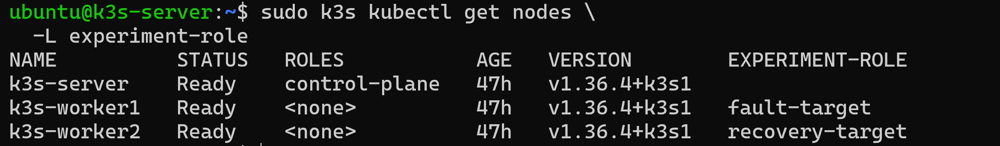
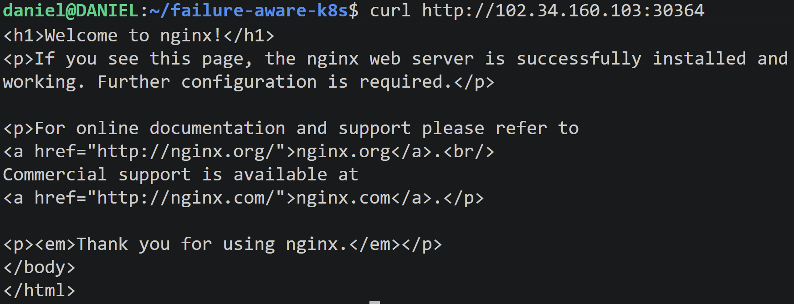
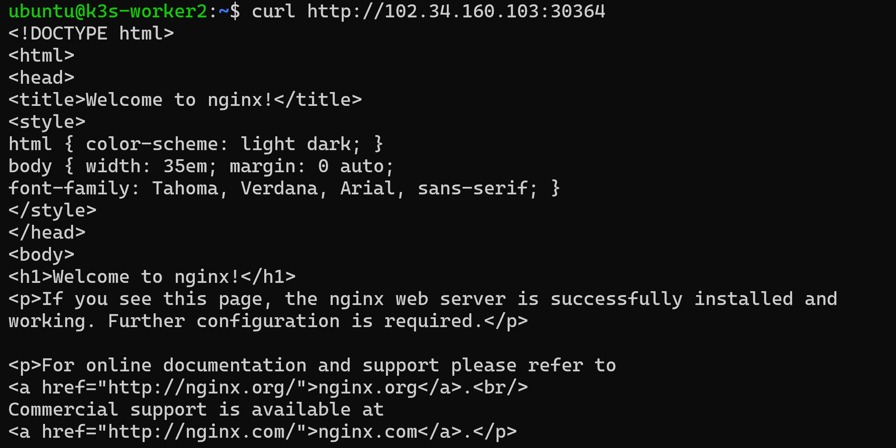

# Experimental Testbed

This document describes the infrastructure, K3s installation,
Kubernetes configuration, baseline workload validation, networking,
storage, resource profiles, and experimental procedures used for the
evaluation of the Failure-Aware Kubernetes Controller.

The testbed configuration forms part of the reproducibility record for
the project. Configuration changes made after the formal experimental
configuration is frozen must be documented and version-controlled.

---

# 1. Infrastructure Overview

The experimental environment is hosted on **Proxmox** and consists of
three virtual machines running K3s.

| Node | Role | Hostname | IP Address | vCPU | RAM | Disk | OS |
|---|---|---|---|---:|---:|---:|---|
| Server | K3s control plane | `k3s-server` | `102.34.160.89` | 4 | 4 GB | 100 GB | Ubuntu 24.04.5 LTS, Kernel `6.8.0-59-generic` |
| Worker 1 | Primary fault target | `k3s-worker1` | `102.34.160.87` | 4 | 4 GB | 100 GB | Ubuntu 24.04.5 LTS, Kernel `6.8.0-59-generic` |
| Worker 2 | Recovery target | `k3s-worker2` | `102.34.160.103` | 4 | 4 GB | 100 GB | Ubuntu 24.04.5 LTS, Kernel `6.8.0-59-generic` |

The Rust experimental harness and external workload generator run from
a separate client machine outside the K3s cluster.

The VM addresses are intended to remain fixed throughout the formal
experimental campaign.

---

# 2. Repository Layout

The project repository currently follows this structure:

```text
failure-aware-k8s/
├── LICENSE
├── Makefile
├── README.md
├── analysis/
├── controller/
├── docs/
│   ├── architecture/
│   ├── experimental-design.md
│   ├── hypothesis.md
│   ├── image.png
│   └── testbed.md
├── experiments/
├── harness/
├── kubernetes/
├── scripts/
└── workloads/
    └── test-workload/
        ├── nginx.yaml
        ├── independent-path-test.sh
        └── healthy-http-latency.sh
```

Workload-specific scripts are kept with the workload to which they
belong. Generic experimental orchestration scripts will be maintained
under `scripts/` or `experiments/`, while the formal Rust experimental
harness will be maintained under `harness/`.

---

# 3. K3s Installation and Cluster Bootstrap

## 3.1 Operating-System Preparation

All three K3s nodes use:

```text
Ubuntu 24.04.5 LTS
Kernel: 6.8.0-59-generic
```

The operating system can be verified using:

```bash
cat /etc/os-release
```

The kernel can be verified using:

```bash
uname -r
```

The nodes were updated using:

```bash
sudo apt update
sudo apt upgrade -y
```

Basic administration tools were installed using:

```bash
sudo apt install -y curl vim git jq
```

---

## 3.2 Configure Node Hostnames

On the control-plane node:

```bash
sudo hostnamectl set-hostname k3s-server
```

On Worker 1:

```bash
sudo hostnamectl set-hostname k3s-worker1
```

On Worker 2:

```bash
sudo hostnamectl set-hostname k3s-worker2
```

Verify:

```bash
hostname
```

The configured node addresses are:

```text
102.34.160.89   k3s-server
102.34.160.87   k3s-worker1
102.34.160.103  k3s-worker2
```

---

## 3.3 Optional Local Name Resolution

Where DNS-based hostname resolution is not available, the nodes may be
added to `/etc/hosts`.

```bash
sudo nano /etc/hosts
```

Add:

```text
102.34.160.89   k3s-server
102.34.160.87   k3s-worker1
102.34.160.103  k3s-worker2
```

Verify:

```bash
ping -c 3 k3s-server
ping -c 3 k3s-worker1
ping -c 3 k3s-worker2
```

---

## 3.4 Install the K3s Server

K3s was installed on `k3s-server` using:

```bash
curl -sfL https://get.k3s.io | sh -
```

Verify:

```bash
sudo systemctl status k3s
```

Check cluster state:

```bash
sudo k3s kubectl get nodes -o wide
```

Initially, the cluster contains:

```text
k3s-server    Ready    control-plane,master
```

---

## 3.5 Record and Pin the K3s Version

The installed K3s version is:

```text
v1.36.4+k3s1
```

Verify using:

```bash
sudo k3s --version
```

The Kubernetes/kubelet versions can be recorded using:

```bash
sudo k3s kubectl get nodes \
  -o custom-columns=NAME:.metadata.name,K8S:.status.nodeInfo.kubeletVersion
```

Recorded Kubernetes version:

```text
v1.36.4+k3s1
```

For reproducibility, future installations should explicitly pin the
K3s version:

```bash
curl -sfL https://get.k3s.io | \
INSTALL_K3S_VERSION='v1.36.4+k3s1' sh -
```

The same K3s version must be used on the server and both workers during
formal experiments.

---

## 3.6 Obtain the Worker Join Token

On `k3s-server`:

```bash
sudo cat /var/lib/rancher/k3s/server/node-token
```

The token is a cluster secret and must **not** be committed to the
repository.

The repository must also exclude:

- K3s join tokens
- kubeconfig credentials
- database passwords
- private keys
- API secrets
- other authentication material

---

## 3.7 Join Worker 1

On `k3s-worker1`:

```bash
curl -sfL https://get.k3s.io | \
INSTALL_K3S_VERSION='v1.36.4+k3s1' \
K3S_URL=https://102.34.160.89:6443 \
K3S_TOKEN='[K3S_TOKEN]' sh -
```

Verify:

```bash
sudo systemctl status k3s-agent
```

From `k3s-server`:

```bash
sudo k3s kubectl get nodes -o wide
```

Expected:

```text
k3s-server     Ready
k3s-worker1    Ready
```

---

## 3.8 Join Worker 2

On `k3s-worker2`:

```bash
curl -sfL https://get.k3s.io | \
INSTALL_K3S_VERSION='v1.36.4+k3s1' \
K3S_URL=https://102.34.160.89:6443 \
K3S_TOKEN='[K3S_TOKEN]' sh -
```

Verify:

```bash
sudo systemctl status k3s-agent
```

Then verify the complete cluster:

```bash
sudo k3s kubectl get nodes -o wide
```

Expected:

```text
NAME          STATUS   ROLES
k3s-server    Ready    control-plane,master
k3s-worker1   Ready    <none>
k3s-worker2   Ready    <none>
```

---

# 4. Native K3s Configuration

The initial Kubernetes configuration is:

- Kubernetes distribution: **K3s**
- K3s version: **v1.36.4+k3s1**
- Kubernetes version: **v1.36.4+k3s1**
- Container runtime: **containerd**
- Configuration: **Default K3s configuration**
- CNI: **Flannel**
- Cluster DNS: **CoreDNS**
- Ingress Controller: **Traefik**
- Service Load Balancer: **ServiceLB**
- Initial storage provisioner: **Local Path Provisioner**
- Formal experimental CSI implementation: **[CSI_IMPLEMENTATION]**
- Cluster domain: **[CLUSTER_DOMAIN]**
- Pod CIDR: **[POD_CIDR]**
- Service CIDR: **[SERVICE_CIDR]**

These components remain constant between the default K3s baseline and
the K3s + Failure-Aware Controller experiments unless the component
itself is explicitly evaluated as an independent variable.

---

## 4.1 Verify System Components

Inspect K3s system workloads:

```bash
sudo k3s kubectl get pods -n kube-system -o wide
```

Inspect all workloads:

```bash
sudo k3s kubectl get pods -A -o wide
```

Before baseline experimentation, there should be no unexplained
long-running states such as:

```text
CrashLoopBackOff
ImagePullBackOff
Pending
```

Any such condition must be resolved or documented before formal
measurements begin.

---

## 4.2 CNI Configuration

The initial experimental cluster uses the default **Flannel CNI**.

Record:

```text
CNI: Flannel
CNI version: [VERSION]
Configuration: Default K3s configuration
```

The CNI remains unchanged between:

```text
Default K3s
Controller OFF
```

and:

```text
K3s + Failure-Aware Controller
Controller ON
```

This prevents CNI differences from becoming a confounding experimental
variable.

---

## 4.3 Ingress Configuration

The K3s environment uses **Traefik** as its packaged Ingress Controller.

Verify Traefik:

```bash
sudo k3s kubectl get pods -n kube-system | grep traefik
```

Inspect its Service:

```bash
sudo k3s kubectl get svc -n kube-system | grep traefik
```

Inspect K3s-managed Helm charts:

```bash
sudo k3s kubectl get helmchart -n kube-system
```

Record:

```text
Ingress Controller: Traefik
Traefik version: [VERSION]
Configuration: Default K3s configuration
```

K3s packaged component manifests are maintained under:

```text
/var/lib/rancher/k3s/server/manifests/
```

K3s-managed manifests should not be manually modified without
documenting the change.

---

# 5. Node Roles

## 5.1 `k3s-server`

Role: **K3s control plane**

Primary responsibilities include:

- Kubernetes API Server
- Controller Manager
- Scheduler
- cluster datastore
- Node lifecycle management
- NodeLease observation
- cluster-state management

The Failure-Aware Controller consumes native Kubernetes state through
the Kubernetes API rather than replacing these mechanisms.

---

## 5.2 `k3s-worker1`

Role: **Primary fault-injection target**

This worker will primarily host workloads used for:

- genuine node-failure experiments
- control-plane partition experiments
- complete-isolation experiments
- degraded-network experiments
- workload reachability verification
- stateful workload experiments where applicable

---

## 5.3 `k3s-worker2`

Role: **Recovery target**

This worker provides compute capacity when workloads on
`k3s-worker1` require recovery.

This separation enables recovery onto Worker 2 without replacing or
modifying the Kubernetes scheduler.

---

# 6. NodeLease and Heartbeat Verification

NodeLease objects provide the native Kubernetes heartbeat mechanism
that forms the starting point of the Failure-Aware Controller.

List NodeLeases:

```bash
sudo k3s kubectl get leases -n kube-node-lease
```

Expected:

```text
k3s-server
k3s-worker1
k3s-worker2
```

Inspect Worker 1:

```bash
sudo k3s kubectl get lease k3s-worker1 \
  -n kube-node-lease -o yaml
```

Expected Lease fields include:

```yaml
spec:
  holderIdentity: k3s-worker1
  renewTime: "..."
```

Observe the renewal timestamp:

```bash
watch -n 2 \
"sudo k3s kubectl get lease k3s-worker1 \
-n kube-node-lease \
-o custom-columns=NODE:.metadata.name,RENEW:.spec.renewTime"
```

The `renewTime` changes periodically while Worker 1 maintains
communication with the control plane.

Simultaneously observe node state:

```bash
sudo k3s kubectl get nodes -w
```

The native path relevant to this project is:

```text
k3s-worker1 kubelet
        |
        | Lease renewal
        v
Kubernetes API Server
        |
        v
Node lifecycle controller
        |
        v
Ready / Unknown
```

The proposed controller does not replace this mechanism.

It consumes the native Kubernetes failure-suspicion signal after the
node-health mechanism raises suspicion.

---

# 7. Experimental Node Labels

Label Worker 1:

```bash
sudo k3s kubectl label node k3s-worker1 \
  experiment-role=fault-target
```

Label Worker 2:

```bash
sudo k3s kubectl label node k3s-worker2 \
  experiment-role=recovery-target
```

Verify:

```bash
sudo k3s kubectl get nodes -L experiment-role
```

Expected:

| Node | Experimental Role |
|---|---|
| `k3s-server` | Control plane |
| `k3s-worker1` | Fault/partition target |
| `k3s-worker2` | Recovery target |



These labels control experimental workload placement without modifying
the native Kubernetes scheduler.

---

# 8. Experimental Namespace

Create:

```bash
sudo k3s kubectl create namespace failure-aware
```

Verify:

```bash
sudo k3s kubectl get namespace failure-aware
```

---

# 9. Native Healthy-State Baseline

Before introducing the Failure-Aware Controller or fault injection, the
native K3s environment was inspected.

```bash
sudo k3s kubectl get nodes -o wide
```

```bash
sudo k3s kubectl get leases -n kube-node-lease
```

```bash
sudo k3s kubectl describe node k3s-worker1
```

```bash
sudo k3s kubectl get pods -A -o wide
```

Worker 1 healthy state:

```text
Ready = True
```

Inspect existing taints:

```bash
sudo k3s kubectl get node k3s-worker1 \
  -o jsonpath='{.spec.taints}'
```

No unexpected `node.kubernetes.io/unreachable` condition should exist
during the healthy baseline.

---

# 10. Baseline HTTP Test Workload

Before deploying the formal EMR workload, a lightweight Nginx workload
is used to validate:

- Pod scheduling
- worker placement
- Flannel networking
- Kubernetes Services
- CoreDNS
- external client reachability
- continuous application availability
- the independent client path required by Scenario B

The workload-specific files are stored under:

```text
workloads/test-workload/
```

Current structure:

```text
workloads/test-workload/
├── nginx.yaml
├── independent-path-test.sh
└── healthy-http-latency.sh
```

---

## 10.1 Baseline Nginx Manifest

File:

```text
workloads/test-workload/nginx.yaml
```

Contents:

```yaml
apiVersion: apps/v1
kind: Deployment
metadata:
  name: baseline-web
  namespace: failure-aware
spec:
  replicas: 1
  selector:
    matchLabels:
      app: baseline-web
  template:
    metadata:
      labels:
        app: baseline-web
    spec:
      nodeSelector:
        experiment-role: fault-target
      containers:
        - name: nginx
          image: nginx:1.27
          ports:
            - containerPort: 80
          resources:
            requests:
              cpu: "25m"
              memory: "32Mi"
            limits:
              cpu: "100m"
              memory: "128Mi"

---
apiVersion: v1
kind: Service
metadata:
  name: baseline-web
  namespace: failure-aware
spec:
  selector:
    app: baseline-web
  type: NodePort
  ports:
    - name: http
      port: 80
      targetPort: 80
```

Deploy:

```bash
sudo k3s kubectl apply \
  -f workloads/test-workload/nginx.yaml
```

Verify:

```bash
sudo k3s kubectl get pods \
  -n failure-aware \
  -o wide
```

Verify workload placement:

```bash
sudo k3s kubectl get pod \
  -n failure-aware \
  -l app=baseline-web \
  -o jsonpath='{.items[0].spec.nodeName}'
```

Observed node:

```text
k3s-worker1
```

---

## 10.2 Service Verification

Inspect the Service:

```bash
sudo k3s kubectl get svc \
  -n failure-aware
```

Retrieve the NodePort:

```bash
sudo k3s kubectl get svc baseline-web \
  -n failure-aware \
  -o jsonpath='{.spec.ports[0].nodePort}'
```

Recorded NodePort:

```text
[ACTUAL_NODEPORT]
```

Retrieve the ClusterIP:

```bash
sudo k3s kubectl get svc baseline-web \
  -n failure-aware \
  -o jsonpath='{.spec.clusterIP}'
```

Observed ClusterIP:

```text
10.43.86.169
```

---

## 10.3 Pod and Service Reachability

Retrieve Pod details:

```bash
sudo k3s kubectl get pods \
  -n failure-aware \
  -o wide
```

Test the Pod directly while on the any node in the cluster:

```bash
curl http://[POD_IP]
```

Expected:

```text
Welcome to nginx!
```

Test the Service:

```bash
curl http://10.43.86.169
```

Expected:

```text
Welcome to nginx!
```

---

# 11. CoreDNS Verification

A temporary BusyBox Pod was used to verify Kubernetes DNS resolution.

Create:

```bash
sudo k3s kubectl run dns-test \
  --image=busybox:1.36 \
  --restart=Never \
  -n failure-aware \
  -- sleep 3600
```

Verify:

```bash
sudo k3s kubectl get pod dns-test \
  -n failure-aware
```

Resolve the Service name:

```bash
sudo k3s kubectl exec \
  -n failure-aware dns-test -- \
  nslookup baseline-web
```

Observed successful resolution:

```text
Server:  10.43.0.10
Address: 10.43.0.10:53

Name:    baseline-web.failure-aware.svc.cluster.local
Address: 10.43.86.169
```

Therefore:

```text
baseline-web.failure-aware.svc.cluster.local
                    |
                    v
               10.43.86.169
```

CoreDNS service discovery is functioning correctly.

BusyBox `nslookup` may additionally issue lookups based on Kubernetes
search domains and display `NXDOMAIN` for those alternate names. These
additional unsuccessful lookups do not invalidate the successful fully
qualified Service lookup above.

Remove the test Pod:

```bash
sudo k3s kubectl delete pod dns-test \
  -n failure-aware
```

---

# 12. External Independent-Path Verification

The workload was tested from the external experimental client (My personal PC).



This verifies the path required for Scenario B:

```text
Control-plane path:

k3s-worker1  ---->  k3s-server


Independent application path:

External Client
      |
      v
102.34.160.87
      |
      v
baseline-web on k3s-worker1
```

The independent application path must remain available when the
worker-to-control-plane path is deliberately disrupted.

---

## 12.1 Firewall Requirement

The Kubernetes NodePort range is normally:

```text
30000-32767/TCP
```

The firewall must permit the NodePort used by the test workload.

Check UFW:

```bash
sudo ufw status
```

Where appropriate for the controlled test environment, allow the
NodePort range:

```bash
sudo ufw allow 30000:32767/tcp
```

Alternatively, allow only the allocated NodePort.

For a controlled and isolated experimental environment, UFW may
temporarily be disabled where permitted:

```bash
sudo ufw disable
```

**Caution:** disabling the firewall reduces host protection and should
only be done in an appropriately isolated experimental environment.

Firewall state must remain consistent between comparable experimental
runs.

A blocked NodePort could otherwise be incorrectly interpreted as
application or network-partition failure.

---

# 13. Continuous Independent-Path Test

File:

```text
workloads/test-workload/independent-path-test.sh
```

Script:

```sh
#!/bin/sh

URL="http://102.34.160.87:[NODEPORT]"

while true; do
    date '+%Y-%m-%dT%H:%M:%S.%3N'

    curl -s -o /dev/null \
        -w 'HTTP=%{http_code} time=%{time_total}s\n' \
        "$URL"

    sleep 1
done
```

Run from the repository root:

```bash
sh workloads/test-workload/independent-path-test.sh
```

Observed healthy responses included:

```text
2026-09-19T09:36:24.540
HTTP=200 time=0.110325s

2026-09-19T09:36:26.053
HTTP=200 time=0.033957s

2026-09-19T09:36:27.103
HTTP=200 time=0.027503s

2026-09-19T09:36:28.607
HTTP=200 time=0.025054s

2026-09-19T09:36:29.649
HTTP=200 time=0.042599s
```

Repeated HTTP `200` responses demonstrate that the external client can
continuously reach the workload under healthy conditions.

This script is a pilot validation utility. Formal workload generation
and measurement will later be implemented in the Rust experimental
harness.

---

# 14. Healthy HTTP Latency Pilot

File:

```text
workloads/test-workload/healthy-http-latency.sh
```

Script:

```sh
#!/bin/sh

URL="http://102.34.160.87:[NODEPORT]"
OUTPUT="baseline-http-latency.txt"

: > "$OUTPUT"

i=1

while [ "$i" -le 100 ]; do
    curl -s -o /dev/null \
        -w '%{time_total}\n' \
        "$URL" >> "$OUTPUT"

    sleep 0.1
    i=$((i + 1))
done
```

Run:

```bash
sh workloads/test-workload/healthy-http-latency.sh
```

The first ten observations were:

```text
0.022381
0.022032
0.028396
0.016413
0.026923
0.019650
0.021870
0.020069
0.016057
0.021782
```

`curl` reports `time_total` in seconds.

For example:

```text
0.022381 seconds = 22.381 ms
```

These values are pilot measurements used to confirm that the
measurement path functions correctly.

They are **not formal experimental results**.

---

# 15. NodePort Path Behaviour

The NodePort should also be tested against Worker 2:

```bash
curl http://102.34.160.103:[NODEPORT]
```

Record:

```text
External Client -> k3s-worker1:NodePort = [WORKS / DOES NOT WORK]
External Client -> k3s-worker2:NodePort = [WORKS / DOES NOT WORK]
```

This matters because NodePort Service forwarding may allow traffic
arriving through another node to reach the Pod on Worker 1.

Therefore the formal Scenario B probe must distinguish:

```text
The Kubernetes Service remains reachable somewhere
```

from:

```text
The existing workload on the partitioned Worker 1
remains independently reachable.
```

---

# 16. Development Resource Profile

The current development environment uses:

| Node | vCPU | RAM | Disk |
|---|---:|---:|---:|
| `k3s-server` | 4 | 4 GB | 100 GB |
| `k3s-worker1` | 4 | 4 GB | 100 GB |
| `k3s-worker2` | 4 | 4 GB | 100 GB |

This profile is used for:

- initial cluster deployment
- workload validation
- controller development
- baseline characterization
- pilot experiments

---

# 17. Candidate Formal Resource Profiles

Resource constraints will later be introduced as controlled independent
variables.

Candidate profiles are:

## Low

```text
1 vCPU
1 GB RAM
```

## Medium

```text
2 vCPU
2 GB RAM
```

## Higher

```text
4 vCPU
4 GB RAM
```

The final profiles will be frozen only after preliminary
characterization.

For any baseline-versus-controller comparison, CPU and memory
allocations must remain identical.

---

# 18. Healthy Network Characterization

The baseline network properties have not yet been formally measured.

They will be measured before any artificial degradation is introduced.

The network condition is represented as:

```text
N = {B, L, P, J}
```

where:

```text
B = available bandwidth
L = round-trip latency
P = packet-loss rate
J = jitter
```

Current baseline placeholders:

```text
Available bandwidth: [TO BE MEASURED]
RTT:                 [TO BE MEASURED]
Packet loss:         [TO BE MEASURED]
Jitter:              [TO BE MEASURED]
```

The values will be obtained during the next characterization stage
using appropriate network measurement tools rather than being assumed.

---

# 19. External Experimental Client

The external client is separate from the K3s cluster.

Client details:

- Host: **[PC/LAPTOP NAME]**
- OS: **[OS/VERSION]**
- CPU: **[CPU MODEL / CORES]**
- RAM: **[RAM]**
- Network connection: **[WIRED / WIFI / OTHER]**

The external client will run:

- Rust experimental harness
- workload generation
- experiment coordination
- fault orchestration
- event timestamping
- result collection
- statistical analysis

Keeping it external prevents the measurement system from consuming
worker resources and provides an independent path for determining
whether a workload remains useful after loss of control-plane
connectivity.

---

# 20. Formal EMR Workload

The final workload will use an actual containerised Electronic Medical
Record application.

To be selected:

- EMR system: **[EMR NAME]**
- EMR version: **[VERSION]**
- deployment model: **[DEPLOYMENT MODEL]**
- application tier: **[STATELESS / OTHER]**
- relational database: **[MYSQL / MARIADB / POSTGRESQL / OTHER]**
- database version: **[VERSION]**

The relational database will represent a
**duplication-sensitive stateful workload**.

The final workload should expose repeatable:

- read operations
- write operations
- application-health checks

Exact workload parameters will be frozen before formal experiments.

---

# 21. Storage Configuration

Persistent database state must not rely on ephemeral container storage.

Expected path:

```text
EMR Application
      |
      v
Relational Database
      |
      v
PersistentVolumeClaim
      |
      v
CSI / Persistent Storage
```

Initial K3s development storage:

```text
Local Path Provisioner
```

Formal stateful storage remains to be selected:

```text
CSI implementation:  [CSI_IMPLEMENTATION]
CSI version:         [VERSION]
StorageClass:        [STORAGE_CLASS]
Access mode:         [RWO / RWOP]
Replication factor:  [VALUE / N/A]
Volume size:         [SIZE]
```

Native RWO/RWOP access-mode enforcement will remain part of the
storage stack.

The project does not assume that RWO/RWOP alone provides sufficient
fencing during the target network-partition scenarios.

Explicit fencing will therefore be evaluated before recovery of
duplication-sensitive stateful workloads.

---

# 22. Primary Experimental Comparison

The principal comparison is:

```text
DEFAULT K3s
Failure-Aware Controller OFF
```

versus:

```text
K3s + FAILURE-AWARE CONTROLLER
Failure-Aware Controller ON
```

The following must remain fixed for each comparison:

- K3s version
- Kubernetes version
- CNI
- Ingress Controller
- workload version
- database version
- storage configuration
- worker resource profile
- network condition
- fault condition
- request rate
- client concurrency
- transaction mix
- experiment duration

The intended architectural difference is the presence or absence of the
Failure-Aware Controller.

---

# 23. Failure Scenarios

## Scenario A — Genuine Worker Failure

Target:

```text
k3s-worker1
```

Expected operational state:

```text
unreachable
```

---

## Scenario B — Control-Plane Partition, Workload Reachable

Target condition:

```text
k3s-worker1  X  k3s-server
```

while preserving:

```text
External Client ---> k3s-worker1 ---> workload
```

Expected operational state:

```text
reachable_outside_control_plane
```

This is the principal scenario demonstrating the ambiguity targeted by
the project.

---

## Scenario C — Complete Worker Isolation

`k3s-worker1` remains operational but all relevant communication paths
are unavailable.

Expected operational state:

```text
unreachable
```

The controller will not claim to distinguish complete isolation from a
physical crash when no independent evidence exists.

---

## Scenario D — Stateful Database Failure and Recovery

The worker hosting the duplication-sensitive database is failed or
isolated.

Required recovery sequence:

```text
RECOVER requested
       |
       v
Duplication-sensitive?
       |
      YES
       |
       v
Explicit fencing
       |
       v
Verify old authority excluded
       |
       v
Permit Kubernetes recovery
       |
       v
Replacement becomes authoritative
```

---

## Scenario E — Degraded Network

Network degradation will vary:

```text
bandwidth
latency
packet loss
jitter
```

without deliberately failing the worker.

---

# 24. Rust Experimental Harness

The formal experimental harness will run outside the K3s cluster.

It will eventually provide:

- workload generation
- concurrent requests
- request timestamps
- latency measurement
- success/failure recording
- Kubernetes event observation
- fault-injection coordination
- experiment start/stop control
- raw result export

The harness and controller are separate:

```text
Rust Experimental Harness
        |
        | drives and measures
        v
Experimental K3s Environment


Failure-Aware Controller
        |
        | system under test
        v
Kubernetes recovery behaviour
```

The harness will record:

```text
t_failure
t_suspect
t_classified
t_authorized
t_restored
t_last_success
t_first_success
```

---

# 25. Experimental Measurements

Timing metrics:

- Failure Detection Latency (FDL)
- Failure Classification Latency (FCL)
- Decision Timing Difference (DTD)
- Workload Switching Latency (WSL)
- Service Interruption Duration (SID)
- End-to-End Recovery Latency (ERL)

Application metrics:

- P50 latency
- P95 latency
- P99 latency
- request failure rate
- throughput
- local service availability

Controller overhead:

- CPU consumption
- memory consumption
- diagnostic network traffic
- diagnostic probe count

Correctness:

- unnecessary workload recreation
- incorrect recovery decisions
- duplicate authoritative execution
- successful stateful recovery

---

# 26. Formal Experimental Repetitions

Pilot runs validate:

- fault injection
- environment reset
- timestamps
- workload generation
- metrics collection
- controller behavior
- data export

Pilot runs are not included in the formal headline results.

After the configuration is frozen:

```text
Minimum repetitions per configuration: 30
```

Formal results will report:

- raw observations
- mean
- 95% confidence interval
- P50/P95/P99 where applicable
- effect size where applicable

---

# 27. Reproducibility Requirements

The repository will preserve:

- K3s version
- Kubernetes version
- OS version
- kernel version
- VM resource allocation
- container image versions/digests
- CNI configuration
- Ingress configuration
- CSI configuration
- EMR version
- database version
- experimental configuration files
- workload manifests
- fault-injection scripts
- Rust harness source
- controller source
- raw experimental data
- analysis scripts
- generated figures and tables

Secrets and credentials must not be committed.

The repository will eventually expose a single reproduction entry
point such as:

```bash
make reproduce
```

or:

```bash
cargo xtask reproduce
```

---

# 28. Current Healthy-Baseline Status

Completed:

- [x] Git repository initialized
- [x] Hypotheses pre-registered
- [x] Experimental design documented
- [x] Three Proxmox VMs provisioned
- [x] K3s server installed
- [x] Worker 1 joined
- [x] Worker 2 joined
- [x] All nodes operational
- [x] NodeLeases verified
- [x] Flannel present
- [x] CoreDNS verified
- [x] Traefik retained
- [x] Experimental worker labels configured
- [x] `failure-aware` namespace created
- [x] Baseline Nginx workload deployed
- [x] Workload placed on `k3s-worker1`
- [x] Kubernetes Service verified
- [x] CoreDNS Service resolution verified
- [x] External independent HTTP path verified
- [x] Continuous HTTP `200` responses observed
- [x] Healthy HTTP latency pilot completed

Pending next:

- [ ] Healthy bandwidth measurement
- [ ] Healthy RTT measurement
- [ ] Healthy packet-loss measurement
- [ ] Healthy jitter measurement
- [ ] NodePort behavior through Worker 2 documented
- [ ] First Scenario B selective-partition pilot
- [ ] Native K3s response to partition documented
- [ ] EMR selected and deployed
- [ ] Stateful CSI storage selected
- [ ] Rust harness initialized
- [ ] Failure-Aware Controller implementation started

---

# 29. Next Experimental Stage

The next stage is **healthy network characterization**.

The baseline values to be measured are:

```text
B = available bandwidth
L = round-trip latency
P = packet-loss rate
J = jitter
```

Only after those healthy characteristics are measured will artificial
network degradation or selective partitioning be introduced.

The subsequent Scenario B pilot will disrupt:

```text
k3s-worker1  X  k3s-server
```

while preserving:

```text
External Client ---> k3s-worker1 ---> baseline-web
```

The expected native-K3s observation is:

```text
Worker Lease stops renewing
          |
          v
Kubernetes eventually raises failure suspicion
          |
          +-------------------------------+
                                          |
                              meanwhile   |
                                          v
                              existing workload
                              remains reachable
                              to external client
```

This establishes the central failure ambiguity before the
Failure-Aware Controller is introduced.

